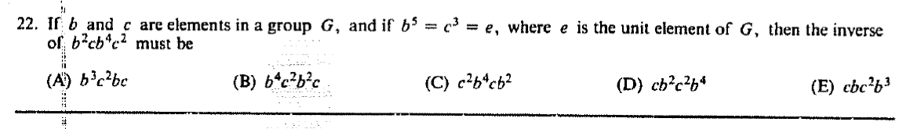

::: {.problem}
If $b$ and $c$ are elements in a group $G$, and if $b^5=c^3=e$, where $e$ is the identity of $G$, determine the inverse of $b^2cb^4c^2$ from the listed choices.

:::

::: {.solution}
<1>1. Reversing the order of the factors gives
\[
(b^2cb^4c^2)^{-1}
=c^{-2}b^{-4}c^{-1}b^{-2}.
\]
::: {.proof}
For any product \(x_1x_2\cdots x_r\),
\[
(x_1x_2\cdots x_r)^{-1}=x_r^{-1}\cdots x_2^{-1}x_1^{-1}.
\]
Apply this identity to the four factors \(b^2,c,b^4,c^2\).
:::

<1>2. The torsion relations give
\[
c^{-2}=c,
\qquad
c^{-1}=c^2,
\qquad
b^{-4}=b,
\qquad
b^{-2}=b^3.
\]
::: {.proof}
From \(c^3=e\), exponents of \(c\) may be reduced modulo \(3\); from \(b^5=e\), exponents of \(b\) may be reduced modulo \(5\).
:::

<1>3. Therefore
\[
\boxed{(b^2cb^4c^2)^{-1}=cb\,c^2b^3}.
\]
::: {.proof}
Substitute the identities from step <1>2 into the expression from step <1>1. No commutativity is used; the order of the factors is unchanged.
:::

<1>4. Q.E.D.
::: {.proof}
Step <1>3 is the requested inverse.
:::
:::
