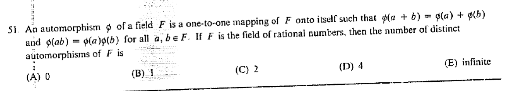

::: {.problem}

:::

::: {.solution}
Every field automorphism of $\QQ$ is the identity, so the answer is $\boxed{\text{(B)}\ 1}$.

::: pf

::: {.pf-step #s1}

Any automorphism fixes every rational number.

::: pf-proof

Let $\varphi:\QQ\to\QQ$ be a field automorphism.
Since $\varphi(1)=1$, additivity gives $\varphi(n)=n$ for every $n\in\ZZ$.
For $m/n\in\QQ$ with $n\ne0$,
\[
\varphi(m/n)=\varphi(m)\varphi(n)^{-1}=m/n.
\]
Thus $\varphi=\operatorname{id}_{\QQ}$.

:::

:::

::: pf-qed

Step {.pf-ref} proves that the identity is the only field automorphism of $\QQ$, so choice (B) is correct.

:::

:::

:::
