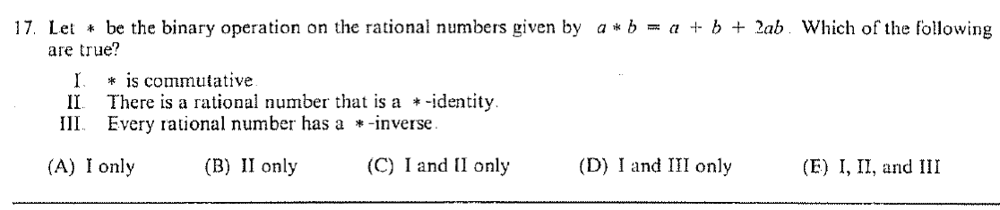

::: {.problem}
Let $*$ be the binary operation on the rational numbers given by $a*b=ab+a+b$.
Decide which of the following assertions are true: (I) $*$ is commutative; (II) there is a rational $*$-identity; (III) every rational number has a $*$-inverse.

:::

::: {.solution}
Assertions I and II are true, while III is false.

::: pf

::: {.pf-step #s1}

The operation is commutative.

::: pf-proof

Since multiplication and addition in $\QQ$ are commutative,
$$
a*b=ab+a+b=ba+b+a=b*a.
$$

:::

:::

::: {.pf-step #s2}

The $*$-identity is $0$.

::: pf-proof

For every $a\in\QQ$,
$$
a*0=a\cdot0+a+0=a,
$$
and by commutativity also $0*a=a$.

:::

:::

::: {.pf-step #s3}

Not every rational has a $*$-inverse.

::: pf-proof

The identity
$$
a*b=0
$$
is equivalent to
$$
(a+1)(b+1)=1.
$$
For $a\ne-1$ this gives $b=(a+1)^{-1}-1$, but for $a=-1$ one has
$$
(-1)*b=-1
$$
for every $b$.
Thus $-1$ has no inverse.

:::

:::

::: pf-step

Hence exactly I and II hold.

::: pf-proof

Step {.pf-ref} proves I, step {.pf-ref} proves II, and step {.pf-ref} disproves III.

:::

:::

::: pf-qed

The preceding conclusion gives the requested truth values.

:::

:::

:::
