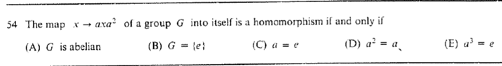

::: {.problem}
For a fixed element $a$ of a group $G$, determine when the map $x\mapsto axa^{-2}$ from $G$ to itself is a homomorphism.

:::

::: {.solution}
The map
$$
\varphi(x)=axa^{-2}
$$
is a homomorphism if and only if $\boxed{a=e}$.

::: pf

::: {.pf-step #s1}

A homomorphism forces $a=e$.

::: pf-proof

Every group homomorphism sends the identity to the identity.
But
$$
\varphi(e)=aea^{-2}=a^{-1}.
$$
Hence $a^{-1}=e$, so $a=e$.

:::

:::

::: {.pf-step #s2}

The condition is sufficient.

::: pf-proof

If $a=e$, then $\varphi(x)=x$ for all $x$, so $\varphi$ is the identity homomorphism.

:::

:::

::: pf-qed

Step {.pf-ref} proves necessity and step {.pf-ref} proves sufficiency, so $\varphi$ is a homomorphism exactly when $a=e$.

:::

:::

:::
