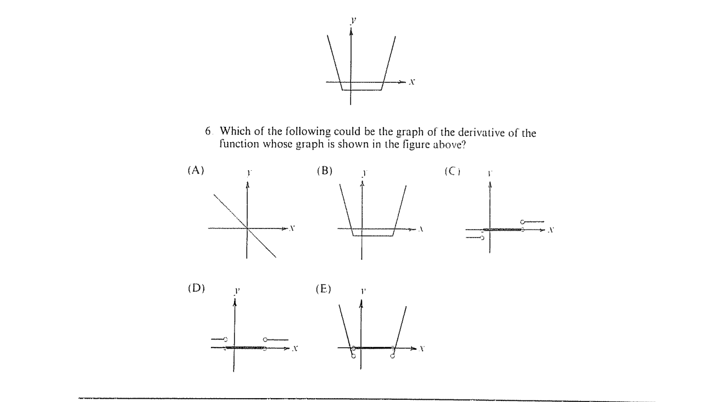

::: {.problem}
Which of the following could be the graph of the derivative of the function whose graph is shown in the figure above?

:::

::: {.solution}

::: pf

::: {.pf-step #s1-1}

On the three linear pieces of the displayed graph, the derivative is,
respectively, a negative constant, $0$, and a positive constant.

::: pf-proof

The left-hand segment is a straight line with negative slope, the middle segment
is horizontal, and the right-hand segment is a straight line with positive
slope. The derivative of a linear function is its slope.

:::

:::

::: {.pf-step #s1-2}

The derivative is undefined at the two points where adjacent linear pieces
meet.

::: pf-proof

At each meeting point the one-sided slopes are different: the first corner has
a negative left-hand slope and zero right-hand slope, while the second has zero
left-hand slope and a positive right-hand slope. Hence the two-sided derivative
does not exist at either corner.

:::

:::

::: {.pf-step #s1-3}

The answer is $\boxed{\text{(C)}}$.

::: pf-proof

Choice (C) is exactly the graph consisting of a negative horizontal segment on
the left, the value $0$ between the two corner abscissae, and a positive
horizontal segment on the right, with the two breakpoint values omitted as in
step {.pf-ref}.

:::

:::

::: pf-qed

Steps {.pf-ref} through {.pf-ref} determine and identify the derivative graph.

:::

:::

:::
