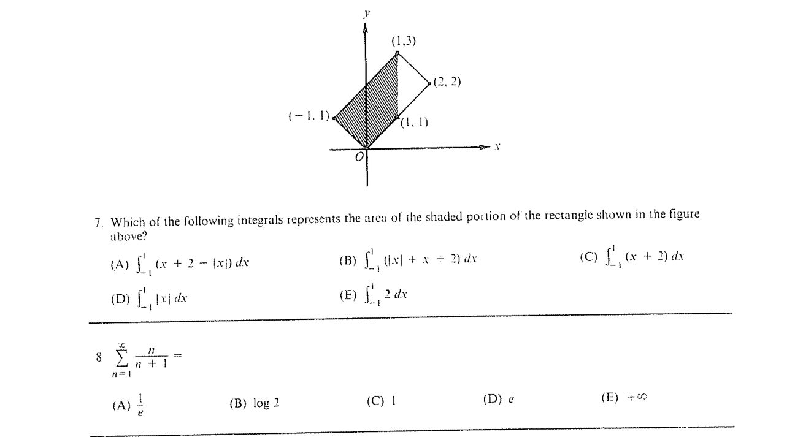

::: {.problem}

Which of the following integrals represents the area of the shaded portion of the rectangle shown in the figure above?

(A) $\int_{-1}^{1} (x + 2 - \abs{x}) \, dx$
(B) $\int_{-1}^{1} (\abs{x} + x + 2) \, dx$
(C) $\int_{-1}^{1} (x + 2) \, dx$
(D) $\int_{-1}^{1} \abs{x} \, dx$
(E) $\int_{-1}^{1} 2 \, dx$
:::

::: {.solution}

::: pf

::: {.pf-step #s1-1}

For $-1\leq x\leq1$, the upper boundary of the shaded region is
$$
y=x+2.
$$

::: pf-proof

The upper edge passes through $(-1,1)$ and $(1,3)$, so it has slope $1$ and
equation $y=x+2$.

:::

:::

::: {.pf-step #s1-2}

For $-1\leq x\leq1$, the lower boundary of the shaded region is
$$
y=\abs{x}.
$$

::: pf-proof

On $[-1,0]$, the lower edge joins $(-1,1)$ to $(0,0)$ and therefore has
equation $y=-x$. On $[0,1]$, it lies on the edge joining $(0,0)$ to $(2,2)$,
whose equation is $y=x$. These two formulas combine as $y=\abs{x}$.

:::

:::

::: {.pf-step #s1-3}

The shaded area is represented by
$$
\boxed{\int_{-1}^{1}\left(x+2-\abs{x}\right)\,dx},
$$
so the answer is (A).

::: pf-proof

By steps {.pf-ref} and {.pf-ref}, a vertical slice at $x$ has height
$$
(x+2)-\abs{x}.
$$
Integrating this height from the leftmost shaded abscissa $-1$ to the rightmost
shaded abscissa $1$ gives the displayed integral, which is option (A).

:::

:::

::: pf-qed

Step {.pf-ref} identifies the requested integral.

:::

:::

:::
