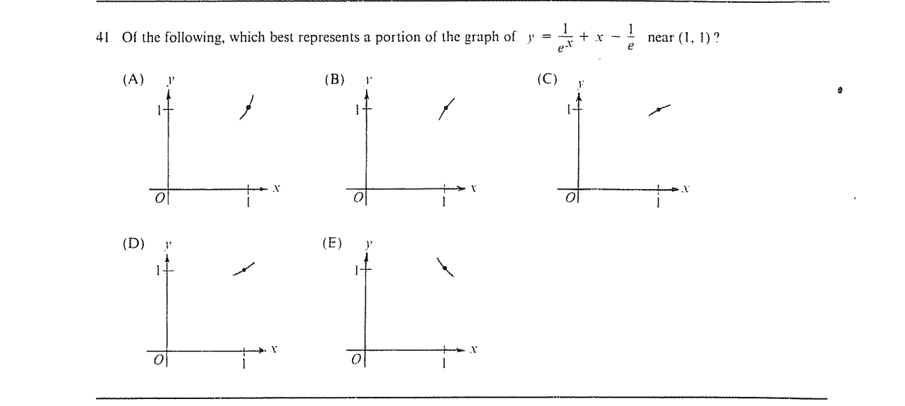

::: {.problem}
Of the following, which best represents a portion of the graph of $y = \frac{1}{e^x} + x - \frac{1}{e}$ near $(1, 1)$?

:::

::: {.solution}

Let
$$
f(x)=e^{-x}+x-e^{-1}.
$$

::: pf

::: {.pf-step #s1-1}

The graph passes through $(1,1)$ and has positive slope there.

::: pf-proof

One has
$$
f(1)=e^{-1}+1-e^{-1}=1
$$
and
$$
f'(x)=1-e^{-x},
\qquad
f'(1)=1-e^{-1}>0.
$$

:::

:::

::: {.pf-step #s1-2}

The graph is concave upward near $x=1$.

::: pf-proof

Since
$$
f''(x)=e^{-x}>0
$$
for every real $x$, the graph is strictly concave upward in a neighborhood of
$x=1$.

:::

:::

::: {.pf-step #s1-3}

The answer is $\boxed{\text{(D)}}$.

::: pf-proof

Among the five source figures, choice (D) is the segment through $(1,1)$ that is
increasing there and bends upward. These are exactly the local properties from
steps {.pf-ref} and {.pf-ref}.

:::

:::

::: pf-qed

Step {.pf-ref} identifies the requested local graph.

:::

:::

:::
