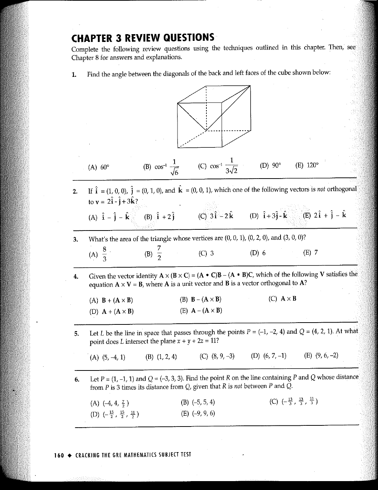

::: {.problem}
Find the angle between the diagonals of the back and left faces of the cube shown below:

(A) $60^\circ$
(B) $\cos^{-1}\frac{1}{\sqrt{6}}$
(C) $\cos^{-1}\frac{1}{3\sqrt{2}}$
(D) $90^\circ$
(E) $120^\circ$
:::

::: {.solution}

::: pf

::: {.pf-step #s1-1}

The two face diagonals may be represented by the direction vectors
$$
\mathbf A=(1,0,1),
\qquad
\mathbf B=(0,1,1).
$$

::: pf-proof

Place a unit cube with a common vertex of the back and left faces at the origin and take its three incident edges as the coordinate directions. The back face is spanned by the first and third coordinate directions, so its displayed diagonal has direction $(1,0,1)$. The left face is spanned by the second and third coordinate directions, so its displayed diagonal has direction $(0,1,1)$.

:::

:::

::: {.pf-step #s1-2}

If $\theta$ is the angle between these diagonals, then
$$
\cos\theta=\frac12.
$$

::: pf-proof

By step {.pf-ref},
$$
\mathbf A\cdot\mathbf B=1,
\qquad
\norm{\mathbf A}=\norm{\mathbf B}=\sqrt2.
$$
Therefore the dot-product formula gives
$$
\cos\theta
=\frac{\mathbf A\cdot\mathbf B}
{\norm{\mathbf A}\norm{\mathbf B}}
=\frac1{2}.
$$

:::

:::

::: {.pf-step #s1-3}

The angle is
$$
\boxed{60^\circ},
$$
so the answer is (A).

::: pf-proof

The angle between two vectors is taken in $[0,\pi]$. Step {.pf-ref} therefore gives $\theta=\arccos(1/2)=\pi/3=60^\circ$.

:::

:::

::: pf-qed

Step {.pf-ref} gives the requested angle and corresponding choice.

:::

:::

:::
