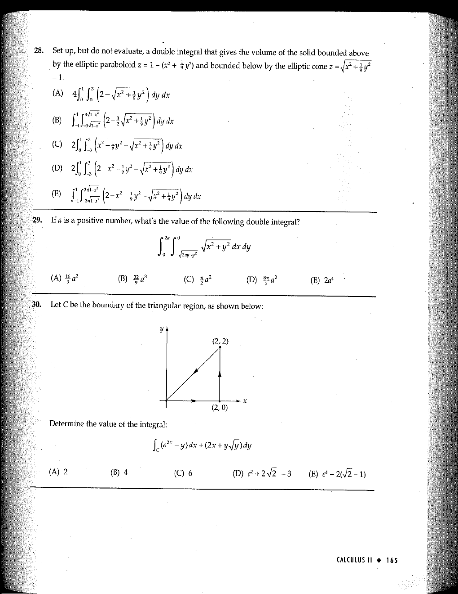

::: {.problem}
Let $C$ be the boundary of the triangular region, as shown below:

Determine the value of the integral:
$$
\int_C(e^{2x}-y)\,dx+(2x+y\sqrt{y})\,dy
$$

(A) $2$
(B) $4$
(C) $6$
(D) $e^2+2\sqrt{2}-3$
(E) $e^4+2(\sqrt{2}-1)$
:::

::: {.solution}

::: pf

::: {.pf-step #s1-1}

The curve $C$ is the positively oriented boundary of the triangle with vertices
$$
(0,0),\qquad (2,0),\qquad (2,2),
$$
whose area is $2$.

::: pf-proof

The arrows in the supplied figure run from $(0,0)$ to $(2,0)$, then to $(2,2)$, and then back to $(0,0)$ along the diagonal. Thus the enclosed triangular region remains on the left, so the orientation is counterclockwise. Its base and height both have length $2$, hence
$$
\operatorname{Area}(R)=\frac12(2)(2)=2.
$$

:::

:::

::: {.pf-step #s1-2}

For
$$
M(x,y)=e^{2x}-y,
\qquad
N(x,y)=2x+y\sqrt y,
$$
one has
$$
\frac{\partial N}{\partial x}
-
\frac{\partial M}{\partial y}
=3
$$
throughout the triangular region.

::: pf-proof

Direct differentiation gives
$$
\frac{\partial N}{\partial x}=2
\qquad\text{and}\qquad
\frac{\partial M}{\partial y}=-1.
$$
Their difference is therefore $3$.

:::

:::

::: {.pf-step #s1-3}

The line integral is
$$
\boxed{6},
$$
so the answer is (C).

::: pf-proof

By Green's theorem and the positive orientation established in step {.pf-ref},
$$
\int_C M\,dx+N\,dy
=
\iint_R
\left(
\frac{\partial N}{\partial x}
-
\frac{\partial M}{\partial y}
\right)dA.
$$
Using step {.pf-ref} and the area from step {.pf-ref},
$$
\int_C M\,dx+N\,dy
=3\,\operatorname{Area}(R)
=3\cdot2
=6.
$$

:::

:::

::: pf-qed

Step {.pf-ref} gives the requested integral value and corresponding choice.

:::

:::

:::
