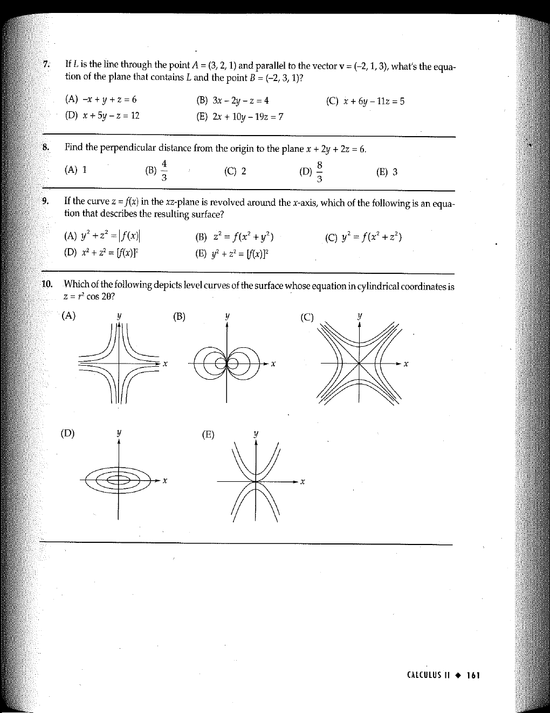

::: {.problem}
Which of the following depicts level curves of the surface whose equation in cylindrical coordinates is $z=r^2\cos 2\theta$?

The five graphical choices (A)–(E) appear on the source page:

:::

::: {.solution}

::: pf

::: {.pf-step #s1-1}

In Cartesian coordinates the surface equation is
$$
z=x^2-y^2.
$$

::: pf-proof

Using
$$
x=r\cos\theta,\qquad y=r\sin\theta,
$$
and the identity $\cos 2\theta=\cos^2\theta-\sin^2\theta$, one obtains
$$
r^2\cos 2\theta
=r^2(\cos^2\theta-\sin^2\theta)
=(r\cos\theta)^2-(r\sin\theta)^2
=x^2-y^2.
$$
Thus $z=x^2-y^2$.

:::

:::

::: {.pf-step #s1-2}

The level curve at height $z=c$ is
$$
x^2-y^2=c.
$$

::: pf-proof

Fixing the value of $z$ in the Cartesian equation from step {.pf-ref} gives exactly the displayed equation in the $xy$-plane.

:::

:::

::: {.pf-step #s1-3}

These level curves consist of the two diagonal lines when $c=0$, hyperbolas opening in the $x$-direction when $c>0$, and hyperbolas opening in the $y$-direction when $c<0$.

::: pf-proof

If $c=0$, step {.pf-ref} gives
$$
x^2-y^2=(x-y)(x+y)=0,
$$
so the level set is $y=x$ together with $y=-x$. If $c>0$, division by $c$ gives
$$
\frac{x^2}{c}-\frac{y^2}{c}=1,
$$
which is a hyperbola with transverse axis on the $x$-axis. If $c<0$, writing $d=-c>0$ gives
$$
\frac{y^2}{d}-\frac{x^2}{d}=1,
$$
which is a hyperbola with transverse axis on the $y$-axis.

:::

:::

::: {.pf-step #s1-4}

Therefore the required depiction is
$$
\boxed{\text{(C)}}.
$$

::: pf-proof

Among the five source figures, choice (C) is the one showing the level-curve family characterized in step {.pf-ref}.

:::

:::

::: pf-qed

Step {.pf-ref} identifies the requested graphical choice.

:::

:::

:::
