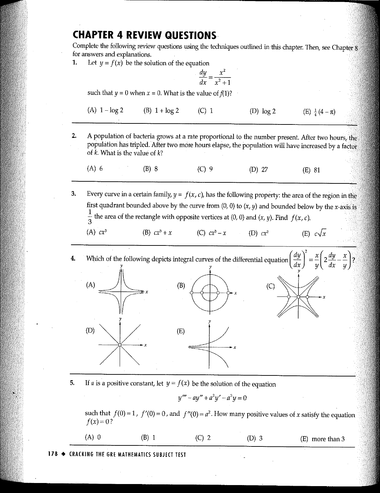

::: {.problem}
Which of the following depicts integral curves of the differential equation

$$
\left(\frac{dy}{dx}\right)^2 = \frac{x}{y}\left(2\frac{dy}{dx} - \frac{x}{y}\right)?
$$

The five graphical choices (A)–(E) appear on the source page:

:::

::: {.solution}

::: pf

::: {.pf-step #s1-1}

Wherever the differential equation is defined, it is equivalent to
$$
\frac{dy}{dx}=\frac{x}{y}.
$$

::: pf-proof

Writing $y'=dy/dx$, the given equation is
$$
(y')^2
=\frac{x}{y}\left(2y'-\frac{x}{y}\right).
$$
Moving all terms to the left gives
$$
(y')^2-2\frac{x}{y}y'
+\left(\frac{x}{y}\right)^2=0,
$$
that is,
$$
\left(y'-\frac{x}{y}\right)^2=0.
$$
Hence $y'=x/y$. The original equation contains $x/y$, so it is defined only where $y\ne0$.

:::

:::

::: {.pf-step #s1-2}

Its integral curves satisfy
$$
y^2-x^2=C.
$$

::: pf-proof

By step {.pf-ref},
$$
y\,dy=x\,dx.
$$
Integrating gives
$$
\frac12y^2=\frac12x^2+C_0,
$$
equivalently $y^2-x^2=C$.

:::

:::

::: {.pf-step #s1-3}

The required depiction is
$$
\boxed{\text{(C)}}.
$$

::: pf-proof

For $C=0$, step {.pf-ref} gives the two lines $y=\pm x$; the origin is omitted because $y=0$ there. For $C>0$, the curves are hyperbolas opening in the $y$-direction. For $C<0$, they are hyperbolas opening in the $x$-direction, with their intersections with the $x$-axis omitted because the differential equation is undefined when $y=0$. Among the source figures, exactly choice (C) has these curves and deleted points.

:::

:::

::: pf-qed

Step {.pf-ref} identifies the requested family of integral curves.

:::

:::

:::
