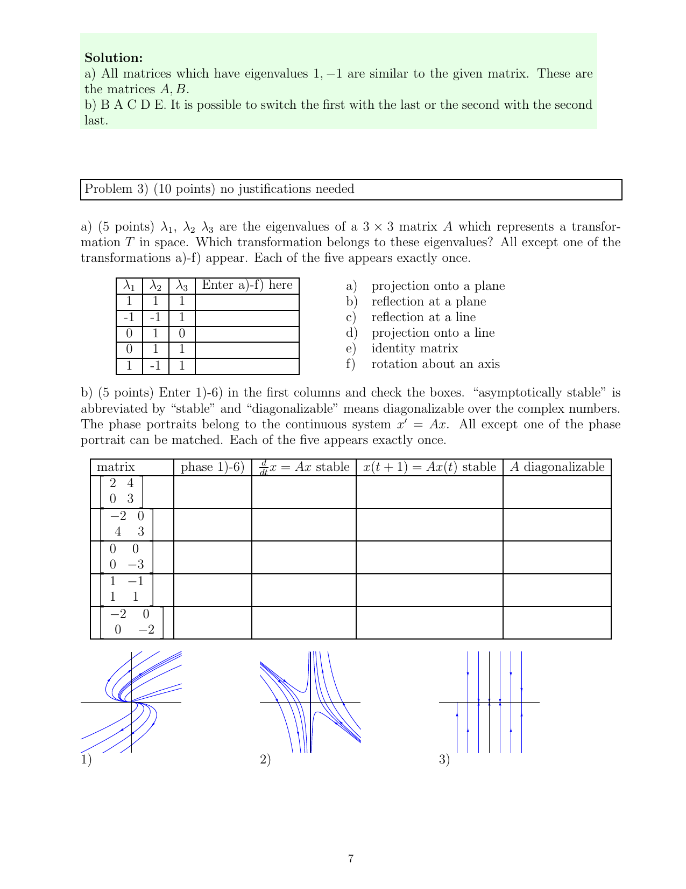

::: {.problem}
No justifications are required.

(a) Each triple $(\lambda_1,\lambda_2,\lambda_3)$ below lists the eigenvalues of a $3\times3$ matrix $A$ representing a transformation $T$ of space:
$$
(1,1,1),\qquad(-1,-1,1),\qquad(0,1,0),\qquad(0,1,1),\qquad(1,-1,1).
$$
Match each triple to one of the transformations: projection onto a plane; reflection at a plane; reflection at a line; projection onto a line; the identity; rotation about an axis.
Exactly five of the six transformations occur, each once.

(b) For each of the five matrices shown on the source page, match one of phase portraits 1--6, decide whether the continuous system $x'=Ax$ is asymptotically stable, decide whether the discrete system $x(t+1)=Ax(t)$ is asymptotically stable, and decide whether $A$ is diagonalizable over $\CC$.
One phase portrait is unused.

:::

::: {.solution}

::: pf

::: pf-step
Match the eigenvalue triples to the geometric transformations.

::: pf-proof
In the displayed order the answers are
$$
\boxed{\text{identity},\ \text{reflection at a line},\
\text{projection onto a line},\ \text{projection onto a plane},\
\text{reflection at a plane}.}
$$
The corresponding eigenvalue patterns are respectively
$(1,1,1)$, $(1,-1,-1)$, $(1,0,0)$, $(1,1,0)$, and $(1,1,-1)$.
Thus “rotation about an axis” is the unused choice.
:::

:::

::: pf-step
Analyze the five matrices and match the phase portraits.

::: pf-proof
Let
$$
A_1=\begin{pmatrix}2&4\\0&3\end{pmatrix},\quad
A_2=\begin{pmatrix}-2&0\\4&3\end{pmatrix},\quad
A_3=\begin{pmatrix}0&0\\0&-3\end{pmatrix},
$$
$$
A_4=\begin{pmatrix}1&-1\\1&1\end{pmatrix},\qquad
A_5=-2I.
$$
Their spectra are
$$
\{2,3\},\quad \{-2,3\},\quad \{0,-3\},\quad
\{1+i,1-i\},\quad \{-2\},
$$
respectively.

For $x'=Ax$, asymptotic stability requires all eigenvalues to have negative
real part, so only $A_5$ is asymptotically stable. For
$x(t+1)=Ax(t)$, asymptotic stability requires all eigenvalues to have modulus
strictly less than $1$, so none of the five is asymptotically stable.

The first two and fourth matrices have distinct eigenvalues, the third is
diagonal, and the fifth is scalar; hence all five are diagonalizable over
$\CC$.

The source figures then match as follows: $A_1$ is the unstable node (1),
$A_2$ the saddle (2), $A_3$ the neutral-line/contraction portrait (3),
$A_4$ the unstable spiral (5), and $A_5$ the stable radial node (6).
Thus phase portrait 4 is unused.

| Matrix | Phase | continuous stable? | discrete stable? | diagonalizable? |
| --- | ---: | --- | --- | --- |
| $A_1$ | 1 | no | no | yes |
| $A_2$ | 2 | no | no | yes |
| $A_3$ | 3 | no | no | yes |
| $A_4$ | 5 | no | no | yes |
| $A_5$ | 6 | yes | no | yes |
:::

:::

:::
:::

::: {.remark}
Reflection in a line in three-dimensional Euclidean space is rotation by
$\pi$ about that line, so "reflection at a line" and "rotation about an axis"
both describe a transformation with eigenvalues $(-1,-1,1)$. The one-use
matching of part (a) assigns this triple to "reflection at a line" and leaves
"rotation about an axis" unused.
:::
