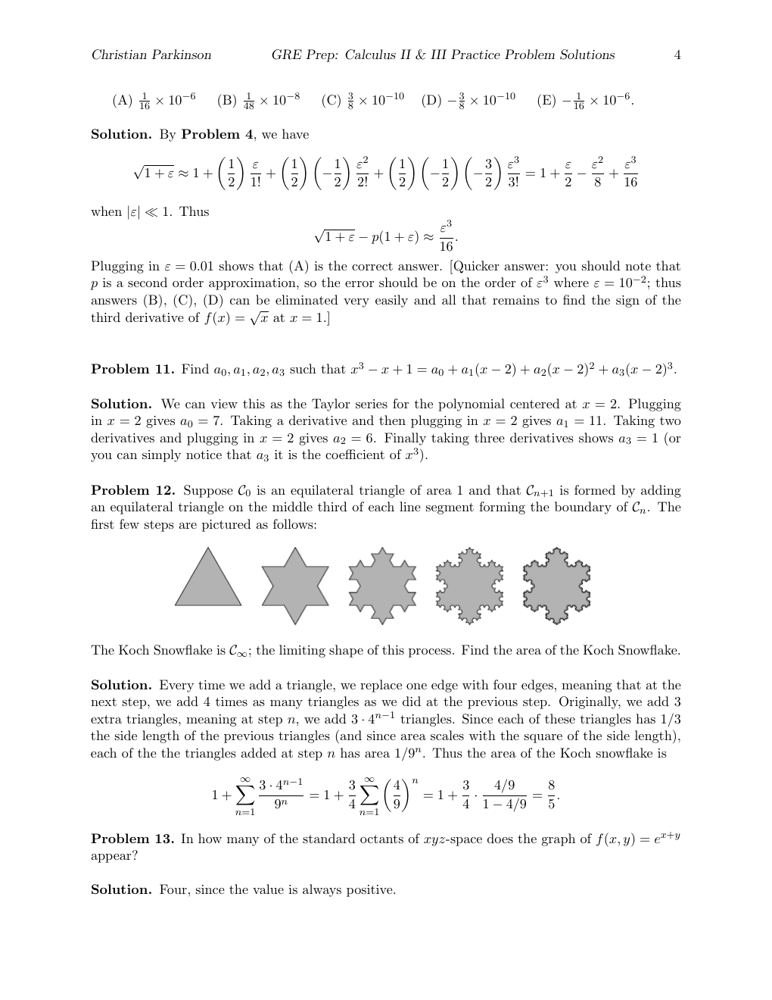

::: {.problem}
Suppose $\mathcal{C}_{0}$ is an equilateral triangle of area $1$ and that $\mathcal{C}_{n+1}$ is formed by adding an equilateral triangle on the middle third of each line segment forming the boundary of $\mathcal{C}_{n}$. The first few steps are pictured as follows:

The Koch Snowflake is $\mathcal{C}_{\infty}$, the limiting shape of this process.
Find the area of the Koch Snowflake.
:::

::: {.solution}
Every time we add a triangle, we replace one edge with four edges, meaning that at the next step, we add 4 times as many triangles as we did at the previous step.
Originally, we add 3 extra triangles, meaning at step $n$, we add $3\cdot4^{n-1}$ triangles.
Each of these triangles has $1/3$ the side length of the triangles added at the previous step, and area scales with the square of the side length, so each triangle added at step $n$ has area $1/9^n$. Thus the area of the Koch snowflake is

$$
1+\sum_{n=1}^{\infty}\frac{3\cdot4^{n-1}}{9^n}=1+\frac34\sum_{n=1}^{\infty}\left(\frac49\right)^n=1+\frac34\cdot\frac{4/9}{1-4/9}=\frac85.
$$
:::
