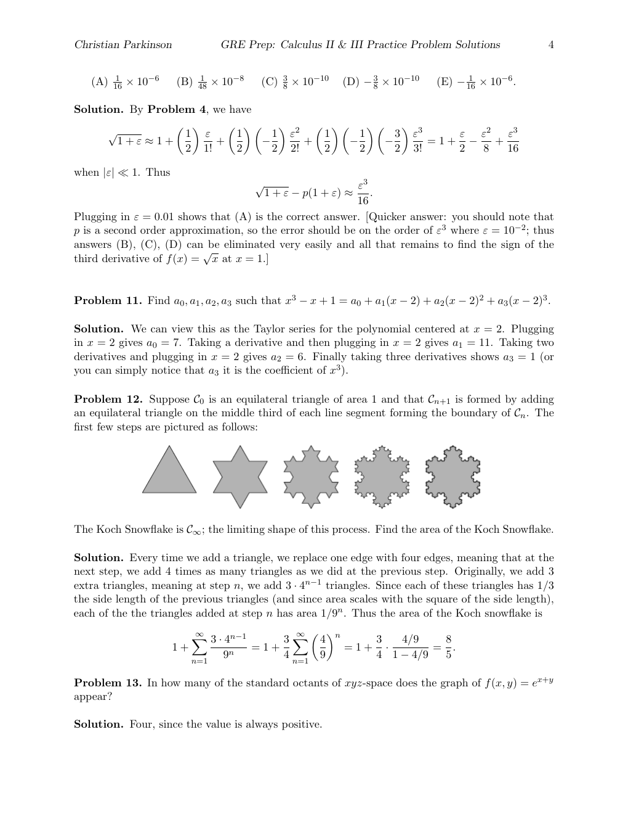

::: {.problem}
Suppose $\mathcal{C}_{0}$ is an equilateral triangle of area $1$ and that $\mathcal{C}_{n+1}$ is formed by adding an equilateral triangle on the middle third of each line segment forming the boundary of $\mathcal{C}_{n}$. The first few steps are pictured as follows:

The Koch Snowflake is $\mathcal{C}_{\infty}$, the limiting shape of this process.
Find the area of the Koch Snowflake.
:::

::: {.solution}

Start from the equilateral triangle $\mathcal C_0$ of area $1$ and let $A_n$
be the area of $\mathcal C_n$; the snowflake has area $\lim_nA_n$.

::: pf

::: {.pf-step #counts}

$\mathcal C_n$ has $3\cdot4^n$ edges, each of length $3^{-n}$ times the
original, and $\mathcal C_{n+1}$ is obtained by adding $3\cdot4^n$ equilateral
triangles on those edges, each of area $9^{-(n+1)}$.

::: pf-proof

Passing from $\mathcal C_n$ to $\mathcal C_{n+1}$ replaces each segment of the
boundary by four segments of one third the length, so the number of edges is
multiplied by $4$, starting from $3$. Each new triangle is built on a segment
of $\mathcal C_n$, whose length is $\frac13$ of a segment of $\mathcal
C_{n-1}$, so its side is $3^{-(n+1)}$ of the original side; areas of similar
triangles scale as the square of the side, so its area is $9^{-(n+1)}$ times
the area of $\mathcal C_0$, that is $9^{-(n+1)}$.

:::

:::

::: {.pf-step #sum}

$\displaystyle A_{n+1}-A_n=3\cdot4^n\cdot9^{-(n+1)}$, and the total area is
$1+\sum_{n\ge0}3\cdot4^n9^{-(n+1)}$.

::: pf-proof

$\mathcal C_{n+1}$ is the union of $\mathcal C_n$ with the $3\cdot4^n$ added
triangles, whose interiors are disjoint and disjoint from $\mathcal C_n$, so
by additivity the area increases by the number of triangles times $9^{-(n+1)}$
by step {.pf-ref}. Summing the increments from $n=0$ to $N-1$
telescopes to $A_N-1$.

:::

:::

::: {.pf-step #area}

$\boxed{\text{area}=1+\frac34\sum_{n\ge0}\Big(\frac49\Big)^n\cdot\frac19\cdot\ldots=\frac85}$;
explicitly
$1+\sum_{n\ge0}3\cdot4^n9^{-n-1}=1+\frac{3}{9}\cdot\frac{1}{1-\frac49}=\frac85$.

::: pf-proof

$3\cdot4^n9^{-(n+1)}=\frac39\big(\frac49\big)^n=\frac13\big(\frac49\big)^n$,
so the added area is the geometric series
$\frac13\cdot\frac{1}{1-4/9}=\frac13\cdot\frac95=\frac35$, and
$1+\frac35=\frac85$. The series converges since the ratio $\frac49<1$, so the
limiting shape has finite area $\frac85$, larger than the initial triangle by
the geometric series of added triangles; the printed solution computes the
same sum in the form $\frac34\cdot\frac{4/9}{1-4/9}$.

:::

:::

:::

:::
