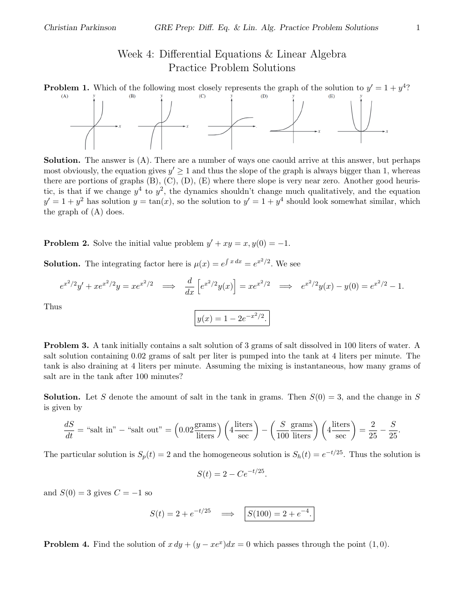

::: {.problem}
Which of the following most closely represents the graph of the solution to $y' = 1 + y^{4}$?

:::

::: {.solution}
The collection retains its solution sheet, `assets/attachments/Week4_solns.pdf`: this is Problem 1, on PDF p. 1 of Christian Parkinson, *Week 4: Differential Equations & Linear Algebra Practice Problem Solutions*. The argument below is that sheet's, with the two inequalities it appeals to checked and its "slope always bigger than $1$" corrected to $\ge1$.

::: pf

::: {.pf-step #slope}
At every point $(x,y)$ of the graph of a solution of $y'=1+y^4$ the slope of the graph is at least $1$.

::: pf-proof
The fourth power of a real number is non-negative, so $y'=1+y^4\ge1$ wherever a solution is defined; and the slope of the graph of a differentiable function at the point $x$ is by definition $y'(x)$. Equality occurs exactly at the points where $y=0$, so the bound is $\ge1$ and not $>1$.
:::

:::

::: {.pf-step #elimination}
Of the five graphs, only (A) has slope bounded below by $1$ everywhere; graphs (B), (C), (D) and (E) each have a portion whose slope is near $0$.

::: pf-proof
This is the sheet's reading of the figure it prints beside the problem, and it is the only step of the argument that rests on the drawing rather than on the equation: each of (B), (C), (D), (E) is drawn with a stretch where the tangent is nearly horizontal, which step {.pf-ref} shows a solution cannot have, while (A) is drawn everywhere with a positive slope well away from $0$.
:::

:::

::: {.pf-step #comparison}
$y=\tan x$ solves $y'=1+y^2$, and the solutions of $y'=1+y^2$ and $y'=1+y^4$ have the same qualitative shape.

::: pf-proof
$\frac{d}{dx}\tan x=\sec^2x=1+\tan^2x$, so $y=\tan x$ is a solution of $y'=1+y^2$ on $\left(-\frac{\pi}{2},\frac{\pi}{2}\right)$. Both equations have $y'=1+f(y)$ with $f\ge0$ even and increasing for $y\ge0$, so in both the slope is least ($=1$) on the axis and grows with $\abs{y}$, and in both the solutions are increasing with vertical asymptotes; this is why the sheet offers the comparison as a heuristic check, not as a proof of the identity of the graphs.
:::

:::

::: {.pf-step}
$\boxed{\text{(A)}}$.

::: pf-proof
Figure (A) is the graph of a function whose slope is everywhere at least $1$, which is what step {.pf-ref} requires of a solution, and it is the only one of the five with that property by step {.pf-ref}; step {.pf-ref} corroborates the choice. Among the five, (A) is therefore the graph that most closely represents the solution.
:::

:::

:::
:::
