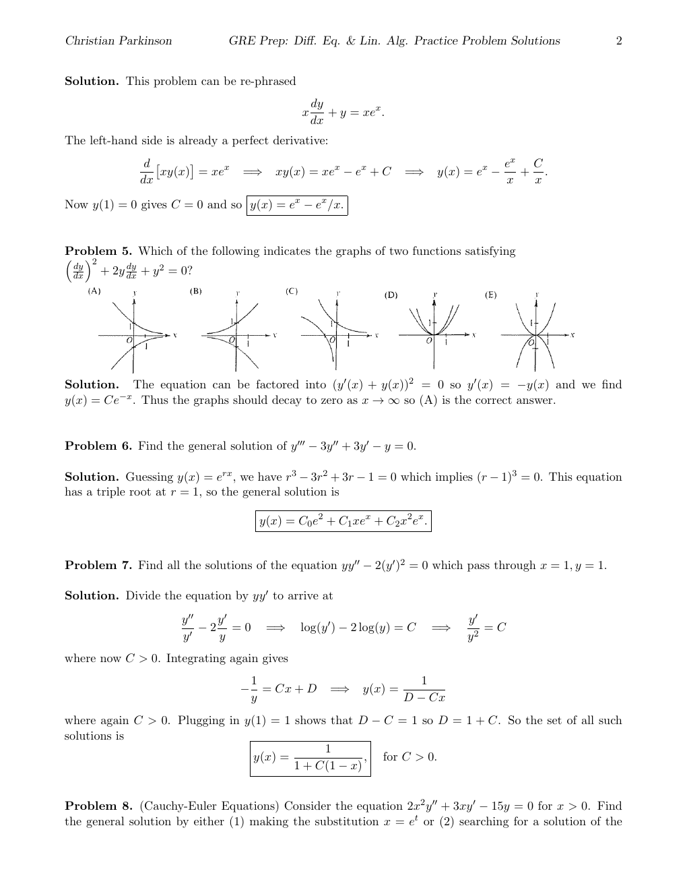

::: {.problem}
Which of the following indicates the graphs of two functions satisfying $\left( \frac{dy}{dx} \right)^{2} + 2y \frac{dy}{dx} + y^{2} = 0$?

:::

::: {.solution}
The equation factors, so the solution is forced; the only work is to say what the graph looks like and to fix the answer among the printed options, which are in the attached page image. The equation $(y')^2+2yy'+y^2=0$ is $(y'+y)^2=0$, whose solutions are $y=Ce^{-x}$, and only those. The argument is this card's own: no retained solution set covers this problem.

::: pf

::: {.pf-step #factor}
$(y')^2+2yy'+y^2=(y'+y)^2$, so on any interval where $y$ is differentiable the differential equation is equivalent to $y'+y=0$.

::: pf-proof
Expand the square: $(y'+y)^2=(y')^2+2y'y+y^2$. A square of a real number is $0$ exactly when the number is $0$; the left side is the square of the real-valued function $y'+y$, so the equation holds on an interval exactly when $y'(x)+y(x)=0$ for all $x$ there.
:::

:::

::: {.pf-step #solve}
The solutions of $y'+y=0$ on an interval are exactly $y(x)=Ce^{-x}$ with $C\in\RR$.

::: pf-proof
If $y'+y=0$, multiply by the integrating factor $e^x$: $\frac{\dd}{\dd x}(e^xy)=e^x(y'+y)=0$, so $e^xy=C$ is constant and $y=Ce^{-x}$. Conversely $y=Ce^{-x}$ satisfies $y'+y=-Ce^{-x}+Ce^{-x}=0$.
:::

:::

::: {.pf-step #shape}
Every solution $y=Ce^{-x}$ has constant sign on $\RR$ (or is identically $0$), is strictly monotone when $C\ne0$, and tends to $0$ as $x\to+\infty$.

::: pf-proof
For $C>0$ the function is positive and strictly decreasing, for $C<0$ negative and strictly increasing, and for $C=0$ it vanishes identically. In every case $\abs{y(x)}=\abs C e^{-x}\to0$ as $x\to+\infty$, while $\abs{y(x)}\to\infty$ as $x\to-\infty$ unless $C=0$.
:::

:::

::: {.pf-step #conclusion}
The graphs of two functions satisfying the equation are two curves $y=C_1e^{-x}$ and $y=C_2e^{-x}$.

::: pf-proof
By steps {.pf-ref} and {.pf-ref} each function is $C_ie^{-x}$. Two such curves either coincide (when $C_1=C_2$), or are disjoint and parallel in the sense that their ratio is the constant $C_1/C_2$, and each decays to $0$ at $+\infty$ by step {.pf-ref}. Among the printed choices this is the pair of decaying exponential graphs, which is alternative (A) on the attached page; the figure is reproduced in the statement's attachment rather than transcribed.
:::

:::

:::
:::
