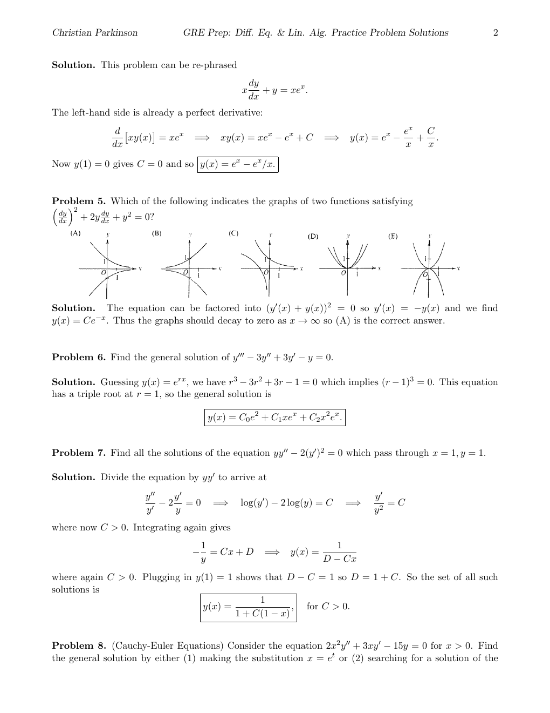

::: {.problem}
Which of the following indicates the graphs of two functions satisfying $\left( \frac{dy}{dx} \right)^{2} + 2y \frac{dy}{dx} + y^{2} = 0$?

:::

::: {.solution}
The equation factors as $(y'(x)+y(x))^2=0$, so $y'(x)=-y(x)$ and $y(x)=Ce^{-x}$. Thus the graphs decay to zero as $x\to\infty$, and (A) is the correct answer.
:::
