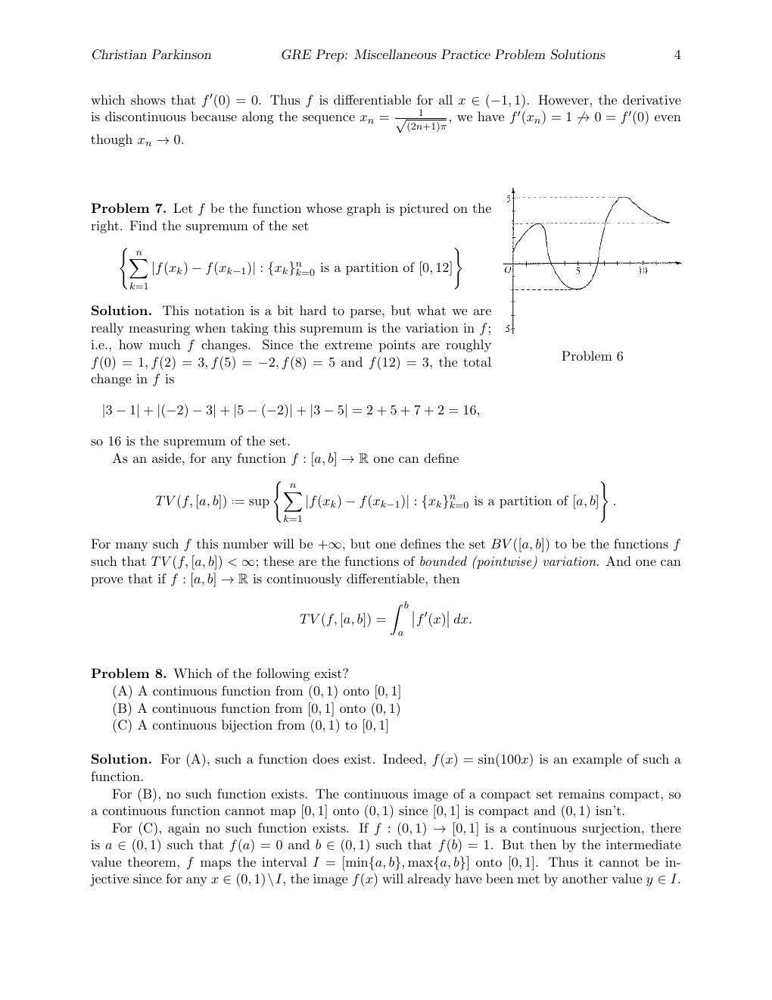

::: {.problem}
Let $f$ be the function whose graph is pictured below.
Find the supremum of the set
$$
\left\{ \sum_{k=1}^{n} \abs{f(x_{k}) - f(x_{k-1})} : \{x_{k}\}_{k=0}^{n} \text{ is a partition of } [0, 12] \right\}.
$$

:::

::: {.solution}
The supremum is the total variation of $f$ on $[0,12]$. The graph is monotone between its turning points, which read from the figure as $f(0)=1$, $f(2)=3$, $f(5)=-2$, $f(8)=5$ and $f(12)=3$. On a monotone piece the sum telescopes to the change in $f$, so the total variation is

$$
\abs{3-1}+\abs{(-2)-3}+\abs{5-(-2)}+\abs{3-5}=2+5+7+2=16,
$$

and $16$ is the supremum of the set.

For any $f\colon[a,b]\to\RR$ one defines

$$
TV(f,[a,b]):=\sup\left\{\sum_{k=1}^n\abs{f(x_k)-f(x_{k-1})}:\{x_k\}_{k=0}^n\text{ is a partition of }[a,b]\right\}.
$$

For many $f$ this number is $+\infty$. The set $BV([a,b])$ consists of the $f$ with $TV(f,[a,b])<\infty$; these are the functions of bounded variation. If $f\colon[a,b]\to\RR$ is continuously differentiable, then

$$
TV(f,[a,b])=\int_a^b\abs{f'(x)}\,dx.
$$
:::
