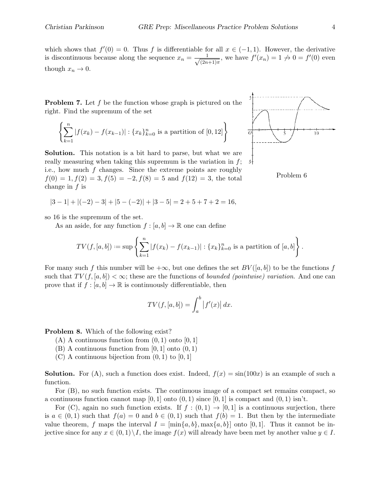

::: {.problem}
Let $f$ be the function whose graph is pictured below.
Find the supremum of the set
$$
\left\{ \sum_{k=1}^{n} \abs{f(x_{k}) - f(x_{k-1})} : \{x_{k}\}_{k=0}^{n} \text{ is a partition of } [0, 12] \right\}.
$$

:::

::: {.solution}

For $f\colon[0,12]\to\RR$ the supremum in the statement is the total variation
$TV(f;[0,12])$, the supremum of $\sum_k\abs{f(x_k)-f(x_{k-1})}$ over
partitions $0=x_0<\dots<x_n=12$.

::: pf

::: {.pf-step #variation}

The supremum equals the total variation, and it is attained by the partition
through the points where $f$ changes monotonicity.

::: pf-proof

That the supremum is $TV(f;[0,12])$ is the definition, so the content is to
compute it. For a function that is monotone on consecutive intervals
$[t_{j-1},t_j]$, the sum over any partition refines as
$\sum_k\abs{f(x_k)-f(x_{k-1})}=\sum_j\big(\text{variation accrued on
}[t_{j-1},t_j]\big)\le\sum_j\abs{f(t_j)-f(t_{j-1})}$, since on each piece the
total increase is at most the absolute difference of the endpoint values, with
equality when the partition includes the $t_j$. So the supremum is the sum of
the absolute increments between consecutive turning points, which the pictured
graph supplies.

:::

:::

::: {.pf-step #value}

The extremal values of the pictured graph are $f(0)=1$, $f(2)=3$, $f(5)=-2$,
$f(8)=5$ and $f(12)=3$, so the supremum is $2+5+7+2=\boxed{16}$.

::: pf-proof

Between consecutive turning points the function is monotone, with the
increments $3-1=2$, $-2-3=-5$, $5-(-2)=7$ and $3-5=-2$; step
{.pf-ref} gives the supremum as the sum of their absolute
values, $2+5+7+2=16$. The printed solution on page 4 of the retained booklet
computes the same five values and the same sum, describing them as "roughly"
those values because the graph is a sketch: the answer $16$ is the total
variation of the drawn function, and it is the answer to the question as
posed.

:::

:::

:::

:::
