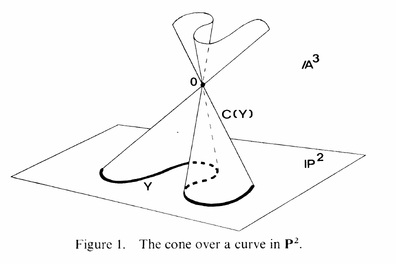

::: {.problem}
Let $Y \subseteq \PP^n$ be a nonempty algebraic set, and let $\theta: \AA^{n+1} \sm \theset{(0,\ldots,0)} \to \PP^n$ send the point with affine coordinates $(a_0,\ldots,a_n)$ to the point with homogeneous coordinates $\thevector{a_0 : \cdots : a_n}$.
The \dfn{affine cone} over $Y$ is
$$
C(Y) = \inverseof{\theta}(Y) \union \theset{(0,\ldots,0)} .
$$

(a) Show that $C(Y)$ is an algebraic set in $\AA^{n+1}$ whose ideal equals $I(Y)$, regarded as an ordinary ideal of $k[x_0,\ldots,x_n]$.

(b) Show that $C(Y)$ is irreducible if and only if $Y$ is.

(c) Show that $\dim C(Y) = \dim Y + 1$.

The projective closure $\overline{C(Y)}$ in $\PP^{n+1}$ is called the \dfn{projective cone} over $Y$.

{width=400px}
:::

::: {.solution}
Put $S = k[x_0,\ldots,x_n]$ and $J = I(Y)$, and write $Z_a(J) \subseteq \AA^{n+1}$ for the affine zero set.

**Part (a).** Since $Y \neq \emptyset$, the homogeneous ideal $J$ contains no nonzero constant, so $J \subseteq S_+$ and $\vector{0} \in Z_a(J)$.
A point $\vector{a} \neq \vector{0}$ lies in $Z_a(J)$ exactly when every homogeneous element of $J$ vanishes at $\vector{a}$, that is, when $\theta(\vector{a}) \in Z(J)$.
By [[P-AGH23ZIPROPS]], part (e), $Z(J) = Y$ because $Y$ is closed.
Hence $C(Y) = Z_a(J)$ is an algebraic set.
By the affine Nullstellensatz and the radicality of $J$ ([[P-AGH24CORRESPONDENCE]]),
$$
I(C(Y)) = I(Z_a(J)) = \sqrt{J} = J .
$$

**Part (b).** By (a), $I(C(Y)) = I(Y)$.
An affine algebraic set is irreducible exactly when its ideal is prime [@Har77, Corollary I.1.4], and $Y$ is irreducible exactly when $I(Y)$ is prime by [[P-AGH24CORRESPONDENCE]], part (b).

**Part (c).** By (a), $A(C(Y)) = S/I(Y) = S(Y)$.
Suppose first that $Y$ is irreducible.
Then $C(Y)$ is an affine variety by (b), and Proposition I.1.7 with [[P-AGH26HOMDIM]] gives
$$
\dim C(Y) = \dim A(C(Y)) = \dim S(Y) = \dim Y + 1 .
$$
In general, let $Y = Y_1 \union \cdots \union Y_m$ be the decomposition into irreducible components.
From the definition, $C(Y) = C(Y_1) \union \cdots \union C(Y_m)$, a finite union of irreducible closed sets.
The top member of a chain of irreducible closed subsets of a finite union of closed sets lies in one of them, so the dimension of the union is the maximum of the dimensions.
Hence $\dim C(Y) = \max_j (\dim Y_j + 1) = \dim Y + 1$.
:::
