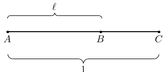

::: {.exercise}
Consider the Fibonacci numbers $\{F_n\}_{n=0}^{\infty}$, defined by the two initial values $F_0 = 0$, $F_1 = 1$ and the recursion relation
$$
F_n = F_{n-1} + F_{n-2} \quad \text{for } n \geq 2.
$$

(a) Consider the generating function $F(x) = \sum_{n=0}^{\infty} F_n x^n$ associated to $\{F_n\}$, and prove that
$$
F(x) = x^2 F(x) + x F(x) + x
$$
for all $x$ in a neighborhood of $0$.

(b) Show that the polynomial $q(x) = 1 - x - x^2$ can be factored as
$$
q(x) = (1 - \alpha x)(1 - \beta x),
$$
where $\alpha$ and $\beta$ are the roots of the polynomial $p(x) = x^2 - x - 1$.

(c) Expand the expression for $F$ in partial fractions and obtain
$$
F(x) = \frac{x}{1 - x - x^2} = \frac{x}{(1 - \alpha x)(1 - \beta x)} = \frac{A}{1 - \alpha x} + \frac{B}{1 - \beta x},
$$
where $A = 1/(\alpha - \beta)$ and $B = 1/(\beta - \alpha)$.

(d) Conclude that $F_n = A\alpha^n + B\beta^n$ for $n \geq 0$. The two roots of $p$ are actually
$$
\alpha = \frac{1 + \sqrt{5}}{2} \quad \text{and} \quad \beta = \frac{1 - \sqrt{5}}{2},
$$
so that $A = 1/\sqrt{5}$ and $B = -1/\sqrt{5}$.

The number $1/\alpha = (\sqrt{5} - 1)/2$, which is known as the golden mean, satisfies the following property: given a line segment $[AC]$ of unit length (Figure 2), there exists a unique point $B$ on this segment so that the following proportion holds
$$
\frac{AC}{AB} = \frac{AB}{BC}.
$$
If $\ell = AB$, this reduces to the equation $\ell^2 + \ell - 1 = 0$, whose only positive solution is the golden mean. This ratio arises also in the construction of the regular pentagon. It has played a role in architecture and art, going back to the time of ancient Greece.

:::

::: {.solution}
No retained solution set covers this exercise; the collection retains the textbook (`assets/attachments/Stein-Shakarchi-Complex-Analysis.pdf`) and no solutions manual, so the argument is the card's own. Throughout $F(x)=\sum_{n\ge0}F_{n}x^{n}$ with $F_{0}=0$, $F_{1}=1$ and $F_{n}=F_{n-1}+F_{n-2}$ for $n\ge2$.

::: pf

::: {.pf-step #equation}
(a) $F(x)=x+xF(x)+x^{2}F(x)$ near $0$.

::: pf-proof
Since $F_{n}$ grows at most exponentially, the series has a positive radius of convergence, and within it
$$
F(x)=F_{0}+F_{1}x+\sum_{n\ge2}F_{n}x^{n}=x+\sum_{n\ge2}\bigl(F_{n-1}+F_{n-2}\bigr)x^{n}=x+x\sum_{m\ge1}F_{m}x^{m}+x^{2}\sum_{m\ge0}F_{m}x^{m},
$$
where the two reindexings are $m=n-1$ and $m=n-2$. The first sum is $F(x)-F_{0}=F(x)$ and the second is $F(x)$, so $F=x+xF+x^{2}F$.
:::

:::

::: {.pf-step #factorization}
(b) $1-x-x^{2}=(1-\alpha x)(1-\beta x)$ where $\alpha,\beta$ are the roots of $x^{2}-x-1$.

::: pf-proof
Expanding, $(1-\alpha x)(1-\beta x)=1-(\alpha+\beta)x+\alpha\beta x^{2}$. For the roots of $x^{2}-x-1$ one has $\alpha+\beta=1$ and $\alpha\beta=-1$ by Vieta, so the expansion is $1-x-x^{2}$.
:::

:::

::: {.pf-step #partial-fractions}
(c) $F(x)=\dfrac{A}{1-\alpha x}+\dfrac{B}{1-\beta x}$ with $A=\dfrac{1}{\alpha-\beta}$ and $B=\dfrac{1}{\beta-\alpha}$.

::: pf-proof
From step {.pf-ref}, $F(x)(1-x-x^{2})=x$, so by step {.pf-ref} $F(x)=\frac{x}{(1-\alpha x)(1-\beta x)}$ as rational functions. Seek $A,B$ with
$$
\frac{A}{1-\alpha x}+\frac{B}{1-\beta x}=\frac{A(1-\beta x)+B(1-\alpha x)}{(1-\alpha x)(1-\beta x)}=\frac{x}{(1-\alpha x)(1-\beta x)},
$$
that is $A+B=0$ and $-(A\beta+B\alpha)=1$. With $B=-A$ the second reads $A(\alpha-\beta)=1$, so $A=\frac{1}{\alpha-\beta}$ and $B=\frac{1}{\beta-\alpha}$.
:::

:::

::: {.pf-step}
(d) $F_{n}=A\alpha^{n}+B\beta^{n}$, and with $\alpha,\beta=\frac{1\pm\sqrt5}{2}$ this is $F_{n}=\frac{\alpha^{n}-\beta^{n}}{\sqrt5}$.

::: pf-proof
Each $\frac{1}{1-\alpha x}=\sum_{n\ge0}\alpha^{n}x^{n}$ for $\abs{\alpha x}<1$, and similarly for $\beta$, so by step {.pf-ref}
$$
F(x)=\sum_{n\ge0}\bigl(A\alpha^{n}+B\beta^{n}\bigr)x^{n}
$$
near $0$. Comparing coefficients with $F(x)=\sum F_{n}x^{n}$ gives $F_{n}=A\alpha^{n}+B\beta^{n}$. The roots of $x^{2}-x-1$ are $\alpha=\frac{1+\sqrt5}{2}$ and $\beta=\frac{1-\sqrt5}{2}$, whose difference is $\sqrt5$, so $A=\frac{1}{\sqrt5}$ and $B=-\frac{1}{\sqrt5}$; that is Binet's formula, as required.
:::

:::

:::
:::
