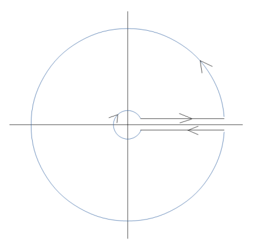

::: {.exercise}
Evaluate the integral

$$
\int_ {- \infty} ^ {\infty} \frac {d x}{1 + x ^ {4}}.
$$

Where are the poles of $1 / ( 1 + z ^ { 4 } ) \ ?$
:::

::: {.solution}
The poles of
$$
\frac1{1+z^4}
$$
are the four roots of $z^4=-1=e^{i\pi}$, namely
$$
e^{i\pi/4},\quad e^{3i\pi/4},\quad e^{5i\pi/4},\quad e^{7i\pi/4}.
$$
Integrate over the upper semicircle. The arc contribution tends to $0$ because the integrand is $O(R^{-4})$ while the arc length is $O(R)$. The poles in the upper half-plane are
$$
z_1=e^{i\pi/4},\qquad z_2=e^{3i\pi/4}.
$$
They are simple, and
$$
\operatorname{Res}_{z=z_j}\frac1{1+z^4}=\frac1{4z_j^3}.
$$
Hence
$$
\int_{-\infty}^{\infty}\frac{dx}{1+x^4}
=2\pi i\left(\frac1{4z_1^3}+\frac1{4z_2^3}\right).
$$
Since
$$
z_1^{-3}=e^{-3i\pi/4}=\frac{-1-i}{\sqrt2},
\qquad
z_2^{-3}=e^{-9i\pi/4}=\frac{1-i}{\sqrt2},
$$
the sum is $-\sqrt2\,i$. Therefore
$$
\int_{-\infty}^{\infty}\frac{dx}{1+x^4}
=2\pi i\left(-\frac{\sqrt2\,i}{4}\right)
=\frac{\pi}{\sqrt2}.
$$
:::

::: {.solution title="Half line: sector contour"}
Let $f(z) \coloneqq (z^4+1)^{-1}$ and $z_0 \coloneqq e^{i\pi/4}$. For $R>1$ let $\Gamma$ be the counterclockwise boundary of the quarter disc, made of

- $\gamma_1: \theset{t \st t\in [0, R]}$,

- $C_R: \theset{Re^{it}\st t\in [0, \pi/2]}$,

- $\gamma_2$: the segment from $iR$ to $0$.

The zeros of $z^4+1$ are $z_0 i^k$ for $k=0,1,2,3$, so $z_0$ is the only pole inside $\Gamma$.

::: pf

::: {.pf-step #rotate}
$\int_{\gamma_2} f(z) \dz = -i\int_{\gamma_1} f(z)\dz$.

::: pf-proof
With $z = ti$, $\dz = i\dt$ and $(ti)^4 = t^4$:
$$
\int_{\gamma_2} f(z) \dz = \int_R^0 {i \over t^4 + 1}\dt = -i \int_0^R {1\over t^4 + 1}\dt.
$$
:::

:::

::: {.pf-step #arc}
$\int_{C_R} f\to 0$ as $R\to\infty$.

::: pf-proof
$\abs{\int_{C_R} f}\leq \frac{\pi R/2}{R^4-1}\to 0$.
:::

:::

::: {.pf-step #residue}
$\Res_{z=z_0}f = \frac14 e^{5i\pi/4}$.

::: pf-proof
For a simple zero of the denominator, $\Res_{z=z_0} f = \frac{1}{4z_0^3} = \frac14 e^{-3i\pi/4} = \frac14 e^{5i\pi/4}$.
:::

:::

::: pf-step
$I = \frac{\pi}{2\sqrt 2}$.

::: pf-proof
By the residue theorem and steps {.pf-ref} and {.pf-ref}, letting $R\to\infty$ gives $(1-i)I = 2\pi i\Res_{z=z_0} f$. With step {.pf-ref},
$$
I = \frac{2\pi i}{1-i}\cdot\frac{e^{5i\pi/4}}{4} = \pi(i-1)\cdot\frac{-1-i}{4\sqrt 2} = \frac{2\pi}{4\sqrt 2} = \frac{\pi}{2\sqrt 2}.
$$
:::

:::

:::

:::

::: {.solution title="Half line: the log trick"}
Let $f(z) \coloneqq (z^4+1)^{-1}$, let $\log$ be the branch on $\CC\sm[0,\infty)$ with $\arg z\in(0,2\pi)$, and let $g(z) \coloneqq f(z)\log z$. Take the keyhole contour:

For $0<\varepsilon<1<R$, let $\Gamma$ be the counterclockwise contour consisting of

- $\gamma_+ = \theset{x+i\varepsilon \st x\in [\varepsilon, R]}$, traversed left to right,

- the large circle $C_R$, traversed counterclockwise,

- $\gamma_- = \theset{x-i\varepsilon \st x\in [\varepsilon, R]}$, traversed right to left,

- the small circle $C_\varepsilon$, traversed clockwise.

The poles of $f$ are $z_k \coloneqq e^{ik\pi/4}$ for $k=1,3,5,7$, all inside $\Gamma$, and $\log z_k = ik\pi/4$.

::: pf

::: {.pf-step #slit}
As $\varepsilon\to 0$, $\int_{\gamma_+} g + \int_{\gamma_-} g \to -2\pi i\int_0^R f(x)\dx$.

::: pf-proof
On the upper edge of the cut $\log z\to\log x$, and on the lower edge $\log z\to\log x+2\pi i$. Since $\gamma_-$ runs from right to left,
$$
\int_{\gamma_+} g + \int_{\gamma_-} g \to \int_0^R f(x)\log x\dx - \int_0^R f(x)(\log x + 2\pi i)\dx = -2\pi i\int_0^R f(x)\dx.
$$
:::

:::

::: {.pf-step #circles}
$\int_{C_R} g\to 0$ as $R\to\infty$ and $\int_{C_\varepsilon} g\to 0$ as $\varepsilon\to 0$.

::: pf-proof
On $\abs{z}=\rho$, $\abs{\log z}\leq\abs{\log\rho}+2\pi$. So $\abs{\int_{C_R} g}\leq 2\pi R\,\frac{\log R+2\pi}{R^4-1}\to 0$ and $\abs{\int_{C_\varepsilon} g}\leq 2\pi\varepsilon\,\frac{\abs{\log\varepsilon}+2\pi}{1-\varepsilon^4}\to 0$.
:::

:::

::: {.pf-step #residues}
$\Res_{z=z_k} g = -\frac{z_k\log z_k}{4}$.

::: pf-proof
$\Res_{z=z_k} f = \frac{1}{4z_k^3} = \frac{z_k}{4z_k^4} = -\frac{z_k}{4}$, since $z_k^4 = -1$, and $\log$ is holomorphic at $z_k$.
:::

:::

::: {.pf-step #sum}
$\frac14\sum_{k\in\{1,3,5,7\}} z_k\log z_k = \frac{\pi}{2\sqrt 2}$.

::: pf-proof
Write $\omega \coloneqq e^{i\pi/4}$, so $z_1, z_3, z_5, z_7 = \omega, \omega i, -\omega, -\omega i$. Then
$$
\frac14\sum_k z_k\log z_k = \frac{i\pi}{16}\left(\omega + 3\omega i - 5\omega - 7\omega i\right) = \frac{i\pi\omega}{16}(-4-4i) = -\frac{i\pi\omega(1+i)}{4}.
$$
Since $1+i = \sqrt 2\,\omega$ and $\omega^2 = i$, this is $-\frac{i\pi\sqrt 2\, i}{4} = \frac{\pi\sqrt 2}{4} = \frac{\pi}{2\sqrt 2}$.
:::

:::

::: pf-step
$I = \frac{\pi}{2\sqrt 2}$.

::: pf-proof
By the residue theorem, $\int_\Gamma g = 2\pi i\sum_k\Res_{z=z_k} g$. Letting $\varepsilon\to 0$ and $R\to\infty$, steps {.pf-ref} and {.pf-ref} give $-2\pi i I = 2\pi i\sum_k\Res_{z=z_k} g$, so $I = \frac14\sum_k z_k\log z_k$ by step {.pf-ref}; apply step {.pf-ref}.
:::

:::

:::

:::

::: {.remark title="Variations"}
The integrand is even, so the same computation gives
$$
\int_0^\infty\frac{dx}{1+x^4}=\frac{\pi}{2\sqrt2}.
$$
:::
