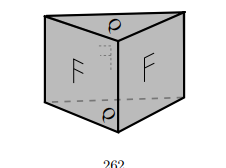

::: {.problem}
Use cellular chain complexes to compute the homology of the solid triangular prism whose faces are identified as shown.

:::

::: {.solution}

::: pf

::: {.pf-step #shape}

Write the prism as $\Delta\times I$. The two triangular faces carry the letter $Q$ in the same position, so they are glued by the vertical translation. The three side faces carry the letter $F$, upright and readable from outside, so they are glued to each other preserving the vertical coordinate and carrying each edge of $\Delta$ to the next one in the same cyclic direction. Hence
$$X\cong P\times S^1,$$
where $P$ is the triangle with its three edges identified to one edge $a$ by the boundary word $a^3$.

::: pf-proof

The dotted glyph on the back face is $F$ reflected, which is $F$ read from outside the solid. Reading each side face from left to right, from outside, runs around $\Delta$ in one cyclic direction, so the edges of the cross-section are glued as $a,a,a$. The translation of the top to the bottom face commutes with these side identifications, so the quotient is the product of the cross-section quotient $P$ with the circle.

:::

:::

::: {.pf-step #cells}

$X$ has the product CW structure with cells $v,a,t,f,a\times t,f\times t$ in dimensions $0,1,1,2,2,3$, and cellular differentials
$$
d(a)=d(t)=0,\qquad d(f)=3a,\qquad d(a\times t)=0,\qquad d(f\times t)=3\,(a\times t).
$$

::: pf-proof

$P$ has one $0$-cell $v$, one $1$-cell $a$ and one $2$-cell $f$ attached along $a^3$, so $d(f)=3a$ and $d(a)=0$. The circle has cells $v$ and $t$ with $d(t)=0$. The product formula $d(\sigma\times\tau)=d\sigma\times\tau\pm\sigma\times d\tau$ gives the rest.

:::

:::

::: pf-qed

From the chain complex
$$
0\to\ZZ\,(f\times t)\xrightarrow{d_3}\ZZ f\oplus\ZZ(a\times t)\xrightarrow{d_2}\ZZ a\oplus\ZZ t\xrightarrow{0}\ZZ v\to0
$$
of Step {.pf-ref},
$$
\boxed{H_0(X)\cong\ZZ,\qquad H_1(X)\cong\ZZ\oplus\ZZ/3,\qquad H_2(X)\cong\ZZ/3,\qquad H_3(X)=0.}
$$
Indeed $H_1=(\ZZ a\oplus\ZZ t)/\langle 3a\rangle$, $\ker d_2=\ZZ(a\times t)$ modulo $\operatorname{im}d_3=3\ZZ(a\times t)$ gives $H_2$, and $d_3$ is injective. This agrees with the Künneth formula for $P\times S^1$, since $H_*(P)=(\ZZ,\ZZ/3,0)$.

:::

:::

:::
