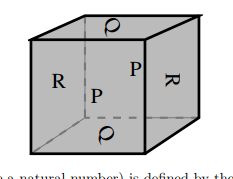

::: {.problem}
Use cellular chain complexes to compute the homology of the cube whose faces are identified in pairs according to the scheme shown.

:::

::: {.solution}

::: pf

::: {.pf-step #torus}

$X$ is the mapping torus of the homeomorphism $\rho$ of $T^2=\RR^2/\ZZ^2$ induced by a quarter turn of the square, which acts on $H_1(T^2)\cong\ZZ^2$ by
$$A=\begin{pmatrix}0&-1\\1&0\end{pmatrix}.$$

::: pf-proof

The letters $P$ and $Q$ appear in the same position on their paired faces, so these two pairs are glued by translations, and each slice of the cube parallel to the $R$ faces becomes a torus. The letter $R$ on the right face is the letter $R$ of the left face turned through $90^\circ$, so the last pair is glued by a quarter turn of the square. A quarter turn carries the pair of horizontal sides of the square to the pair of vertical sides, so it respects the translation identifications and induces $\rho$. It sends the horizontal generator of $H_1(T^2)$ to the vertical one and the vertical one to minus the horizontal one.

:::

:::

::: {.pf-step #action}

$\rho_*$ is the identity on $H_0(T^2)$ and $H_2(T^2)$, and $A$ on $H_1(T^2)$. On $H_1$, $1-A$ has determinant $2$, so
$$\ker(1-A)=0,\qquad\operatorname{coker}(1-A)\cong\ZZ/2.$$

::: pf-proof

A rotation preserves orientation, so it acts by $\det A=1$ on $H_2$. Here $1-A=\begin{pmatrix}1&1\\-1&1\end{pmatrix}$, and an integer $2\times2$ matrix with determinant $2$ is injective with cokernel of order $2$.

:::

:::

::: {.pf-step #wang}

For each $k$ there is a short exact sequence
$$
0\to\operatorname{coker}(1-\rho_*\mid H_k(T^2))\to H_k(X)\to\ker(1-\rho_*\mid H_{k-1}(T^2))\to0.
$$

::: pf-proof

Give $T^2$ the CW structure with one $0$-cell, two $1$-cells and one $2$-cell, and homotope $\rho$ to a cellular map. The mapping torus then has cells $e\times\{0\}$ and $e\times(0,1)$ for each cell $e$ of $T^2$, and its cellular chain complex is the mapping cone of $1-\rho_\sharp$ on $C_*(T^2)$, whose differentials are zero. The long exact sequence of that mapping cone is the Wang sequence, which splits into the displayed short exact sequences.

:::

:::

::: pf-qed

By Steps {.pf-ref} and {.pf-ref},
$$
\boxed{H_k(X;\ZZ)\cong
\begin{cases}
\ZZ,&k=0,\\
\ZZ\oplus\ZZ/2,&k=1,\\
\ZZ,&k=2,\\
\ZZ,&k=3,\\
0,&k>3.
\end{cases}}
$$
In degree $1$ the sequence is $0\to\ZZ/2\to H_1(X)\to\ZZ\to0$, which splits because $\ZZ$ is free. In degree $2$ the cokernel on $H_2(T^2)$ is $\ZZ$ and the kernel on $H_1(T^2)$ is $0$. In degree $3$ the kernel on $H_2(T^2)$ is $\ZZ$. As a check, $X$ is a closed orientable $3$-manifold, so $H_3\cong\ZZ$ and the Euler characteristic is $1-1+1-1=0$.

:::

:::

:::
