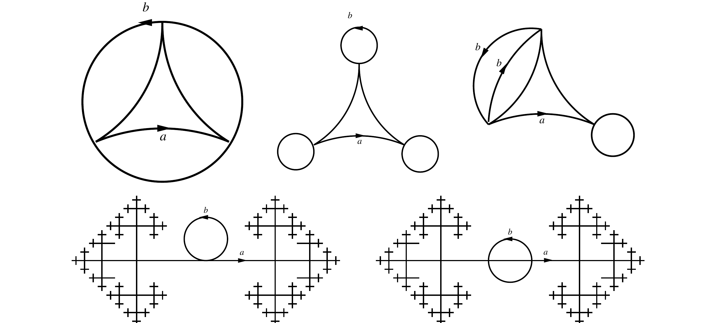

::: {.problem}
Let $W=S^1\vee S^1$, with $\pi_1(W)=F_2=\langle a,b\rangle$.

(a) For each cover in the source figure, give generators for its
corresponding subgroup of $F_2$.

(b) Describe the covering graph corresponding to each subgroup
$$
\begin{aligned}
H_1&=\langle a^2,b^2,(ab)^2\rangle,\\
H_2&=\langle a^2,b^2,aba^{-1},bab^{-1}\rangle,\\
H_3&=\langle a,b^3\rangle,\\
H_4&=\langle [a^m,b^n]:m,n\in\ZZ\rangle,\\
H_5&=\langle [a^{2m},b^{2n}]:m,n\in\ZZ\rangle.
\end{aligned}
$$
:::

::: {.solution}

An oriented $a$-edge or $b$-edge in a covering graph records the
lift of the corresponding loop of $W$. A connected covering graph
must have exactly one incoming and one outgoing edge of each label
at every vertex. A spanning tree gives a free basis of its
fundamental group: each edge outside that tree yields the word of
the based loop it completes.

For the three finite diagrams in (a), label the lower-left vertex
$0$, the lower-right vertex $1$, and the upper vertex $2$.
In each diagram the $a$-edges run $0\to1\to2\to0$.
Use the tree with the $a$-edges $0\to1$ and $1\to2$.

In the left diagram the $b$-edges run around the same three-cycle.
The corresponding subgroup has free generators
$$
a^3,\qquad ba^{-1},\qquad aba^{-2},\qquad a^2b.
$$
Equivalently it is the kernel of $F_2\to\ZZ/3$ that sends both
$a$ and $b$ to $1$.

In the middle diagram each vertex has a $b$-loop. The subgroup has
free generators
$$
a^3,\qquad b,\qquad aba^{-1},\qquad a^2ba^{-2}.
$$
It is the kernel of $F_2\to\ZZ/3$ sending $a$ to $1$ and $b$ to $0$.

In the right diagram the $b$-edges exchange vertices $0$ and $2$
and fix vertex $1$. The subgroup based at vertex $0$ has free
generators
$$
a^3,\qquad ba^{-2},\qquad aba^{-1},\qquad a^2b.
$$
The two lower diagrams each show an infinite $a$-line with one
$b$-loop and the remaining $b$-edges completed by trees. With the
lifted basepoint at the loop, the subgroup is $\langle b\rangle$.
Moving the lifted basepoint along $a$ changes it to a conjugate
$\langle a^rba^{-r}\rangle$. The figures mark no lifted basepoint,
so they determine the subgroup only up to conjugacy.

For (b), specify each covering graph by its labeled directed
edges. At any vertex where a label lacks an incoming or outgoing
edge, attach the unique tree edges needed to complete the cover;
the attached pieces contain no new cycles.

For $H_1$, the finite core has vertices $0,1,2,3$ and edges
$$
\begin{array}{c|l}
a&0\to1,\quad1\to0,\quad3\to2\\
b&0\to2,\quad2\to0,\quad1\to3.
\end{array}
$$
The loops $0\xrightarrow{a}1\xrightarrow{a}0$,
$0\xrightarrow{b}2\xrightarrow{b}0$, and
$0\xrightarrow{a}1\xrightarrow{b}3\xrightarrow{a}2
\xrightarrow{b}0$ read $a^2,b^2,(ab)^2$.
The core has rank $3$. Relative to the spanning tree with edges
$0\xrightarrow{a}1$, $0\xrightarrow{b}2$, and
$1\xrightarrow{b}3$, its usual free basis is
$a^2,b^2,aba b^{-1}$; replacing the last generator by
$(ab)^2=(aba b^{-1})b^2$ gives the stated free basis.
Complete its missing labeled edges with infinite trees.

For $H_2$, take the complete three-vertex graph with
$$
\begin{array}{c|l}
a&0\to1,\quad1\to0,\quad2\to2\\
b&0\to2,\quad2\to0,\quad1\to1.
\end{array}
$$
The four edges outside the tree
$0\xrightarrow{a}1$,
$0\xrightarrow{b}2$ give the loops
$a^2,b^2,aba^{-1},bab^{-1}$.
Thus this graph is already the three-sheeted cover for $H_2$.

For $H_3$, make one vertex $0$ with an $a$-loop and a
three-edge $b$-cycle through vertices $0,1,2$.
Attach infinite trees at the unused $a$-edge germs at $1$ and
$2$. Its core has the free basis $a,b^3$.

The group $H_4$ is the commutator subgroup $[F_2,F_2]$.
Indeed the indicated generators lie in $[F_2,F_2]$ and include
$[a,b]$. The identities
$$
\begin{aligned}
a[a^m,b^n]a^{-1}
  &=[a^{m+1},b^n][a,b^n]^{-1},\\
b[a^m,b^n]b^{-1}
  &=[a^m,b]^{-1}[a^m,b^{n+1}]
\end{aligned}
$$
show that their subgroup is normal; the negative values of $m,n$
give invariance under inverse conjugations as well. The normal
closure of $[a,b]$ is $[F_2,F_2]$. Its cover is the square grid with
vertices $(m,n)\in\ZZ^2$, $a$-edges
$(m,n)\to(m+1,n)$ and $b$-edges
$(m,n)\to(m,n+1)$.

Finally, put $L=\langle a^2,b^2\rangle$.
The same commutator argument, with $a^2,b^2$ in place of $a,b$,
gives $H_5=[L,L]$.
Start with a square grid indexed by $\ZZ^2$, but replace each
horizontal edge by a path of two $a$-edges and each vertical edge
by a path of two $b$-edges. At every intermediate vertex attach
the missing labeled edges as infinite trees. The junction vertices
record the abelianization $L/[L,L]\cong\ZZ^2$, while the
intermediate vertices and trees complete the graph as a cover
of $W$.

:::
