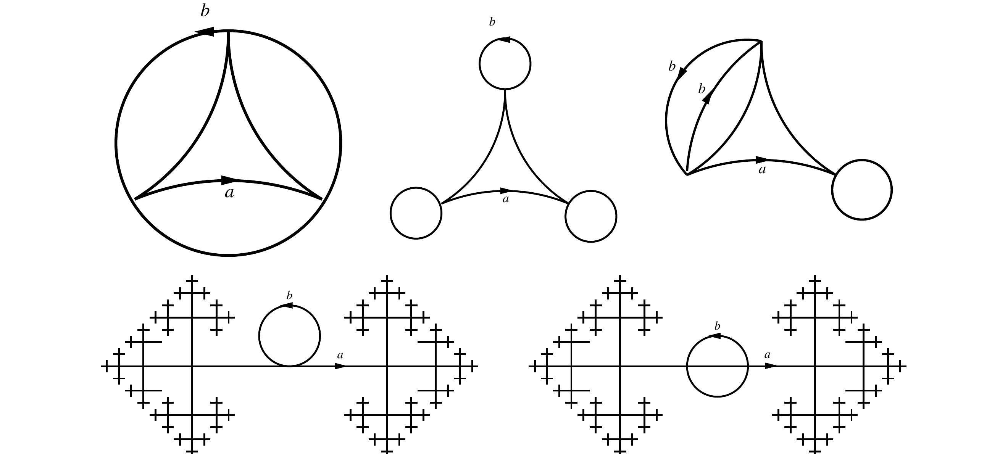

::: {.problem}
Let $W=S^1\vee S^1$, with $\pi_1(W)=F_2=\langle a,b\rangle$.

(a) For each cover in the source figure, give generators for its
corresponding subgroup of $F_2$.

(b) Describe the covering graph corresponding to each subgroup
$$
\begin{aligned}
H_1&=\langle a^2,b^2,(ab)^2\rangle,\\
H_2&=\langle a^2,b^2,aba^{-1},bab^{-1}\rangle,\\
H_3&=\langle a,b^3\rangle,\\
H_4&=\langle [a^m,b^n]:m,n\in\ZZ\rangle,\\
H_5&=\langle [a^{2m},b^{2n}]:m,n\in\ZZ\rangle.
\end{aligned}
$$

Sheet 4, Problem 8 also asks for the cover corresponding to the
commutator subgroup of $F_2$. Describe that cover.
:::

::: {.solution}

Write $W=S^1\vee S^1$ and $F_2=\langle a,b\rangle=\pi_1(W)$. A *covering
graph* is a connected graph whose edges are oriented and labelled $a$ or $b$,
with exactly one incoming and one outgoing edge of each label at every vertex;
it covers $W$ by sending every vertex to the wedge point and every labelled
edge once around the circle of its label. Fix a vertex $v$ of a covering graph
$\Gamma$ together with a spanning tree $T$ rooted at $v$, write $t(u)$ for the
word read along the tree path from $v$ to $u$, and for an edge $e$ from $u$ to
$u'$ with label $\ell(e)$ write $w(e)=t(u)\,\ell(e)\,t(u')^{-1}$.

::: pf

::: {.pf-step #basis}

The classes of the loops $w(e)$, for $e\notin T$, form a free basis of the
subgroup $\pi_1(\Gamma,v)\le F_2$.

::: pf-proof

Collapsing $T$ is a homotopy equivalence of $\Gamma$ with the one-vertex graph
$\Gamma/T$, which has one loop for each edge outside $T$, so $\pi_1(\Gamma,v)$
is free on the classes of those loops. The loop completed by $e$ runs along
the tree path to $u$, then through $e$, then back along the tree path from
$u'$ to $v$; the covering map sends a labelled edge homeomorphically onto the
circle of its label, so reading this loop in $W$ spells the word
$t(u)\ell(e)t(u')^{-1}$. A covering map injects on fundamental groups, so
these words freely generate their subgroup of $F_2$.

:::

:::

::: {.pf-step #left}

In the left diagram, with the vertices $0,1,2$ at the lower left, lower right
and top so that the inner arcs are the $a$-edges $0\to1\to2\to0$, taking the
outer 3-cycle also to run $0\to1\to2\to0$ gives the subgroup
$$
\langle a^3,\ ba^{-1},\ aba^{-2},\ a^2b\rangle ,
$$
and taking it to run the other way gives $\langle a^3,\ ba^{-2},\ a^2ba^{-1},\
ab\rangle$.

::: pf-proof

The outer circle is the three $b$-edges and the inner arcs are the three
$a$-edges, one arrow per label being drawn. With the tree
$0\xrightarrow{a}1\xrightarrow{a}2$ the non-forest edges are
$2\xrightarrow{a}0$, $0\xrightarrow{b}1$, $1\xrightarrow{b}2$ and
$2\xrightarrow{b}0$, and step {.pf-ref} reads off $a^2\cdot a=a^3$,
$1\cdot b\cdot a^{-1}$, $a\cdot b\cdot a^{-2}$ and $a^2\cdot b\cdot 1$. If the
$b$-edges are $0\to2$, $2\to1$, $1\to0$, the non-forest ones give $b\cdot
a^{-2}$, $a^2\cdot b\cdot a^{-1}$ and $a\cdot b$. The two answers are
different subgroups, since their images in $\ZZ^2$ are
$\{(x,y):x+y\equiv0\bmod 3\}$ and $\{(x,y):x\equiv y\bmod 3\}$; the drawn
arrow at the top supports the second and the retained solutions of step
{.pf-ref} the first.

:::

:::

::: {.pf-step #middle}

In the middle diagram, with $0,1,2$ at the lower left, lower right and top,
the $a$-edges are $0\to1\to2\to0$ and every vertex carries a $b$-loop; the
subgroup based at $0$ is $\langle a^3,\ b,\ aba^{-1},\ a^2ba^{-2}\rangle$.

::: pf-proof

Each circle of the picture is one $b$-loop and the three joining arcs are the
$a$-edges. With the tree $0\xrightarrow{a}1\xrightarrow{a}2$ the four
non-forest edges are the $a$-edge $2\to0$ and the three $b$-loops, which step
{.pf-ref} turns into $a^3$, $b$, $aba^{-1}$ and $a^2ba^{-2}$. A
$b$-loop read the other way round would give the inverse of the same
generator, so this picture has no orientation ambiguity.

:::

:::

::: {.pf-step #right}

In the right diagram the $a$-edges are the 3-cycle $0\to1\to2\to0$, the
$b$-edges are $0\to2$, $2\to0$ and a loop at $1$, and the subgroup at $0$ is
$\langle a^3,\ ba^{-2},\ aba^{-1},\ a^2b\rangle$.

::: pf-proof

The two arcs of the left-hand lens are the two $b$-edges joining the lower
left and top vertices, and the right-hand circle is the $b$-loop at the lower
right vertex, so the $b$-edges interchange $0$ and $2$ and fix $1$. With the
tree $0\xrightarrow{a}1\xrightarrow{a}2$ the non-forest edges are
$2\xrightarrow{a}0$, $0\xrightarrow{b}2$, $2\xrightarrow{b}0$ and
$1\xrightarrow{b}1$, which give $a^2\cdot a$, $b\cdot a^{-2}$, $a^2\cdot
b\cdot 1$ and $a\cdot b\cdot a^{-1}$ by step {.pf-ref}. Since the
$b$-edges are an involution here, no choice of their sense changes the answer.

:::

:::

::: {.pf-step #index}

In each of the three finite diagrams the number of vertices equals the number
of sheets of the cover, namely $3$, so each subgroup has index $3$ and rank
$1+3(2-1)=4$, in agreement with the four generators found in steps
{.pf-ref}, {.pf-ref} and {.pf-ref}.

::: pf-proof

The sheets over the base vertex of $W$ are the vertices of the covering graph,
and there are three of them, so the index is $3$. For an index-$d$ subgroup of
a free group of rank $r$ the rank is $1+d(r-1)$, here $1+3=4$, and each
displayed basis has four elements. Infinite-index subgroups of $F_2$ have no
such formula, which is why the rank of the last two pictures is read off their
non-forest edges instead.

:::

:::

::: {.pf-step #fourth}

In the fourth diagram, an infinite $a$-line with one $b$-loop at a vertex, the
subgroup at a vertex $\alpha$ of the line is $\langle b\rangle$, of rank $1$
and infinite index.

::: pf-proof

The line is a spanning tree of the graph, since it contains every vertex and
no cycle, so the loop is the only non-forest edge; step {.pf-ref}
turns it into the word $b$ at the loop's own vertex. A rank-one subgroup of
$F_2$ has infinite index, as follows also from step {.pf-ref}.
Moving the basepoint along the line conjugates this subgroup to $\langle
a^rba^{-r}\rangle$.

:::

:::

::: {.pf-step #fifth}

In the fifth diagram the $b$-loop crosses the $a$-line, so it meets the line
in two distinct vertices $\alpha\to\beta$ joined by one $b$-edge in each
direction; at $\beta$ the subgroup is $\langle ba,\ a^{-1}b\rangle=\langle
ba,\ b^{-1}a\rangle$, of rank $2$ and infinite index, hence not conjugate to
$\langle b\rangle$.

::: pf-proof

The two $b$-edges are $0\to1$ and $1\to0$ between consecutive vertices of the
line, and the line is again a spanning tree, so by step {.pf-ref}
the basis at the vertex $0=\beta$ consists of $b\cdot a$ and $a^{-1}\cdot b$:
the first traverses its $b$-edge and then the tree path from its endpoint back
to $0$, the second the tree path out to its initial vertex before its
$b$-edge. The two words are distinct free generators, so the rank is $2$; a
rank-two subgroup of $F_2$ has infinite index, since finite index $d$ would
give rank $1+2(d-1)\ge3$. Rank is an invariant of conjugacy, and $\langle
b\rangle$ has rank $1$, so this subgroup is not conjugate to $\langle
b\rangle$, which is what separates the fourth picture from the fifth.

:::

:::

::: {.pf-step #retained}

The retained solution set for this sheet gives, in its §2.4 (printed page 16
of the notebook), the five lists
$$
\langle ab^{-1}, aba^{-2}, a^3b^{-1}a^{-2}, a^3\rangle,\quad
\langle b, aba^{-1}, a^2ba^{-2}, a^3\rangle,\quad
\langle b^2, ba, a^3, aba^{-1}\rangle,\quad
\langle b\rangle,\quad
\langle ba, b^{-1}a\rangle ,
$$
and they are the subgroups of the five pictures in the order the pictures are
printed.

::: pf-proof

The lists are transcribed from
`assets/Topology/650_UCSD_Qual_Questions/Quals/extracted/Topology Problems
(Solutions).md`, §2.4 "Covering Spaces", items 7 to 12; the notebook is one
author's worked solutions to these sheets, its accompanying cover drawings
survive only as lost images, and no page number is printed in the extraction,
so the citation is by section and item. First picture: $a^3$, $aba^{-2}$,
$ba^{-1}=(ab^{-1})^{-1}$ and $a^2b=(a^3b^{-1}a^{-2})^{-1}a^3$ lie in the first
list, and conversely $a^3$, $aba^{-2}$, $ab^{-1}=(ba^{-1})^{-1}$ and
$a^3b^{-1}a^{-2}=a^3(a^2b)^{-1}$ lie in the subgroup of step
{.pf-ref}; so the two agree, and they agree with the same-sense
reading of the outer cycle. Second picture: the second list is the basis of
step {.pf-ref} in another order. Third picture: with $g_1=a^3$,
$g_2=a^2b$, $g_3=ba^{-2}$, $g_4=aba^{-1}$ from step {.pf-ref} and
$h_1=b^2$, $h_2=ba$, $h_3=a^3$, $h_4=aba^{-1}$, the identities $b^2=g_3g_2$,
$ba=g_3g_1$, $a^3=g_1$, $aba^{-1}=g_4$ give one inclusion and
$g_3=h_2h_3^{-1}$, $g_2=h_3h_2^{-1}h_1$, $g_1=h_3$, $g_4=h_4$ the other.
Fourth and fifth pictures: the fourth and fifth lists are the subgroups of
steps {.pf-ref} and {.pf-ref}, the last because
$a^{-1}b=(b^{-1}a)^{-1}$. Each identity is a cancellation in $F_2$ checked by
hand.

:::

:::

::: {.pf-step #hfirst}

The subgroup $H_1=\langle a^2,b^2,(ab)^2\rangle$ has a connected covering
graph whose core has vertices $0,1,2,3$ and edges $a\colon 0\to1,\ 1\to0,\
3\to2$ and $b\colon 0\to2,\ 2\to0,\ 1\to3$, with the missing germs completed
by infinite trees; its fundamental group at $0$ is $H_1$.

::: pf-proof

At $0$, $2$ and $3$ each label has one incoming and one outgoing edge, while
$1$ lacks an incoming $b$-edge and $3$ lacks an outgoing $b$-edge and an
incoming $a$-edge and $2$ lacks an outgoing $a$-edge; attaching a tree at each
missing germ, labelled so that the new vertices again have one edge of each
kind in and out and containing no cycle, completes the graph to a cover, and a
tree attached at a single vertex changes no fundamental group. The core has
$6$ edges and $4$ vertices, so rank $3$. With the tree $0\xrightarrow{a}1$,
$0\xrightarrow{b}2$, $1\xrightarrow{b}3$ the loops of the class $a^2$, $b^2$
and $aba b^{-1}$ are: along $0\xrightarrow{a}1$ and back by
$1\xrightarrow{a}0$; along $0\xrightarrow{b}2$ and back by
$2\xrightarrow{b}0$; and along $0\xrightarrow{a}1\xrightarrow{b}3$,
$3\xrightarrow{a}2$, $2\xrightarrow{b}0$. Hence the subgroup is $\langle
a^2,b^2,abab^{-1}\rangle$, which equals $\langle a^2,b^2,(ab)^2\rangle$
because $(ab)^2=abab^{-1}b^2$.

:::

:::

::: {.pf-step #hsecond}

The subgroup $H_2=\langle a^2,b^2,aba^{-1},bab^{-1}\rangle$ is the subgroup of
the three-sheeted cover with $a\colon 0\to1,\ 1\to0,\ 2\to2$ and $b\colon
0\to2,\ 2\to0,\ 1\to1$.

::: pf-proof

Every vertex has one incoming and one outgoing edge of each label, so this
complete labelled graph is a cover; it is connected and has three vertices,
hence three sheets. With the tree $0\xrightarrow{a}1$, $0\xrightarrow{b}2$ the
non-forest edges $1\xrightarrow{a}0$, $2\xrightarrow{b}0$,
$2\xrightarrow{a}2$, $1\xrightarrow{b}1$ give $a^2$, $b^2$, $bab^{-1}$ and
$aba^{-1}$ by step {.pf-ref}.

:::

:::

::: {.pf-step #hthird}

The subgroup $H_3=\langle a,b^3\rangle$ has the cover whose core is a vertex
$0$ with an $a$-loop and a three-edge $b$-cycle $0\to1\to2\to0$, with infinite
trees attached at the unused $a$-germs of $1$ and $2$.

::: pf-proof

The $b$-edges form a cycle through the three vertices and the $a$-loop
satisfies both $a$-germs at $0$; at $1$ and $2$ both $a$-germs are missing,
and trees complete them without adding cycles. The core has rank $4-3+1=2$ and
its two basis cycles read $a$ and $b^3$, so the subgroup is $\langle
a,b^3\rangle$. It has infinite index: a finite index $d$ would force rank
$1+2(d-1)$, which is odd, and $2$ is even, so the cover is infinite-sheeted
although its core is finite.

:::

:::

::: {.pf-step #hfourth}

The subgroup $H_4=\langle[a^m,b^n]:m,n\in\ZZ\rangle$ is the commutator
subgroup $[F_2,F_2]$, and its cover, which also answers Problem 8 of the
sheet, is the square grid with vertices $(m,n)\in\ZZ^2$, $a$-edges
$(m,n)\to(m+1,n)$ and $b$-edges $(m,n)\to(m,n+1)$.

::: pf-proof

The identities $a[a^m,b^n]a^{-1}=[a^{m+1},b^n][a,b^n]^{-1}$ and
$b[a^m,b^n]b^{-1}=[a^m,b]^{-1}[a^m,b^{n+1}]$ show that the subgroup generated
by all $[a^m,b^n]$ is closed under conjugation by $a$ and by $b$, and negative
$m,n$ give the inverse conjugations; it contains $[a,b]$, so it contains the
normal closure of $[a,b]$, which is $[F_2,F_2]$, and it is contained in it.
The grid is a covering graph, each vertex having exactly one $a$-edge in and
out and one $b$-edge in and out. Its fundamental group at $(0,0)$ is generated
by the loops around the unit squares, each of which is a conjugate of $[a,b]$
by a word in $a,b$, and every such conjugate is realised as a loop; so the
subgroup is $[F_2,F_2]$. The deck group is $\ZZ^2$, acting by translation, and
$F_2/[F_2,F_2]\cong\ZZ^2$ identifies it.

:::

:::

::: {.pf-step #hfifth}

The subgroup $H_5=\langle[a^{2m},b^{2n}]:m,n\in\ZZ\rangle$ is $[L,L]$ for
$L=\langle a^2,b^2\rangle$, and its cover is the graph obtained from the
square grid indexed by $\ZZ^2$ by replacing each horizontal edge with a path
of two $a$-edges and each vertical edge with a path of two $b$-edges, the
missing germs at the new vertices completed by infinite trees.

::: pf-proof

The conjugation identities of step {.pf-ref} with $a^2$ and $b^2$
in place of $a$ and $b$ show that the subgroup generated by the
$[a^{2m},b^{2n}]$ is normal in $L$ and contains $[a^2,b^2]$, while $[L,L]$ is
the normal closure of $[a^2,b^2]$ in $L$; hence the two agree. In the
described graph every junction vertex has one $a$-edge pair and one $b$-edge
pair pointing along the grid, each intermediate vertex has the others supplied
by the trees, and a tree adds no cycle; the total space is homotopy equivalent
to the doubled grid, whose loops are exactly the conjugates of $[a^2,b^2]$ by
words in $a^2$ and $b^2$, that is $[L,L]$. The junctions record the
abelianisation $L/[L,L]\cong\ZZ^2$.

:::

:::

:::

:::
