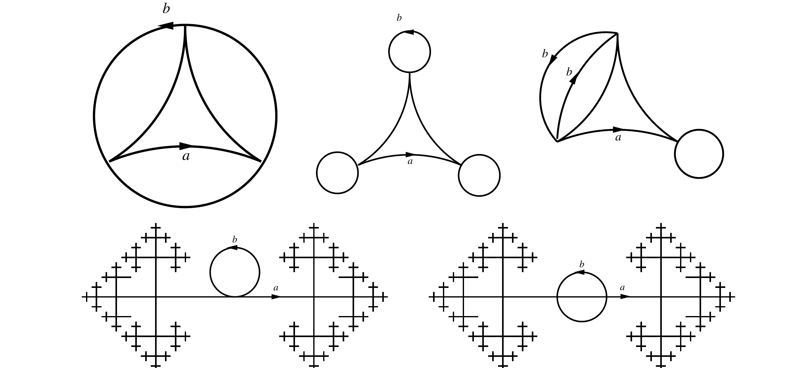

::: {.problem}
Let $W=S^1\vee S^1$ and identify $\pi_1(W)=F_2=\langle a,b\rangle$ in the usual way.

(a) For each of the following pictures of a cover of $S^1\vee S^1$, write down generators for their corresponding subgroups in the free group $\langle a,b\rangle$.

(b) Conversely, for each of the following subgroups of $\langle a,b\rangle$, draw the corresponding cover:
$$
\langle a^2,b^2,(ab)^2\rangle\qquad
\langle a^2,b^2,aba^{-1},bab^{-1}\rangle\qquad
\langle a,b^3\rangle\qquad
\langle\{a^mb^na^{-m}b^{-n}:\forall m,n\}\rangle\qquad
\langle\{a^{2m}b^{2n}a^{-2m}b^{-2n}:\forall m,n\}\rangle .
$$

Problem 8 of the same sheet asks: identify $\pi_1(S^1\vee S^1)$ with $F_2=\langle a,b\rangle$ in the usual way, and draw and describe the covering space corresponding to the subgroup $H$ generated by all elements of the form $xyx^{-1}y^{-1}$ with $x,y\in F_2$.
:::

::: {.solution}
The source is the retained sheet `assets/attachments/UCSD_290_F14_sheet4.pdf`: Problem 7 is printed on p. 253 and Problem 8 on p. 254, which are PDF pages 1 and 2, and the five covers of part (a) are part of the statement; the crop `assets/Topology/figures/ucsd_290_f14_sheet4_problem7.png` is that part of the page. The five lists of part (a) are transcribed from the retained worked notebook `assets/Topology/650_UCSD_Qual_Questions/Quals/extracted/Topology Problems (Solutions).md`, section 2.4 "Covering Spaces", page 16 of its contents: the answer to Problem 7 is the five lists the extraction numbers 8 to 12, and they are checked against the printed pictures below. The notebook's own cover drawings, its "Relevant covers", survive only as lost images, so the covers of part (b) and of Problem 8 are the card's own.

Write $W=S^1\vee S^1$ and $F_2=\langle a,b\rangle=\pi_1(W)$. A *covering graph* is a connected graph whose edges are oriented and labelled $a$ or $b$, with exactly one incoming and one outgoing edge of each label at every vertex; it covers $W$ by sending every vertex to the wedge point and every labelled edge once around the circle of its label. Fix a vertex $v$ of a covering graph $\Gamma$ together with a spanning tree $T$ rooted at $v$, write $t(u)$ for the word read along the tree path from $v$ to $u$, and for an edge $e$ from $u$ to $u'$ with label $\ell(e)$ write $w(e)=t(u)\,\ell(e)\,t(u')^{-1}$.

::: pf

::: {.pf-step #basis}
The classes of the loops $w(e)$, for $e\notin T$, form a free basis of the subgroup $\pi_1(\Gamma,v)\le F_2$.

::: pf-proof
Collapsing $T$ is a homotopy equivalence of $\Gamma$ with the one-vertex graph $\Gamma/T$, which has one loop for each edge outside $T$, so $\pi_1(\Gamma,v)$ is free on the classes of those loops. The loop completed by $e$ runs along the tree path to $u$, then through $e$, then back along the tree path from $u'$ to $v$; the covering map sends a labelled edge homeomorphically onto the circle of its label, so reading this loop in $W$ spells the word $t(u)\ell(e)t(u')^{-1}$. A covering map injects on fundamental groups, so these words freely generate their subgroup of $F_2$.
:::

:::

::: {.pf-step #figures}
In the printed pictures one arrow of each label is drawn, and the covering condition fixes the rest. The first three pictures have three vertices and one $a$-cycle through all three; the last two are the infinite $4$-valent tree, drawn with horizontal $a$-edges and vertical $b$-edges, in which the $b$-edge at one spine vertex (fourth picture) is drawn as a circle tangent to the spine and the $b$-edge at two consecutive spine vertices (fifth picture) as a circle crossing the spine.

::: pf-proof
In the last two pictures every vertex is a crossing of one horizontal and one vertical segment, giving two $a$-half-edges and two $b$-half-edges, and no cycle closes, so the segments form an infinite tree, the branches cut off at the edge of the drawing continuing. In the fourth picture the circle touches the spine at a vertex that carries no vertical segment, so the circle supplies that vertex's two $b$-germs and the tree together with the circle is a covering graph. In the fifth the circle meets the spine at two vertices, neither carrying a vertical segment, and its two arcs are the two $b$-edges between them, one in each direction; the tree with those two arcs removed is a maximal forest. The drawn arrows fix the reading: the $a$-arrow points right along the spine, and the covering condition then gives one incoming and one outgoing $a$-edge at every vertex, so a horizontal path is read in a single direction, and the same holds for the vertical $b$-edges.
:::

:::

::: {.pf-step #left}
In the left picture, with the vertices $0,1,2$ at the lower left, lower right and top so that the inner arcs are the $a$-edges $0\to1\to2\to0$, the outer $3$-cycle runs the same way and the subgroup at $0$ is
$$
\langle a^3,\ ba^{-1},\ aba^{-2},\ a^2b\rangle .
$$
Read the other way, the outer cycle would give $\langle a^3,\ ba^{-2},\ a^2ba^{-1},\ ab\rangle$, a different subgroup.

::: pf-proof
The outer circle is the three $b$-edges and the inner arcs are the three $a$-edges. With the tree $0\xrightarrow{a}1\xrightarrow{a}2$ the non-forest edges are $2\xrightarrow{a}0$, $0\xrightarrow{b}1$, $1\xrightarrow{b}2$ and $2\xrightarrow{b}0$, and step {.pf-ref} reads off $a^2\cdot a=a^3$, $1\cdot b\cdot a^{-1}$, $a\cdot b\cdot a^{-2}$ and $a^2\cdot b\cdot 1$. The drawn $b$-arrow sits on the outer arc leaving the top vertex and points away from it, so the outer cycle runs $0\to1\to2\to0$ like the inner one and these are the words. Had it run the other way, the $b$-edges $0\to2$, $2\to1$ and $1\to0$ would give $b\cdot a^{-2}$, $a^2\cdot b\cdot a^{-1}$ and $a\cdot b$. The two answers are different subgroups, since their images in $\ZZ^2$ are $\{(x,y):x+y\equiv0\bmod 3\}$ and $\{(x,y):x\equiv y\bmod 3\}$.
:::

:::

::: {.pf-step #middle}
In the middle picture, with $0,1,2$ at the lower left, lower right and top, the $a$-edges are $0\to1\to2\to0$ and every vertex carries a $b$-loop; the subgroup at $0$ is $\langle a^3,\ b,\ aba^{-1},\ a^2ba^{-2}\rangle$.

::: pf-proof
Each circle of the picture is one $b$-loop and the three joining arcs are the $a$-edges. With the tree $0\xrightarrow{a}1\xrightarrow{a}2$ the four non-forest edges are the $a$-edge $2\to0$ and the three $b$-loops, which step {.pf-ref} turns into $a^3$, $b$, $aba^{-1}$ and $a^2ba^{-2}$. A $b$-loop read the other way round would give the inverse of the same generator, so this picture has no orientation ambiguity.
:::

:::

::: {.pf-step #right}
In the right picture the $a$-edges are the $3$-cycle $0\to1\to2\to0$, the $b$-edges are $0\to2$, $2\to0$ and a loop at $1$, and the subgroup at $0$ is $\langle a^3,\ ba^{-2},\ aba^{-1},\ a^2b\rangle$.

::: pf-proof
The two arcs of the left-hand lens are the two $b$-edges joining the lower left and top vertices, and the right-hand circle is the $b$-loop at the lower right vertex, so the $b$-edges interchange $0$ and $2$ and fix $1$. With the tree $0\xrightarrow{a}1\xrightarrow{a}2$ the non-forest edges are $2\xrightarrow{a}0$, $0\xrightarrow{b}2$, $2\xrightarrow{b}0$ and $1\xrightarrow{b}1$, which give $a^2\cdot a$, $b\cdot a^{-2}$, $a^2\cdot b\cdot 1$ and $a\cdot b\cdot a^{-1}$ by step {.pf-ref}. Since the $b$-edges are an involution here, no choice of their sense changes the answer.
:::

:::

::: {.pf-step #index}
In each of the three finite diagrams the number of vertices equals the number of sheets of the cover, namely $3$, so each subgroup has index $3$ and rank $1+3(2-1)=4$, in agreement with the four generators found in steps {.pf-ref}, {.pf-ref} and {.pf-ref}.

::: pf-proof
The sheets over the base vertex of $W$ are the vertices of the covering graph, and there are three of them, so the index is $3$. For an index-$d$ subgroup of a free group of rank $r$ the rank is $1+d(r-1)$, here $1+3=4$, and each displayed basis has four elements. Infinite-index subgroups of $F_2$ have no such formula, which is why the rank of the last two pictures is read off their non-forest edges instead.
:::

:::

::: {.pf-step #fourth}
In the fourth picture the subgroup at the base vertex of the circle is $\langle b\rangle$: rank $1$ and infinite index.

::: pf-proof
The tree is a maximal forest of the graph and contains every vertex, and the circle is the only edge outside it, so by step {.pf-ref} the subgroup is generated by the word the circle spells, which is $b$ at its base vertex. Its rank is $1$, and a rank-one subgroup of $F_2$ is not of finite index, since an index-$d$ subgroup has rank $1+d\ge2$. Moving the basepoint along the spine conjugates this subgroup to $\langle a^rba^{-r}\rangle$.
:::

:::

::: {.pf-step #fifth}
In the fifth picture the circle crosses the spine at two consecutive vertices $\alpha,\beta$; at $\beta$ the subgroup is $\langle ba,\ a^{-1}b\rangle=\langle ba,\ b^{-1}a\rangle$, of rank $2$ and infinite index, hence not conjugate to $\langle b\rangle$.

::: pf-proof
The two arcs of the circle are the $b$-edges $\beta\to\alpha$ and $\alpha\to\beta$, and the tree with those two arcs removed is a maximal forest. Read from $\beta$, where $t(\alpha)=a^{-1}$: the edge $\beta\to\alpha$ gives $1\cdot b\cdot a=ba$ and the edge $\alpha\to\beta$ gives $a^{-1}\cdot b\cdot1=a^{-1}b$, so the basis is $\{ba,a^{-1}b\}$, and $a^{-1}b=(b^{-1}a)^{-1}$ gives the stated form. A finite-index subgroup of $F_2$ of index $d$ has rank $1+d$, so a rank-two subgroup of finite index would be all of $F_2$; but the image of this subgroup in $\ZZ^2$ is generated by $(1,1)$ and $(-1,1)$ and has index $2$, so the subgroup is proper and of infinite index. Rank is a conjugacy invariant and $\langle b\rangle$ has rank $1$, so the two subgroups are not conjugate.
:::

:::

::: {.pf-step #retained}
The retained solution set for this sheet gives, in its section 2.4 (page 16 of the notebook's contents), the five lists
$$
\langle ab^{-1}, aba^{-2}, a^3b^{-1}a^{-2}, a^3\rangle,\quad
\langle b, aba^{-1}, a^2ba^{-2}, a^3\rangle,\quad
\langle b^2, ba, a^3, aba^{-1}\rangle,\quad
\langle b\rangle,\quad
\langle ba, b^{-1}a\rangle ,
$$
and they are the subgroups of the five pictures in the order the pictures are printed.

::: pf-proof
The lists are transcribed from `assets/Topology/650_UCSD_Qual_Questions/Quals/extracted/Topology Problems (Solutions).md`, section 2.4 "Covering Spaces", the five lists the extraction numbers 8 to 12 under its answer to Problem 7; the notebook's contents give page 16 for section 2.4, and its extracted text carries no page markers, so the citation is by section and item. First picture: $a^3$, $aba^{-2}$, $ba^{-1}=(ab^{-1})^{-1}$ and $a^2b=(a^3b^{-1}a^{-2})^{-1}a^3$ lie in the first list, and conversely $a^3$, $aba^{-2}$, $ab^{-1}=(ba^{-1})^{-1}$ and $a^3b^{-1}a^{-2}=a^3(a^2b)^{-1}$ lie in the subgroup of step {.pf-ref}; the two agree, and they agree with the printed reading of the outer cycle. Second picture: the second list is the basis of step {.pf-ref} in another order. Third picture: with $g_1=a^3$, $g_2=a^2b$, $g_3=ba^{-2}$, $g_4=aba^{-1}$ from step {.pf-ref} and $h_1=b^2$, $h_2=ba$, $h_3=a^3$, $h_4=aba^{-1}$, the identities $b^2=g_3g_2$, $ba=g_3g_1$, $a^3=g_1$, $aba^{-1}=g_4$ give one inclusion and $g_3=h_2h_3^{-1}$, $g_2=h_3h_2^{-1}h_1$, $g_1=h_3$, $g_4=h_4$ the other. Fourth and fifth pictures: the fourth and fifth lists are the subgroups of steps {.pf-ref} and {.pf-ref}, the last because $a^{-1}b=(b^{-1}a)^{-1}$. Each identity is a cancellation in $F_2$ checked by hand.
:::

:::

::: {.pf-step #hfirst}
The subgroup $H_1=\langle a^2,b^2,(ab)^2\rangle$ has a connected covering graph whose core has vertices $0,1,2,3$ and edges $a\colon 0\to1,\ 1\to0,\ 3\to2$ and $b\colon 0\to2,\ 2\to0,\ 1\to3$, with the missing germs completed by infinite trees; its fundamental group at $0$ is $H_1$.

::: pf-proof
At $0$ each label has one incoming and one outgoing edge; $1$ lacks an incoming $b$-edge, $2$ lacks an outgoing $a$-edge, and $3$ lacks an incoming $a$-edge and an outgoing $b$-edge. Attaching a tree at each missing germ, labelled so that the new vertices again have one edge of each kind in and out and containing no cycle, completes the graph to a cover, and a tree attached at a single vertex changes no fundamental group. The core has $6$ edges and $4$ vertices, so rank $3$. With the tree $0\xrightarrow{a}1$, $0\xrightarrow{b}2$, $1\xrightarrow{b}3$ the loops of the class $a^2$, $b^2$ and $aba b^{-1}$ are: along $0\xrightarrow{a}1$ and back by $1\xrightarrow{a}0$; along $0\xrightarrow{b}2$ and back by $2\xrightarrow{b}0$; and along $0\xrightarrow{a}1\xrightarrow{b}3$, $3\xrightarrow{a}2$, $2\xrightarrow{b}0$. Hence the subgroup is $\langle a^2,b^2,abab^{-1}\rangle$, which equals $\langle a^2,b^2,(ab)^2\rangle$ because $(ab)^2=abab^{-1}b^2$.
:::

:::

::: {.pf-step #hsecond}
The subgroup $H_2=\langle a^2,b^2,aba^{-1},bab^{-1}\rangle$ is the subgroup of the three-sheeted cover with $a\colon 0\to1,\ 1\to0,\ 2\to2$ and $b\colon 0\to2,\ 2\to0,\ 1\to1$.

::: pf-proof
Every vertex has one incoming and one outgoing edge of each label, so this complete labelled graph is a cover; it is connected and has three vertices, hence three sheets. With the tree $0\xrightarrow{a}1$, $0\xrightarrow{b}2$ the non-forest edges $1\xrightarrow{a}0$, $2\xrightarrow{b}0$, $2\xrightarrow{a}2$, $1\xrightarrow{b}1$ give $a^2$, $b^2$, $bab^{-1}$ and $aba^{-1}$ by step {.pf-ref}.
:::

:::

::: {.pf-step #hthird}
The subgroup $H_3=\langle a,b^3\rangle$ has the cover whose core is a vertex $0$ with an $a$-loop and a three-edge $b$-cycle $0\to1\to2\to0$, with infinite trees attached at the unused $a$-germs of $1$ and $2$.

::: pf-proof
The $b$-edges form a cycle through the three vertices and the $a$-loop satisfies both $a$-germs at $0$; at $1$ and $2$ both $a$-germs are missing, and trees complete them without adding cycles. The core has rank $4-3+1=2$ and its two basis cycles read $a$ and $b^3$, so the subgroup is $\langle a,b^3\rangle$. A finite-index subgroup of $F_2$ of index $d$ has rank $1+d$, so rank $2$ would force $d=1$; but the image of $\langle a,b^3\rangle$ in $\ZZ^2$ is $\langle(1,0),(0,3)\rangle$, of index $3$, so the subgroup is proper and the cover is infinite-sheeted although its core is finite.
:::

:::

::: {.pf-step #hfourth}
The subgroup $H_4=\langle a^mb^na^{-m}b^{-n}:m,n\in\ZZ\rangle$ is the commutator subgroup $[F_2,F_2]$, and its cover, which also answers Problem 8 of the sheet, is the square grid with vertices $(m,n)\in\ZZ^2$, $a$-edges $(m,n)\to(m+1,n)$ and $b$-edges $(m,n)\to(m,n+1)$.

::: pf-proof
The identities $a[a^m,b^n]a^{-1}=[a^{m+1},b^n][a,b^n]^{-1}$ and $b[a^m,b^n]b^{-1}=[a^m,b]^{-1}[a^m,b^{n+1}]$ show that the subgroup generated by all $[a^m,b^n]$ is closed under conjugation by $a$ and by $b$, and negative $m,n$ give the inverse conjugations; it contains $[a,b]$, so it contains the normal closure of $[a,b]$, which is $[F_2,F_2]$, and it is contained in it. The grid is a covering graph, each vertex having exactly one $a$-edge in and out and one $b$-edge in and out. Its fundamental group at $(0,0)$ is generated by the loops around the unit squares, each of which is a conjugate of $[a,b]$ by a word in $a,b$, and every such conjugate is realised as a loop; so the subgroup is $[F_2,F_2]$. The deck group is $\ZZ^2$, acting by translation, and $F_2/[F_2,F_2]\cong\ZZ^2$ identifies it.
:::

:::

::: {.pf-step #hfifth}
The subgroup $H_5=\langle a^{2m}b^{2n}a^{-2m}b^{-2n}:m,n\in\ZZ\rangle$ is $[L,L]$ for $L=\langle a^2,b^2\rangle$, and its cover is the graph obtained from the square grid indexed by $\ZZ^2$ by replacing each horizontal edge with a path of two $a$-edges and each vertical edge with a path of two $b$-edges, the missing germs at the new vertices completed by infinite trees.

::: pf-proof
The conjugation identities of step {.pf-ref} with $a^2$ and $b^2$ in place of $a$ and $b$ show that the subgroup generated by the $[a^{2m},b^{2n}]$ is normal in $L$ and contains $[a^2,b^2]$, while $[L,L]$ is the normal closure of $[a^2,b^2]$ in $L$; hence the two agree. In the described graph every junction vertex has one $a$-edge pair and one $b$-edge pair pointing along the grid, each intermediate vertex has the others supplied by the trees, and a tree adds no cycle; the total space is homotopy equivalent to the doubled grid, whose loops are exactly the conjugates of $[a^2,b^2]$ by words in $a^2$ and $b^2$, that is $[L,L]$. The junctions record the abelianisation $L/[L,L]\cong\ZZ^2$.
:::

:::

:::

:::

::: {.remark}
The sheet marks no basepoint on any of the five pictures; the basepoints named above are chosen, and changing one replaces a subgroup by a conjugate.
:::
