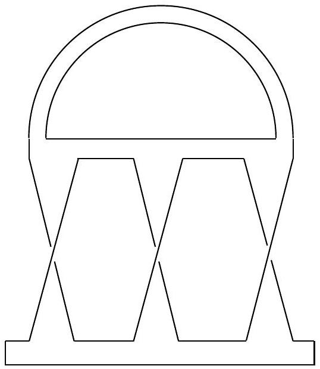

::: {.problem}
State the classification theorem for compact surfaces and identify the surface drawn on the exam on your list.

:::

::: {.solution}

::: pf

::: pf-step
The classification theorem says that every compact connected surface is homeomorphic to exactly one surface of one of the following two forms:
$$
\Sigma_{g,b}
=
\left(\#^g T^2\right)
\setminus
\bigsqcup_{i=1}^{b}\operatorname{int}(D_i^2),
\qquad g,b\ge0,
$$
or
$$
N_{k,b}
=
\left(\#^k\RP^2\right)
\setminus
\bigsqcup_{i=1}^{b}\operatorname{int}(D_i^2),
\qquad k\ge1,\ b\ge0.
$$
The first family is orientable and the second is nonorientable; the displayed parameters are unique.

::: pf-proof
This is the classification theorem for compact connected surfaces.
Equivalently, a compact connected surface is determined up to homeomorphism by whether it is orientable, its genus (or nonorientable genus), and its number of boundary components.
For $g=0$, the convention in the first display is $\#^0T^2=S^2$.
If a compact surface is disconnected, apply this statement to each connected component.
:::

:::

::: {.pf-step #euler-char-formulas}
Their Euler characteristics are
$$
\chi(\Sigma_{g,b})=2-2g-b,
\qquad
\chi(N_{k,b})=2-k-b.
$$

::: pf-proof
The closed orientable genus-$g$ surface has Euler characteristic $2-2g$, and the closed nonorientable genus-$k$ surface has Euler characteristic $2-k$.
Removing the interior of one disk decreases the Euler characteristic by one, so removing $b$ disjoint open disks gives the displayed formulas.
:::

:::

::: {.pf-step #band-decomposition}
The drawn surface is a ribbon surface: a bottom disk $B$ and a top disk $T$, joined by three bands $e_1,e_2,e_3$, each with one half twist, together with an untwisted band $a$, the arch, whose two ends lie on $T$.
Its Euler characteristic is
$$
\chi=2-4=-2.
$$

::: pf-proof
The horizontal bar at the bottom of the picture is the disk $B$.
The strip directly under the arch, bounded above by the straight chord of the semicircular hole, is the disk $T$.
Between $T$ and $B$ there are three strips.
In each strip the two boundary edges cross once, with one edge drawn passing under the other, so each strip is a band with one half twist.
The arch is a planar strip from the left end to the right end of the top side of $T$, so it is an untwisted band.
A disk has Euler characteristic $1$, and attaching a band along two arcs decreases the Euler characteristic by $1$.
Hence $\chi=1+1-4=-2$.
:::

:::

::: {.pf-step #orientable}
The surface is orientable.

::: pf-proof
Reflect the orientation of $T$.
Each $e_i$ joins $T$ to $B$ with one half twist, so after the reflection the orientations of $B$ and $T$ agree across every $e_i$.
The arch $a$ has both ends on $T$ and no twist, so it also respects the orientation of $T$.
Thus the orientations of the two disks extend over all four bands.
:::

:::

::: {.pf-step #boundary-count}
The surface has exactly two boundary components.

::: pf-proof
After the reflection in step {.pf-ref}, all bands are untwisted and the surface is the thickening of a ribbon graph.
Its boundary components are the cycles of $\varphi=\sigma\alpha$ on the band ends, where $\alpha$ exchanges the two ends of each band and $\sigma$ is the counterclockwise cyclic order of band ends around each disk.
Write $b_i,t_i$ for the ends of $e_i$ on $B$ and $T$, and $a,a'$ for the left and right ends of the arch.
Around $B$ the order is $(b_3\,b_2\,b_1)$.
Around $T$ the order before the reflection is $(t_1\,t_2\,t_3\,a'\,a)$, so after it the order is $(a\,a'\,t_3\,t_2\,t_1)$.
Then
$$
\varphi=(b_1\,a\,t_3\,b_2\,t_1\,b_3\,t_2)(a'),
$$
which has two cycles.
The cycle $(a')$ is the boundary of the semicircular hole, and the other cycle is the outer boundary curve.
:::

:::

::: pf-step
The drawn surface is
$$
\boxed{\Sigma_{1,2}},
$$
the torus with the interiors of two disjoint disks removed.

::: pf-proof
By step {.pf-ref} the surface is in the orientable family, and by step {.pf-ref} it has $b=2$.
By step {.pf-ref} and step {.pf-ref},
$$
-2=2-2g-2,
$$
so $g=1$.
:::

:::

:::

:::
