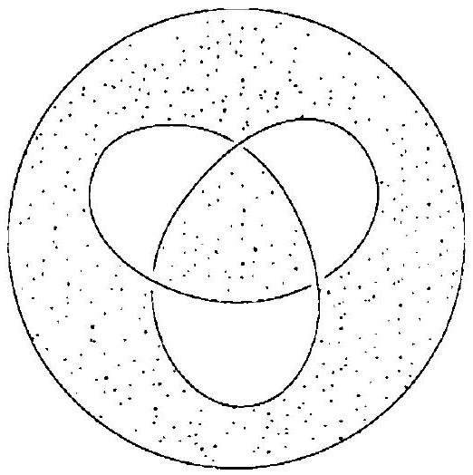

::: {.problem}
Use the classification of surfaces to identify the surface drawn below.

:::

::: {.solution}

::: pf

::: {.pf-step #s1}

The three-lobed broken curve in the diagram is a single closed curve: the standard three-crossing diagram of the trefoil.
The stippled surface is obtained from two stippled regions, the central triangle $D$ and the outer region $R$ between the trefoil and the large outer circle, by joining them with one band at each of the three crossings.
The region $D$ is a disk, and $R$ is an annulus.

::: pf-proof

At every crossing, the gap records which branch passes under the other; following the strands through all three crossings gives a single closed component, the standard trefoil projection.

For the checkerboard construction, each stippled region thickens to a piece of surface and each crossing contributes a narrow band joining the two incident stippled regions.
The three lobes of the trefoil are not stippled.
The stippling of $R$ stops at the large outer circle, and the surface is compact, so that circle is a boundary curve of $R$.
Hence $R$ is bounded by two disjoint simple closed curves, the outer circle and the outer edge of the trefoil diagram, and is an annulus.

:::

:::

::: {.pf-step #s2}

The surface is connected and has Euler characteristic
$$
\chi=1+0-3=-2.
$$

::: pf-proof

Every band joins $D$ to $R$, so the surface is connected.
Attaching a band along two arcs decreases the Euler characteristic by $1$, and
$$
\chi(D)=1,
\qquad
\chi(R)=0.
$$
Hence
$$
\chi=\chi(D)+\chi(R)-3=-2.
$$

:::

:::

::: pf-step

The surface is orientable.

::: pf-proof

The pieces $D$ and $R$ are planar, so each is orientable.
Collapse each piece to a vertex and each crossing band to an edge.
The resulting graph has two vertices joined by three edges.

Traversing one crossing band interchanges the two local sides of the planar pieces.
Thus a global choice of side is consistent precisely when every closed route through the bands uses an even number of bands; a loop inside the annulus $R$ uses no band.
The graph is bipartite, with $D$ and $R$ as its two parts, so every closed route has even length.
Hence the surface is two-sided, and therefore orientable.

:::

:::

::: {.pf-step #s4}

The surface has exactly two boundary components.

::: pf-proof

Away from the outer circle, the boundary of the surface follows the strands of the knot diagram.
By step {.pf-ref} those strands form a single closed curve, the trefoil.
The outer circle is the second boundary curve.
Thus
$$
b=2.
$$

:::

:::

::: pf-step

By the classification of compact connected orientable surfaces, the surface is the torus with the interiors of two disjoint disks removed:
$$
\boxed{\Sigma_{1,2}=T^2\setminus\bigl(\operatorname{int}(D_1^2)\sqcup\operatorname{int}(D_2^2)\bigr)}.
$$

::: pf-proof

An orientable compact connected surface of genus $g$ with $b$ boundary components has Euler characteristic
$$
\chi=2-2g-b.
$$
By steps {.pf-ref} and {.pf-ref},
$$
-2=2-2g-2=-2g,
$$
so $g=1$.
The unique orientable surface with genus $1$ and two boundary components is a torus with the interiors of two disjoint disks removed.

:::

:::

:::

:::
