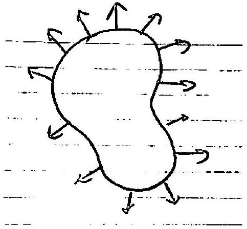

::: {.problem}
A continuous vector field $V$ on the plane is a continuous map from $\RR^2$ to $\RR^2$.
The portion of $V$ along the boundary of a disk $D$ is shown below:

Show that the vector field has a zero inside $D$.
:::

::: {.solution}
The region $D$ in the figure is a closed topological disk bounded by a smooth simple closed curve $\partial D$.
Let $\nu(x)$ be the outward unit normal to $\partial D$ at $x$.
The boundary condition shown in the figure says that $V(x)$ points strictly outward for every $x\in\partial D$; that is,
$$
\langle V(x),\nu(x)\rangle>0
\qquad(x\in\partial D).
$$

::: pf

::: {.pf-step #s1}

If $V$ had no zero in $D$, then the normalized field
$$
u:D\longrightarrow S^1,
\qquad
u(x)=\frac{V(x)}{\norm{V(x)}},
$$
would be continuous, and its restriction to $\partial D$ would have degree $0$.

::: pf-proof

Under the assumption that $V(x)\ne0$ on $D$, the displayed normalization is well defined and continuous.
Since $u\restrict_{\partial D}$ extends continuously over the disk, it is null-homotopic: contract the disk $D$ to a point and compose that contraction with $u$.
A null-homotopic map $S^1\to S^1$ has degree $0$.

:::

:::

::: {.pf-step #s2}

The same boundary map $u\restrict_{\partial D}$ has degree $1$.

::: pf-proof

For $0\le t\le1$, set
$$
W_t(x)=(1-t)V(x)+t\,\nu(x).
$$
Then
$$
\langle W_t(x),\nu(x)\rangle
=(1-t)\langle V(x),\nu(x)\rangle+t>0,
$$
so $W_t(x)\ne0$ for every $x\in\partial D$ and every $t$.
Therefore
$$
H_t(x)=\frac{W_t(x)}{\norm{W_t(x)}}
$$
is a homotopy through maps $\partial D\to S^1$ from $u\restrict_{\partial D}$ to $\nu$.

Traverse $\partial D$ counterclockwise.
The unit tangent $T(x)$ of a smooth simple closed curve has degree $1$ by Hopf's rotation index theorem (the Umlaufsatz).
The outward normal is $\nu(x)=-iT(x)$, the tangent rotated by the fixed angle $-\pi/2$, so $\nu$ also has degree $1$.
Hence
$$
\deg(u\restrict_{\partial D})=\deg(\nu)=1.
$$

:::

:::

::: pf-step

Thus $V$ has a zero in the interior of $D$.

::: pf-proof

If $V$ had no zero in $D$, steps {.pf-ref} and {.pf-ref} would give simultaneously
$$
\deg(u\restrict_{\partial D})=0
\qquad\text{and}\qquad
\deg(u\restrict_{\partial D})=1,
$$
a contradiction.
Therefore $V$ vanishes somewhere in $D$.
The pictured boundary condition implies $V(x)\ne0$ for every $x\in\partial D$, so every zero lies in the interior.

:::

:::

:::

:::
