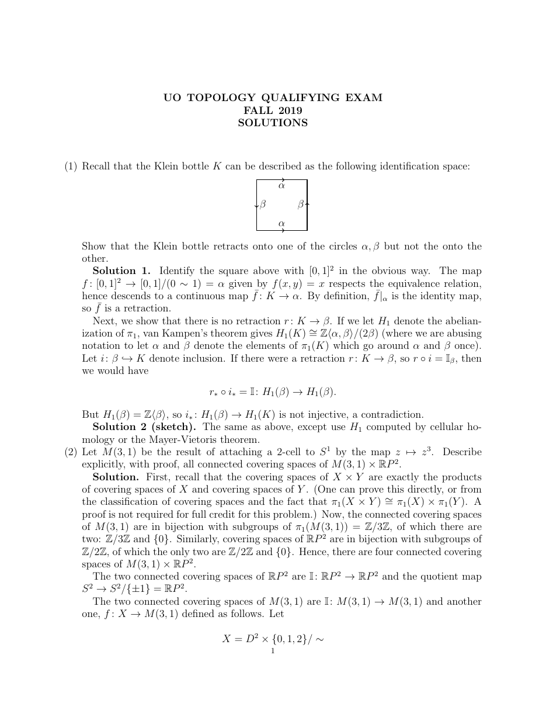

::: {.problem}
Recall the standard square-identification model of the Klein bottle $K$, with the two indicated circles $\alpha$ and $\beta$.

Show that the Klein bottle retracts onto one of the circles $\alpha,\beta$ but not onto the other.
:::

::: {.solution}

Identify the square in the standard model with
\[
[0,1]^2,
\]
with the horizontal edges giving the circle \(\alpha\) and the vertical
edges giving the circle \(\beta\).

::: pf

::: {.pf-step #s1-1}

The map
\[
p:[0,1]^2\to [0,1]/(0\sim1),
\qquad
p(x,y)=[x],
\]
respects the Klein-bottle edge identifications.

::: pf-proof

The two vertical edges are identified pointwise with reversed orientation,
but both points
\[
(0,y)
\qquad\text{and}\qquad
(1,1-y)
\]
map to the same class
\[
[0]=[1].
\]
The two horizontal edges are identified in the standard way, and
\[
p(x,0)=p(x,1)=[x].
\]
Thus equivalent points in the square have the same image under \(p\).

:::

:::

::: {.pf-step #s1-2}

Hence \(p\) descends to a continuous map
\[
\overline p:K\to\alpha.
\]

::: pf-proof

Let
\[
q:[0,1]^2\to K
\]
be the quotient map. By step {.pf-ref}, \(p\) is constant on the equivalence
classes defining \(K\). The universal property of quotient spaces therefore
gives a unique continuous map
\[
\overline p:K\to\alpha
\]
such that
\[
\overline p\circ q=p.
\]

:::

:::

::: {.pf-step #s1-3}

The restriction of \(\overline p\) to \(\alpha\) is the identity.

::: pf-proof

Represent \(\alpha\) by the horizontal edge
\[
\{(x,0):0\le x\le1\}.
\]
For its point represented by \((x,0)\),
\[
\overline p(q(x,0))
=
p(x,0)
=
[x],
\]
which is exactly that same point of \(\alpha\).

:::

:::

::: {.pf-step #s1-4}

Therefore
\[
\boxed{K\text{ retracts onto }\alpha}.
\]

::: pf-proof

By definition, a retraction is a map whose restriction to the target
subspace is the identity. Steps {.pf-ref} and {.pf-ref} give such a map.

:::

:::

::: {.pf-step #s1-5}

The first homology of the Klein bottle is
\[
\boxed{
H_1(K;\ZZ)
\cong
\ZZ\langle[\alpha]\rangle
\oplus
\ZZ/2\langle[\beta]\rangle}.
\]

::: pf-proof

The standard presentation of the Klein-bottle fundamental group is
\[
\pi_1(K)
\cong
\langle \alpha,\beta
\mid
\alpha\beta\alpha^{-1}=\beta^{-1}
\rangle.
\]
Abelianizing turns the relation into
\[
\beta=-\beta,
\]
equivalently
\[
2\beta=0.
\]
Thus
\[
H_1(K;\ZZ)
\cong
\pi_1(K)_{\mathrm{ab}}
\cong
\ZZ\oplus\ZZ/2,
\]
with the indicated generators.

:::

:::

::: {.pf-step #s1-6}

The inclusion
\[
i:\beta\hookrightarrow K
\]
induces a noninjective map
\[
i_*:
H_1(\beta;\ZZ)
\to
H_1(K;\ZZ).
\]

::: pf-proof

Since \(\beta\cong S^1\),
\[
H_1(\beta;\ZZ)
\cong
\ZZ.
\]
The generator maps to
\[
[\beta]\in H_1(K;\ZZ),
\]
which has order \(2\) by step {.pf-ref}. Therefore
\[
2\in\ZZ
\]
lies in the kernel of \(i_*\), so \(i_*\) is not injective.

:::

:::

::: {.pf-step #s1-7}

There is no retraction
\[
r:K\to\beta.
\]

::: pf-proof

Suppose such a retraction existed. Then
\[
r\circ i
=
\operatorname{id}_\beta.
\]
Applying \(H_1(-;\ZZ)\) gives
\[
r_*\circ i_*
=
\operatorname{id}_{H_1(\beta;\ZZ)}.
\]
Any map admitting a left inverse is injective, so \(i_*\) would be
injective. This contradicts step {.pf-ref}.

:::

:::

::: {.pf-step #s1-8}

Hence
\[
\boxed{
K\text{ retracts onto }\alpha
\text{ but not onto }\beta}.
\]

::: pf-proof

Combine steps {.pf-ref} and {.pf-ref}.

:::

:::

::: pf-qed

Step {.pf-ref} is the required conclusion.

:::

:::

:::
