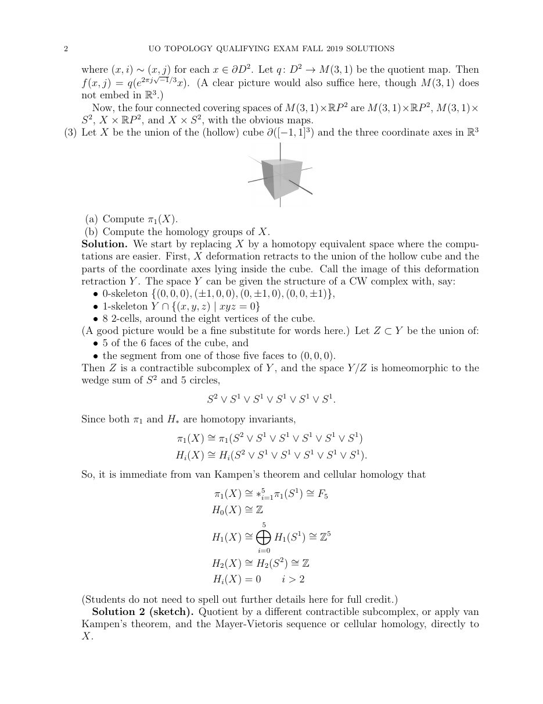

::: {.problem}
Let $X$ be the union of the hollow cube $\partial([-1,1]^3)$ and the three coordinate axes in $\RR^3$.

(a) Compute $\pi_1(X)$.

(b) Compute the homology groups of $X$.
:::

::: {.solution}

Let
\[
C=\partial([-1,1]^3).
\]
Thus \(C\cong S^2\).

::: pf

::: {.pf-step #s1-1}

The space \(X\) deformation retracts onto
\[
Y
=
C
\cup
\bigl(
[-1,1]\times\{0\}\times\{0\}
\bigr)
\cup
\bigl(
\{0\}\times[-1,1]\times\{0\}
\bigr)
\cup
\bigl(
\{0\}\times\{0\}\times[-1,1]
\bigr).
\]

::: pf-proof

Each of the six unbounded rays of the coordinate axes outside the cube meets
the cube boundary in one endpoint. Retract each such ray linearly toward that
endpoint, while fixing the cube boundary and the portions of the axes inside
the cube. The six retractions have disjoint interiors and fit together to a
deformation retraction of \(X\) onto \(Y\).

:::

:::

::: pf-step

The part of \(Y\) lying inside the cube is a tree \(T\) with one
central vertex and six leaves, and the six leaves are attached to six
distinct points of \(C\).

::: pf-proof

The three coordinate segments meet only at the origin. Removing the origin
leaves six open segments, one ending at each of the six face centers
\[
(\pm1,0,0),\quad
(0,\pm1,0),\quad
(0,0,\pm1).
\]
Thus the union of the three segments is a star-shaped tree with six leaves.

:::

:::

::: pf-step

Choose an embedded tree
\[
P\subset C
\]
whose vertex set contains the six attachment points of \(T\).

::: pf-proof

Because \(C\cong S^2\) is path connected, choose arcs in the cube boundary
joining the six face centers to one chosen face center, successively and
without introducing cycles. After a small perturbation, these arcs may be
taken to form an embedded finite tree. Subdivide the natural CW structure on
the cube boundary so that \(P\) is a subcomplex.

:::

:::

::: {.pf-step #s1-4}

The quotient map
\[
Y\longrightarrow Y/P
\]
is a homotopy equivalence.

::: pf-proof

The subcomplex \(P\) is a tree and hence contractible. The inclusion of a
CW subcomplex is a cofibration. Collapsing a contractible subcomplex of a CW
complex to a point is therefore a homotopy equivalence.

:::

:::

::: {.pf-step #s1-5}

In the quotient \(Y/P\), the sphere part is homotopy equivalent to
\[
S^2,
\]
and the image of \(T\) is a connected graph with first Betti number \(5\).

::: pf-proof

Collapsing the contractible tree \(P\subset C\cong S^2\) preserves the
homotopy type of the sphere, so
\[
C/P\simeq S^2.
\]

All six leaves of the star \(T\) lie in \(P\), so after collapsing \(P\)
they are identified to one point. Thus the image of \(T\) is a graph with
two vertices—the image of the six leaves and the original central
vertex—and six edges joining them. Its Euler characteristic is
\[
2-6=-4.
\]
For a connected graph,
\[
\chi=1-b_1,
\]
so
\[
b_1=5.
\]
Hence this graph is homotopy equivalent to a wedge of five circles.

:::

:::

::: {.pf-step #s1-6}

Consequently,
\[
\boxed{
X
\simeq
S^2
\vee
\bigvee_{j=1}^{5}S^1}.
\]

::: pf-proof

By step {.pf-ref},
\[
X\simeq Y.
\]
By step {.pf-ref},
\[
Y\simeq Y/P.
\]
In \(Y/P\), the sphere quotient and the graph from step {.pf-ref} meet at the
single point obtained by collapsing \(P\). Therefore their homotopy types
combine as a wedge:
\[
Y/P
\simeq
S^2
\vee
\bigvee_{j=1}^{5}S^1.
\]

:::

:::

::: {.pf-step #s1-7}

The fundamental group is
\[
\boxed{
\pi_1(X)
\cong
F_5},
\]
the free group on five generators.

::: pf-proof

The sphere \(S^2\) is simply connected. By van Kampen's theorem, the
fundamental group of a wedge of five circles is the free product of five
copies of \(\ZZ\), namely the free group \(F_5\). Apply the homotopy
equivalence from step {.pf-ref}.

:::

:::

::: {.pf-step #s1-8}

The zeroth homology is
\[
\boxed{H_0(X;\ZZ)\cong\ZZ}.
\]

::: pf-proof

The space in step {.pf-ref} is connected, so its zeroth singular homology is
\(\ZZ\).

:::

:::

::: pf-step

The first homology is
\[
\boxed{H_1(X;\ZZ)\cong\ZZ^5}.
\]

::: pf-proof

Reduced homology of a wedge is the direct sum of the reduced homologies of
the wedge summands. The five circles each contribute one copy of
\(\ZZ\) in degree \(1\), while \(S^2\) contributes none.

:::

:::

::: pf-step

The second homology is
\[
\boxed{H_2(X;\ZZ)\cong\ZZ}.
\]

::: pf-proof

In degree \(2\), only the \(S^2\) summand in step {.pf-ref} contributes, giving
one copy of \(\ZZ\).

:::

:::

::: {.pf-step #s1-11}

For every \(k>2\),
\[
\boxed{H_k(X;\ZZ)=0}.
\]

::: pf-proof

Neither \(S^2\) nor \(S^1\) has homology in degrees above \(2\), and wedge
homology is the direct sum of the reduced homologies of the summands.

:::

:::

::: {.pf-step #s1-12}

Thus
\[
\boxed{
H_k(X;\ZZ)
\cong
\begin{cases}
\ZZ,&k=0,\\
\ZZ^5,&k=1,\\
\ZZ,&k=2,\\
0,&k>2.
\end{cases}}
\]

::: pf-proof

Combine steps {.pf-ref} through {.pf-ref}.

:::

:::

::: pf-qed

Step {.pf-ref} answers part (a), and step {.pf-ref} answers part (b).

:::

:::

:::
