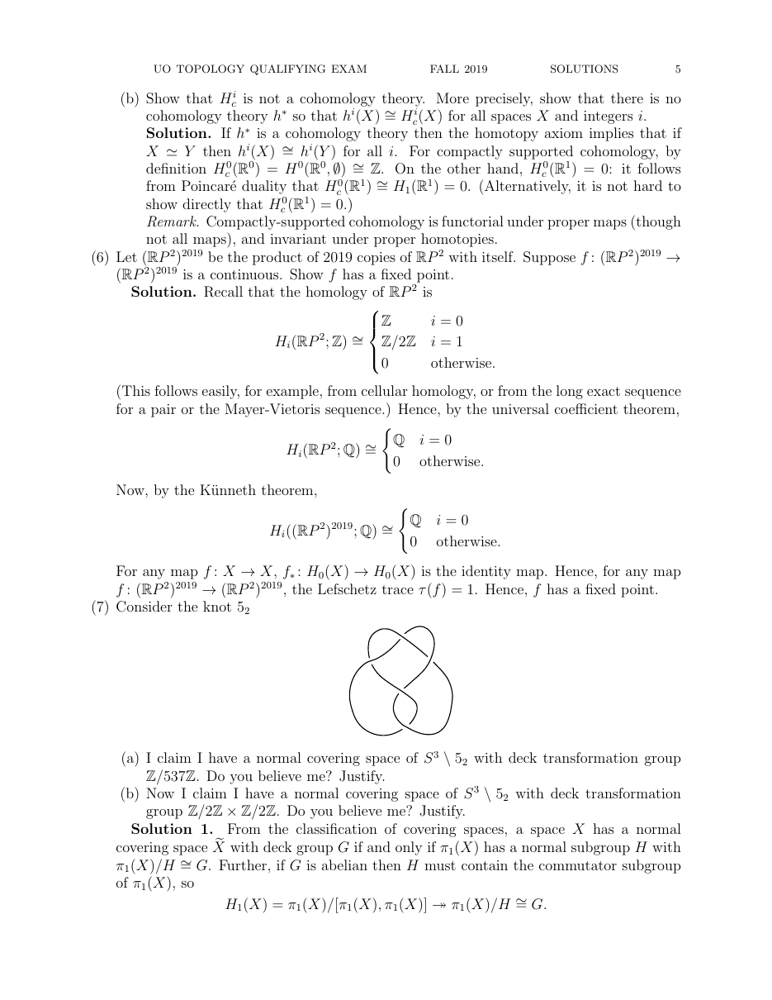

::: {.problem}
Consider the knot $5_2$.

(a) I claim I have a normal covering space of $S^3\setminus 5_2$ with deck transformation group $\ZZ/537\ZZ$. Do you believe me? Justify.

(b) Now I claim I have a normal covering space of $S^3\setminus 5_2$ with deck transformation group $\ZZ/2\ZZ\times\ZZ/2\ZZ$. Do you believe me? Justify.
:::

::: {.solution}

Let
$$
X=S^3\setminus 5_2.
$$

::: pf

::: {.pf-step #s1-1}

A connected normal covering of $X$ with deck transformation group
$G$ exists if and only if there is a normal subgroup
$$
N\trianglelefteq\pi_1(X)
$$
such that
$$
\boxed{\pi_1(X)/N\cong G}.
$$

::: pf-proof

By the classification of connected covering spaces, connected covers
correspond to conjugacy classes of subgroups of $\pi_1(X)$. A cover is
normal exactly when the corresponding subgroup is normal, and for a normal
cover the deck group is the quotient of $\pi_1(X)$ by that normal
subgroup.

:::

:::

::: {.pf-step #s1-2}

If $G$ is abelian and
$$
\pi_1(X)\twoheadrightarrow G,
$$
then this surjection factors through
$$
H_1(X;\ZZ)
\cong
\pi_1(X)_{\mathrm{ab}}.
$$

::: pf-proof

Every homomorphism from a group to an abelian group kills the commutator
subgroup. Thus if
$$
\varphi:\pi_1(X)\to G
$$
is a homomorphism with $G$ abelian, then
$$
[\pi_1(X),\pi_1(X)]
\subseteq
\ker\varphi,
$$
so $\varphi$ factors uniquely through the abelianization.

:::

:::

::: {.pf-step #s1-3}

Conversely, if
$$
H_1(X;\ZZ)\twoheadrightarrow G
$$
for an abelian group $G$, then $X$ has a connected normal covering with
deck group $G$.

::: pf-proof

Compose the abelianization map
$$
\pi_1(X)\twoheadrightarrow H_1(X;\ZZ)
$$
with the given surjection onto $G$. The composite
$$
\pi_1(X)\twoheadrightarrow G
$$
has normal kernel $N$, and
$$
\pi_1(X)/N\cong G.
$$
Apply step {.pf-ref}.

:::

:::

::: {.pf-step #s1-4}

One has
$$
\boxed{
H_1(S^3\setminus 5_2;\ZZ)
\cong
\ZZ}.
$$

::: pf-proof

Alexander duality for the knot
$$
5_2\cong S^1\subset S^3
$$
gives
$$
\widetilde H_i(S^3\setminus 5_2;\ZZ)
\cong
\widetilde H^{2-i}(S^1;\ZZ).
$$
For $i=1$,
$$
\widetilde H_1(S^3\setminus 5_2)
\cong
\widetilde H^1(S^1)
\cong
\ZZ.
$$
Since $H_1$ is already reduced in positive degree, the claim follows.

:::

:::

::: {.pf-step #s1-5}

There is a surjection
$$
\ZZ\twoheadrightarrow\ZZ/537\ZZ.
$$

::: pf-proof

Take reduction modulo $537$:
$$
n\longmapsto[n]_{537}.
$$
This is surjective.

:::

:::

::: {.pf-step #s1-6}

Therefore
$$
\boxed{\text{yes, such a normal cover with deck group }\ZZ/537\ZZ\text{ exists}.}
$$

::: pf-proof

Combine steps {.pf-ref} and {.pf-ref}, and {.pf-ref}.

:::

:::

::: {.pf-step #s1-7}

There is no surjection
$$
\ZZ\twoheadrightarrow
\ZZ/2\ZZ\times\ZZ/2\ZZ.
$$

::: pf-proof

Every quotient of the cyclic group $\ZZ$ is cyclic. The group
$$
\ZZ/2\ZZ\times\ZZ/2\ZZ
$$
is not cyclic: every nonzero element has order $2$, so no single element
generates all four elements.

:::

:::

::: {.pf-step #s1-8}

Therefore
$$
\boxed{
\text{no normal cover with deck group }
\ZZ/2\ZZ\times\ZZ/2\ZZ
\text{ exists}.}
$$

::: pf-proof

If such a normal cover existed, steps {.pf-ref} and {.pf-ref} would produce a
surjection
$$
H_1(X;\ZZ)\cong\ZZ
\twoheadrightarrow
\ZZ/2\ZZ\times\ZZ/2\ZZ,
$$
contradicting step {.pf-ref}.

:::

:::

::: pf-qed

Step {.pf-ref} answers part (a), and step {.pf-ref} answers part (b).

:::

:::

:::
