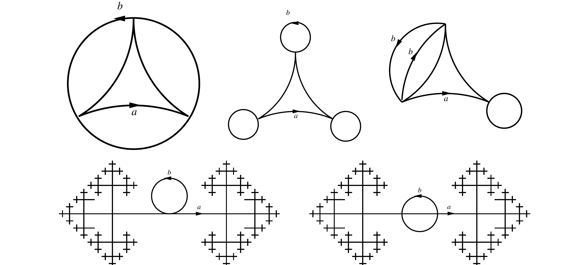

::: {.problem}
Let $W=S^1\vee S^1$ and identify $\pi_1(W)=F_2=\langle a,b\rangle$ in the usual way.

(a) For each of the following pictures of a cover of $S^1\vee S^1$, write down generators for their corresponding subgroups in the free group $\langle a,b\rangle$.

(b) Conversely, for each of the following subgroups of $\langle a,b\rangle$, draw the corresponding cover:
$$
\langle a^2,b^2,(ab)^2\rangle\qquad
\langle a^2,b^2,aba^{-1},bab^{-1}\rangle\qquad
\langle a,b^3\rangle\qquad
\langle\{a^mb^na^{-m}b^{-n}:\forall m,n\}\rangle\qquad
\langle\{a^{2m}b^{2n}a^{-2m}b^{-2n}:\forall m,n\}\rangle .
$$

Problem 8 of the same sheet asks, for $H$ generated by all commutators $xyx^{-1}y^{-1}$ with $x,y\in F_2$, for the covering space corresponding to $H$; its cover is described on the card for that problem, `P-UCTOP290-S4-7`.
:::

::: {.solution}
The collection's provenance is the retained UCSD Math 290 sheet 4 (Problem 7), whose figures are the statement, plus the retained worked notebook whose five lists are matched below. The reading of the five figures is the card's own, taken from the rendering at `assets/Topology/figures/ucsd_290_f14_sheet4_problem7.png`; the group theory below is checked word by word in $F_2=\langle a,b\rangle$, and every identity used is an exact cancellation, not a resemblance.

::: pf

::: {.pf-step #dictionary}
Let $\Gamma$ be a connected graph whose edges are labelled $a$ or $b$ and oriented, with exactly one incoming and one outgoing edge of each label at every vertex. Then $\Gamma\to W=S^1\vee S^1$ is a covering, and for a vertex $v$ the image $\pi_1(\Gamma,v)\le F_2$ is generated by the words read along the edges outside a spanning tree; changing $v$ replaces the subgroup by a conjugate.

::: pf-proof
The label-and-orientation condition is exactly the covering condition for the standard cover $W$ with one vertex and one $a$-loop and one $b$-loop: lifting a small neighbourhood of the base point means choosing, at each vertex, the incoming and outgoing $a$-edge and the incoming and outgoing $b$-edge. A spanning tree $T$ of $\Gamma$ is contractible, so $\Gamma$ deformation retracts onto the quotient with one vertex and one loop per edge outside $T$; the words these loops spell, read from $v$ along $T$, generate $\pi_1(\Gamma,v)$, and their images generate the subgroup. A different basepoint gives the conjugate by the word of the path between the two vertices.
:::

:::

::: {.pf-step #rank}
If $\Gamma$ is finite, connected, with $V$ vertices and $E$ edges, then $\operatorname{rank}\pi_1(\Gamma)=1-V+E$; for a $k$-sheeted cover of $W$ this is $1+k$. If $\Gamma$ is infinite this integer is not defined, and the rank is the number of edges outside a maximal forest.

::: pf-proof
A spanning tree has $V-1$ edges, and the remaining $E-V+1$ edges give a free basis of $\pi_1(\Gamma)$. For a $k$-sheeted cover $E=2k$ (two edges at each of the $k$ vertices) and $V=k$, so the rank is $1-k+2k=1+k$. On an infinite graph a maximal forest still exists (Zorn) and the remaining edges still form a free basis, but $V$ and $E$ are not finite, so no integer formula applies.
:::

:::

::: {.pf-step #p1}
Picture 1 has three vertices $T,L,R$ with $a$-edges $L\to R\to T\to L$ and $b$-edges $T\to L\to R\to T$; at $T$ it gives $\langle a^3,\ ba^{-1},\ aba^{-2},\ a^2b\rangle$.

::: pf-proof
Both labels act by the same $3$-cycle, so the covering is $3$-sheeted and its subgroup has index $3$ and, by step {.pf-ref}, rank $1+3=4$. Take the tree to be the $a$-edges $T\to L$, $L\to R$; the four non-tree edges are $R\xrightarrow{a}T$, $T\xrightarrow{b}L$, $L\xrightarrow{b}R$, $R\xrightarrow{b}T$. Reading each as a loop based at $T$ through the tree gives $a^3$, $ba^{-1}$, $aba^{-2}$ and $a^2b$ respectively. Explicitly, with tree paths $T\to L$ labelled $a$ and $L\to R$ labelled $a$, so that $t(T)=\epsilon$, $t(L)=a$, $t(R)=a^2$: the $a$-edge $R\to T$ gives $t(R)a\,t(T)^{-1}=a^3$; the $b$-edge $T\to L$ gives $t(T)b\,t(L)^{-1}=ba^{-1}$; the $b$-edge $L\to R$ gives $t(L)b\,t(R)^{-1}=aba^{-2}$; and the $b$-edge $R\to T$ gives $t(R)b\,t(T)^{-1}=a^2b$. Each is a loop at $T$, as it must be.
:::

:::

::: {.pf-step #p2}
Picture 2 has $a$-edges the $3$-cycle $T\to L\to R\to T$ and a $b$-loop at each vertex; at $T$ it gives $\langle a^3,\ b,\ aba^{-1},\ a^2ba^{-2}\rangle$.

::: pf-proof
Again $3$-sheeted, so index $3$ and rank $4$. With the tree $T\xrightarrow{a}L\xrightarrow{a}R$, the non-tree edges are $R\xrightarrow{a}T$ (giving $a^3$), the three $b$-loops (giving $b$ at $T$, $aba^{-1}$ at $L$ and $a^2ba^{-2}$ at $R$), each read from $T$ along the tree.
:::

:::

::: {.pf-step #p3}
Picture 3 has $a$-edges the $3$-cycle $P\to L\to R\to P$ and $b$-edges $P\to L$, $L\to P$, together with a $b$-loop at $R$; at $L$ it gives $\langle a^3,\ a^2b,\ ba^{-2},\ aba^{-1}\rangle$.

::: pf-proof
Here $b$ interchanges $P$ and $L$ and fixes $R$, so again $3$-sheeted, index $3$, rank $4$. With the tree $L\xrightarrow{a}R\xrightarrow{a}P$ the non-tree edges give $a^3$ (the $a$-edge $P\to L$), $a^2b$ (the $b$-edge $P\to L$), $ba^{-2}$ (the $b$-edge $L\to P$, whose return along the tree spells $a^{-2}$) and $aba^{-1}$ (the $b$-loop at $R$: out along $L\to R$, round the loop, back along $R\to L$).
:::

:::

::: {.pf-step #p4}
Picture 4 is an infinite $a$-line with a single $b$-loop at one vertex, and its subgroup is $\langle b\rangle$.

::: pf-proof
The $a$-line is a maximal forest (it contains every vertex), so the only non-forest edge is the $b$-loop, and by step {.pf-ref} the subgroup is generated by $b$ alone. Its rank is $1$ and its index in $F_2$ is infinite, as step {.pf-ref} says must happen for an infinite cover.
:::

:::

::: {.pf-step #p5}
Picture 5 is an infinite $a$-line with two consecutive vertices $\alpha\to\beta$ joined by a $b$-edge in each direction, and at $\beta$ its subgroup is $\langle ba,\ b^{-1}a\rangle=\langle ba,\ a^{-1}b\rangle$.

::: pf-proof
The $a$-line is a maximal forest, and the two $b$-edges are the non-forest edges. Read from $\beta$: the $b$-edge $\beta\to\alpha$ followed by the tree path $\alpha\to\beta$ (one $a$-edge) gives $ba$; the $b$-edge $\alpha\to\beta$ preceded by the tree path $\beta\to\alpha$ gives $a^{-1}b$. Since $a^{-1}b=(b^{-1}a)^{-1}$, the subgroup is $\langle ba,\ b^{-1}a\rangle$, free of rank $2$.
:::

:::

::: {.pf-step #match}
The five computed subgroups equal the five lists of the retained notebook, in order: $\langle ab^{-1},aba^{-2},a^3b^{-1}a^{-2},a^3\rangle$, $\langle b,aba^{-1},a^2ba^{-2},a^3\rangle$, $\langle b^2,ba,a^3,aba^{-1}\rangle$, $\langle b\rangle$ and $\langle ba,b^{-1}a\rangle$.

::: pf-proof
Picture 1: writing $K=\langle a^3,ba^{-1},aba^{-2},a^2b\rangle$ and $R_1=\langle ab^{-1},aba^{-2},a^3b^{-1}a^{-2},a^3\rangle$, the identities $a^3\in R_1$, $aba^{-2}\in R_1$, $ba^{-1}=(ab^{-1})^{-1}\in R_1$ and $a^2b=(a^3b^{-1}a^{-2})^{-1}a^3\in R_1$ give $K\subseteq R_1$, while $a^3,aba^{-2},ab^{-1}=(ba^{-1})^{-1},a^3b^{-1}a^{-2}=a^3(a^2b)^{-1}$ all lie in $K$, giving $R_1\subseteq K$.
Picture 2: the four generators $a^3,b,aba^{-1},a^2ba^{-2}$ are those of the retained second list, listed in another order.
Picture 3: with $g_1=a^3$, $g_2=a^2b$, $g_3=ba^{-2}$, $g_4=aba^{-1}$ and $h_1=b^2$, $h_2=ba$, $h_3=a^3$, $h_4=aba^{-1}$, the identities $b^2=g_3g_2$, $ba=g_3g_1$, $a^3=g_1$, $aba^{-1}=g_4$ give $R_3\subseteq S$ and $g_3=h_2h_3^{-1}$, $g_2=h_3h_2^{-1}h_1$, $g_1=h_3$, $g_4=h_4$ give $S\subseteq R_3$. As a check on the tree computation, the four tree-based generators of this cover are $ba$, $a^2b^{-1}$, $b^2$ and $aba^{-1}$, and each is a word in the card's four: $ba=g_3g_1$, $b^2=g_3g_2$, $aba^{-1}=g_4$ and $a^2b^{-1}=a^2b\,(b^2)^{-1}=g_2(g_3g_2)^{-1}=g_3^{-1}$.
Pictures 4 and 5: the retained fourth list is $\langle b\rangle$ and the fifth is $\langle ba,b^{-1}a\rangle$, identical to steps {.pf-ref} and {.pf-ref}.
:::

:::

::: {.pf-step}
The fifth picture's subgroup has rank $2$ and is therefore not conjugate to $\langle b\rangle$, which has rank $1$; and part (b) is not re-derived here.

::: pf-proof
Conjugacy preserves the rank of a free subgroup, so picture 5 is not a conjugate of picture 4: the retained notebook's assignment of $\langle b\rangle$ to both infinite pictures is corrected here, and the corresponding correction on `P-UCTOP290-S4-7` is recorded there. For part (b), the five printed subgroups are as displayed in the statement; the covers they correspond to are drawn on `P-UCTOP290-S4-7`, which solves that half, and no index or rank for them is asserted on this card.
:::

:::

:::
:::
