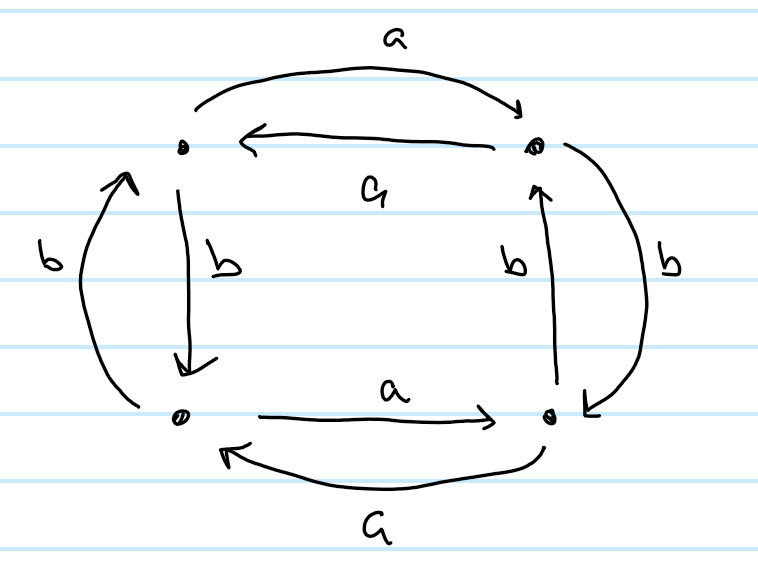
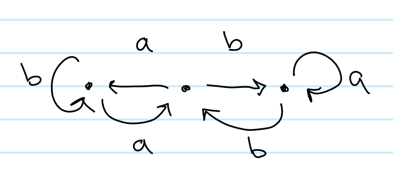
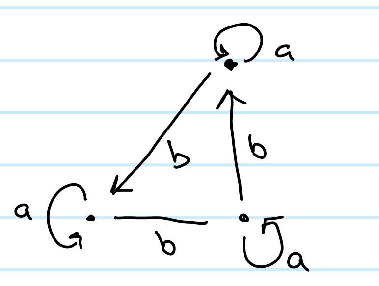
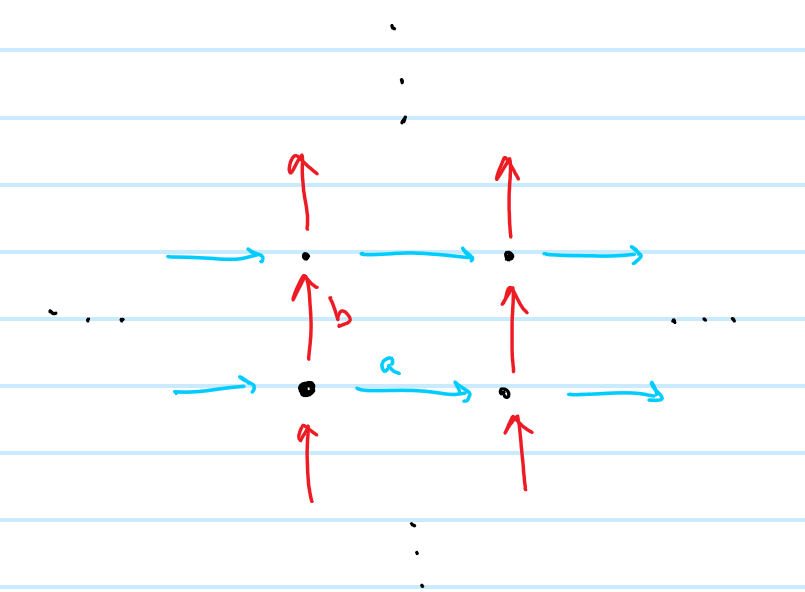
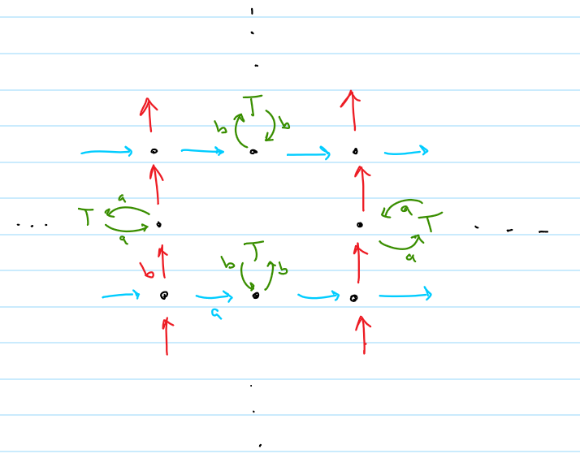

::: {.problem}
Let $W=S^1\vee S^1$ and identify $\pi_1(W)=F_2=\langle a,b\rangle$ in the usual way.

For each of the following pictures of a cover of $S^1\vee S^1$, write down generators for the corresponding subgroup of the free group $\langle a,b\rangle$.

The five pictures as they appear in the retained solutions to the same sheet:

1. 

2. 

3. 

4. 

5. 
:::

::: {.solution}
Fix a lifting of the basepoint of $W$ to a vertex $v$ of a covering graph $\Gamma$. Then $\pi_1(\Gamma,v)$ is identified with a subgroup $H\le F_2$, and

$$
H\cong\pi_1(\Gamma,v)
$$

is free of rank $1-V+E$, where $V$ and $E$ are the numbers of vertices and edges of $\Gamma$: a spanning tree of $\Gamma$ is contractible, and each of the remaining $E-(V-1)$ edges closes up a loop giving one free generator. Concretely, an edge outside the chosen spanning tree contributes the word read off along the tree path to its initial vertex, the edge itself, and the tree path back from its terminal vertex. Its label, $a$ or $b$, is its letter. Changing the lifted basepoint from $v$ to another vertex replaces $H$ by a conjugate $wHw^{-1}$, so the pictures determine $H$ up to conjugacy unless a basepoint is marked.

Applying this to the five pictures gives the following generators:

$$
\begin{aligned}
&\langle ab^{-1},\ aba^{-2},\ a^3b^{-1}a^{-2},\ a^3\rangle,\\
&\langle b,\ aba^{-1},\ a^2ba^{-2},\ a^3\rangle,\\
&\langle b^2,\ ba,\ a^3,\ aba^{-1}\rangle,\\
&\langle b\rangle,\\
&\langle ba,\ b^{-1}a\rangle.
\end{aligned}
$$

The list above is the one recorded in the retained solutions to this sheet. Three of these subgroups have finite index and two do not, matching the three finite covers and the two infinite covers drawn, but the assignment of a list to a particular picture is not settled here: see the audit events.
:::
