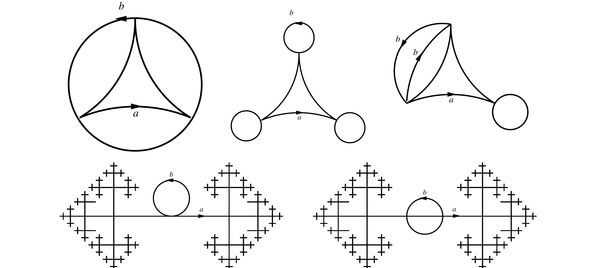

::: {.problem}
Let $W=S^1\vee S^1$ and identify $\pi_1(W)=F_2=\langle a,b\rangle$ in the usual way.

(a) For each of the following pictures of a cover of $S^1\vee S^1$, write down generators for their corresponding subgroups in the free group $\langle a,b\rangle$.

(b) Conversely, for each of the following subgroups of $\langle a,b\rangle$, draw the corresponding cover:
$$
\langle a^2,b^2,(ab)^2\rangle\qquad
\langle a^2,b^2,aba^{-1},bab^{-1}\rangle\qquad
\langle a,b^3\rangle\qquad
\langle\{a^mb^na^{-m}b^{-n}:\forall m,n\}\rangle\qquad
\langle\{a^{2m}b^{2n}a^{-2m}b^{-2n}:\forall m,n\}\rangle .
$$

Problem 8 of the same sheet asks, for $H$ generated by all commutators $xyx^{-1}y^{-1}$ with $x,y\in F_2$, for the covering space corresponding to $H$; its cover is described on the card for that problem, `P-UCTOP290-S4-7`.
:::

::: {.solution}
Let $\Gamma$ be a connected graph covering $W$, with its edges labelled $a$ or $b$ and oriented: the edge labelled $a$ and directed from $u$ to $v$ covers the $a$-loop of $W$ by a homeomorphism onto that loop, and at every vertex of $\Gamma$ there is exactly one incoming and one outgoing edge of each label.

**Basepoints and conjugacy.** A subgroup is an invariant of the cover together with a choice of vertex over the basepoint of $W$: the edges of $\Gamma$ then give a free basis of $\pi_1(\Gamma,v)\cong H\le F_2$, and moving $v$ replaces $H$ by a conjugate. The printed pictures mark no basepoint, so each picture determines its subgroup only up to conjugacy. Below, a basepoint is named for each picture and the basis is computed for it; where a picture is matched to a fixed list of generators, that list is the list for the named basepoint.

**Rank, and the scope of $1-V+E$.** A spanning forest of $\Gamma$ is contractible, so $\pi_1(\Gamma,v)$ is free on the edges outside it. When $\Gamma$ is **finite** with $V$ vertices and $E$ edges this is the integer
$$
\operatorname{rank}\pi_1(\Gamma)=1-V+E ,
$$
and a $k$-sheeted cover of a wedge of $r$ circles has $\operatorname{rank}=1+k(r-1)$. For the figure-eight $W$ of this problem $r=2$, so that formula specialises to $1+k$; the equality $1+k(r-1)=1+k$ is thus a statement about $r=2$ only, not about arbitrary $r$. When $\Gamma$ is **infinite** there is no integer formula: $\pi_1(\Gamma)$ is still free on the non-forest edges, but $1-V+E$ is not defined, and such a subgroup has infinite index however few non-forest edges there are. Both infinite pictures below are of this kind: in the order they are listed, the fourth has one non-forest edge and the fifth has two.

**The five covers.** For the first three pictures write $T,L,R$ for the top, lower-left and lower-right vertices.

1. $a$-edges $L\to R\to T\to L$ and $b$-edges $T\to L\to R\to T$: the same $3$-cycle, so $a$ and $b$ act by the same permutation. At $T$, with the spanning tree the $a$-edges $T\to L$, $L\to R$, the non-forest edges are $R\xrightarrow{a}T$, $T\xrightarrow{b}L$, $L\xrightarrow{b}R$, $R\xrightarrow{b}T$ and give
$$
\langle a^3,\ ba^{-1},\ aba^{-2},\ a^2b\rangle .
$$
2. $a$-edges the $3$-cycle $T\to L\to R\to T$, and a $b$-loop at each vertex. At $T$, the tree being $T\xrightarrow{a}L\xrightarrow{a}R$:
$$
\langle a^3,\ b,\ aba^{-1},\ a^2ba^{-2}\rangle .
$$
3. $a$-edges the $3$-cycle $P\to L\to R\to P$; $b$-edges $P\to L$, $L\to P$ and a $b$-loop at $R$. So $b$ interchanges $P$ and $L$ and fixes $R$. At $L$, with the tree $L\xrightarrow{a}R\xrightarrow{a}P$:
$$
\langle a^3,\ a^2b,\ ba^{-2},\ aba^{-1}\rangle .
$$
At the other natural choice, the $b$-fixed vertex $R$, the basis is $\langle a^3,\ aba^{-2},\ a^2ba^{-1},\ b\rangle$, which is a conjugate.
4. An infinite $a$-line with one $b$-loop at a vertex. At that vertex the line is a spanning tree and the loop is the only non-forest edge:
$$
\langle b\rangle .
$$
5. An infinite $a$-line, with two consecutive vertices $\alpha\to\beta$ of it joined by one $b$-edge in each direction. At $\beta$ the line is a spanning tree and the two $b$-edges are the only non-forest edges, giving the free basis
$$
a^{-1}b\quad\text{and}\quad ba ,
\qquad\text{that is}\qquad
\langle ba,\ b^{-1}a\rangle ,
$$
since $a^{-1}b=(b^{-1}a)^{-1}$.

The first three covers are $3$-sheeted, so their subgroups have index $3$ and rank $1+3=4$, matching the four-element bases. The last two have infinite index and rank $1$ and $2$ respectively, as computed for the fourth and fifth covers.

**Matching the five lists in the retained solutions.** The retained notebook gives five lists under "Generators of the subgroups", and the sheet's own solutions pair them with these five pictures in this order. Each pairing is now an identity of subgroups at the basepoint named above, not a resemblance.

Picture 1: the subgroup $K=\langle a^3,ba^{-1},aba^{-2},a^2b\rangle$ equals the retained first list $R_1=\langle ab^{-1},\,aba^{-2},\,a^3b^{-1}a^{-2},\,a^3\rangle$. Both containments are witnessed by exact word identities:
$$
a^3\in R_1,\qquad
aba^{-2}\in R_1,\qquad
ba^{-1}=(ab^{-1})^{-1}\in R_1,\qquad
a^2b=(a^3b^{-1}a^{-2})^{-1}a^3\in R_1,
$$
so $K\subseteq R_1$; and
$$
a^3\in K,\qquad
aba^{-2}\in K,\qquad
ab^{-1}=(ba^{-1})^{-1}\in K,\qquad
a^3b^{-1}a^{-2}=a^3\,(a^2b)^{-1}\in K,
$$
so $R_1\subseteq K$. Hence $K=R_1$. (The last identity is immediate: $a^3(a^2b)^{-1}=a^3b^{-1}a^{-2}$.)

Picture 2: the retained second list is $\langle b,\ aba^{-1},\ a^2ba^{-2},\ a^3\rangle$, the same four generators as above in a different order, so the subgroups are equal by inspection.

Picture 3: the subgroup $S=\langle a^3,\,a^2b,\,ba^{-2},\,aba^{-1}\rangle$ equals the retained third list $R_3=\langle b^2,\,ba,\,a^3,\,aba^{-1}\rangle$. Writing $g_1=a^3$, $g_2=a^2b$, $g_3=ba^{-2}$, $g_4=aba^{-1}$ and $h_1=b^2$, $h_2=ba$, $h_3=a^3$, $h_4=aba^{-1}$, the identities
$$
b^2=g_3g_2,\qquad ba=g_3g_1,\qquad a^3=g_1,\qquad aba^{-1}=g_4
$$
give $R_3\subseteq S$, and
$$
g_3=h_2h_3^{-1},\qquad g_2=h_3h_2^{-1}h_1,\qquad g_1=h_3,\qquad g_4=h_4
$$
give $S\subseteq R_3$. Hence $S=R_3$.

Picture 4: the retained fourth list is $\langle b\rangle$, the basis computed above.

Picture 5: the retained fifth list is $\langle ba,\,b^{-1}a\rangle$, and the basis computed at $\beta$ is $\langle ba,\,a^{-1}b\rangle$; these are equal because $a^{-1}b=(b^{-1}a)^{-1}$.

So the five pictures correspond to the five retained lists in order, and the correspondence is proved at the stated basepoints. Consequently the fifth picture's subgroup has rank $2$ and is not conjugate to $\langle b\rangle$.

**The other card on this problem.** `P-UCTOP290-S4-7` answers the same printed Problem 7, and its first three bases agree with pictures 1, 2 and 3 above at the basepoints named there. Its treatment of the fifth picture was wrong — it assigned $\langle b\rangle$ up to conjugacy to both infinite pictures, which holds only for the fourth, since the fifth's subgroup has rank $2$ and rank is a conjugacy invariant. That card has been corrected in the same pass, so nothing here rests on it in its uncorrected state.

For part (b), the five printed subgroups are as displayed; the covers corresponding to them are drawn on `P-UCTOP290-S4-7`, which solves that half. They are not re-derived here, and no index or rank is asserted for them on this card.
:::
