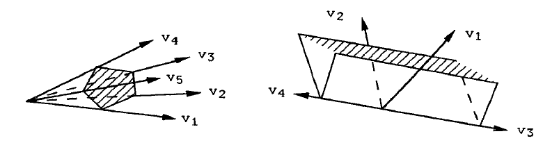

::: {.definition title="The lattices"}
For the torus $T = \GG_m^n$, the \dfn{character lattice} is $M = \Hom(T, \GG_m) \cong \ZZ^n$, with $\chi^m(t) = \prod t_i^{m_i}$, and the \dfn{cocharacter lattice} is $N = \Hom(\GG_m, T)$.
The pairing $\inner{m}{u}$ is the integer $\ell$ with $\chi^m \circ \lambda^u : t \mapsto t^\ell$.
:::

::: {.definition title="Cones and fans"}
A cone $\sigma \subseteq N_\RR$ is \dfn{strongly convex rational polyhedral} if it is generated by finitely many lattice vectors and contains no line.
Its dual is $\dualof{\sigma} = \theset{m \in M_\RR \st \inner{m}{u} \geq 0 \text{ for all } u \in \sigma}$.
A \dfn{fan} $\Sigma$ is a finite collection of such cones closed under faces, in which any two cones meet in a face of each.
:::

::: {.example title="Cones with many edges"}
A cone in $\RR^3$ can have any number of edges; the cross-sections in the figure have five edges $v_1, \ldots, v_5$ and four edges $v_1, \ldots, v_4$.

{width=550px}
:::

::: {.definition title="The variety"}
Let $k$ be a field and let $\Sigma$ be a fan in $N_\RR$.
For $\sigma \in \Sigma$, put
$$
S_\sigma \coloneqq \dualof{\sigma} \intersect M, \qquad U_\sigma \coloneqq \Spec k[S_\sigma] .
$$
The \dfn{toric variety} $X_\Sigma$ of $\Sigma$ is obtained by gluing $U_\sigma$ and $U_\tau$ along $U_{\sigma \intersect \tau}$ for all $\sigma, \tau \in \Sigma$.
:::

::: {.example title="The projective line"}
The fan $\theset{\RR_{\geq 0}, \theset{0}, \RR_{\leq 0}}$ in $N_\RR = \RR$ gives two copies of $\AA^1_k$ glued along $\GG_{m,k}$ by $x \mapsto x^{-1}$:

\begin{tikzcd}
	{k[x^{-1}]} & {k[x, x^{-1}]} & {k[x]} \\
	{\AA^1_k} & {\GG_{m,k}} & {\AA^1_k}
	\arrow[hook, from=1-1, to=1-2]
	\arrow[hook', from=1-3, to=1-2]
	\arrow[hook', from=2-2, to=2-1]
	\arrow[hook, from=2-2, to=2-3]
\end{tikzcd}

so $X_\Sigma = \PP^1$.
:::

::: {.remark}
By Gordan's lemma, $S_\sigma$ is a finitely generated semigroup, so $k[S_\sigma]$ is a finitely generated algebra and $U_\sigma$ is an affine variety.

The cone $\theset{0}$ gives the torus itself, the cone spanned by a basis gives $\AA^n$, and the fan of $\PP^n$ has rays $e_1,\ldots,e_n$ and $-\sum e_i$.
For $d\geq1$, the cone spanned by $(0,1)$ and $(d,-1)$ gives the affine cone over the rational normal curve of degree $d$.
:::
