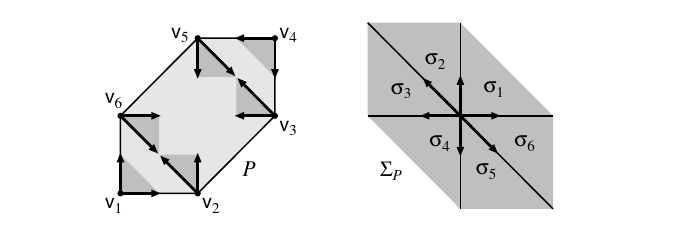

::: {.definition title="Faces"}
Let $P \subseteq M_\RR$ be a lattice polytope.
A \dfn{face} is a slice by a supporting affine hyperplane,
$$
F = P \intersect \theset{m \in M_\RR \st \inner{m}{u} = r}, \qquad \inner{m}{u} \geq r \text{ on } P ,
$$
for some $u \in N$ and $r \in \RR$.
The \dfn{facets} are the faces of codimension one, and $P$ has the facet presentation
$$
P = \theset{ m \in M_\RR \st \inner{m}{u_F} \geq -a_F \text{ for every facet } F } ,
$$
where $u_F \in N$ is the primitive inward normal to $F$.
:::

::: {.definition title="The normal fan"}
For a face $F \leq P$ set
$$
\sigma_F = \Cone\big( u_F' \st F \leq F',\ F' \text{ a facet} \big) \subseteq N_\RR .
$$
These cones form the \dfn{normal fan} $\Sigma_P$, and $X_P \coloneqq X_{\Sigma_P}$.
Vertices of $P$ give the maximal cones, facets of $P$ give the rays, and the whole poset is reversed.
The vertex $m_i$ corresponds to the maximal cone $\sigma_i = \dualof{\Cone(P \cap M - m_i)}$.
:::

::: {.definition title="Combinatorial equivalence"}
Polytopes $P_1$ and $P_2$ are \dfn{combinatorially equivalent} if there is a bijection between their faces that preserves inclusions, intersections and dimensions of faces.
:::

::: {.example title="A hexagon"}
For the hexagon $P$ with vertices $v_1, \ldots, v_6$, the cone of directions out of each vertex $v_i$ is dual to the maximal cone $\sigma_i$ of the normal fan $\Sigma_P$, which has six maximal cones.

{width=550px}
:::

::: {.remark title="Descriptions of $X_P$"}
Let $P$ be a full-dimensional lattice polytope.

1. $X_P$ is the toric variety of the normal fan $\Sigma_P$.

2. If $0\in\operatorname{int}P$, define
   $$
   P^\circ
   \coloneqq
   \theset{
   u\in N_\RR
   \st
   \inner{m}{u}\geq-1
   \text{ for every }m\in P
   }.
   $$
   Then $P^\circ$ is a rational polytope and $\Sigma_P$ is the fan of cones over its proper faces.

3. A direct affine cover indexed by the vertices:
   $$
   X_P
   =
   \Union_{v\in\operatorname{Vert}(P)}
   \Spec k[\Cone(P-v)\intersect M].
   $$
   Here $\Cone(P-v)\subseteq M_\RR$ is the cone of directions out of the vertex $v$, dual to the maximal normal cone $\sigma_v\subseteq N_\RR$.

The direct gluing description realizes explicitly what the normal-fan and polar-dual descriptions encode combinatorially.
:::

::: {.remark}
$X_P$ carries the ample divisor $D_P$ of [[D-TORQD]], so every $X_P$ is projective.
Conversely, a complete fan need not be the normal fan of a polytope, and a complete toric variety need not be projective.
:::
