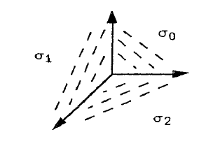
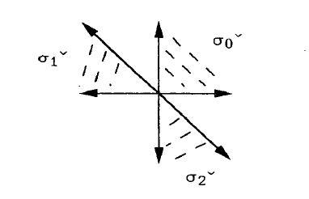

::: {.example title="The fan"}
Let $N = \ZZ^2$. The rays generated by $u_1 = e_1$, $u_2 = e_2$, and $u_0 = -e_1 - e_2$, together with the three two-dimensional cones spanned by consecutive pairs, form a complete fan $\Sigma$.
Each maximal cone is smooth, so $X_\Sigma\cong\PP^2$ is smooth and complete.

{width=250px}
:::

::: {.example title="The charts"}
Let $\sigma_0 = \Cone(e_1, e_2)$, $\sigma_1 = \Cone(e_2, -e_1-e_2)$, $\sigma_2 = \Cone(-e_1-e_2, e_1)$.
Their duals are

{width=300px}

and each $U_{\sigma_i} \cong \CC^2$, with coordinates
$$
U_{\sigma_0} : (x, y), \qquad U_{\sigma_1} : (x^{-1}, x^{-1}y), \qquad U_{\sigma_2} : (y^{-1}, xy^{-1}) .
$$
Setting $x = t_1/t_0$ and $y = t_2/t_0$ identifies $U_{\sigma_i}$ with the standard chart $\theset{t_i \neq 0}$ of $\PP^2$, and the gluings agree.
:::

::: {.example title="Class group"}
The map $M \to \ZZ^3$ is $m \mapsto (\inner{m}{u_1}, \inner{m}{u_2}, \inner{m}{u_0})$, with matrix rows $(1,0), (0,1), (-1,-1)$.
The image is generated by $(1,0,-1)$ and $(0,1,-1)$, which is the kernel of the sum map $(a_1,a_2,a_0)\mapsto a_1+a_2+a_0$. Hence the sum map induces an isomorphism from the cokernel to $\ZZ$.
Thus $\Cl(\PP^2)\cong\ZZ$ and $D_1\sim D_2\sim D_0$. Writing $H$ for their common divisor class, each $D_i$ is a coordinate line of class $H$.
:::

::: {.example title="Anticanonical polytope"}
$K_{\PP^2}=-(D_0+D_1+D_2)$, so $K_{\PP^2}\sim-3H$. The torus-invariant anticanonical divisor $D_0+D_1+D_2$ has polytope
$$
P_{-K} = \theset{ m \st m_1 \geq -1,\ m_2 \geq -1,\ -m_1 - m_2 \geq -1 } = \operatorname{Conv}\big( (-1,-1),\ (2,-1),\ (-1,2) \big) ,
$$
the translate by $(-1,-1)$ of $\operatorname{Conv}((0,0),(3,0),(0,3))$.
Counting its lattice points gives $1 + 2 + 3 + 4 = 10 = h^0(\OO(3))$, which is the dimension of the space of plane cubics.
Its polar dual is $\operatorname{Conv}\big( (1,0), (0,1), (-1,-1) \big)$, the convex hull of the ray generators, so $P_{-K}$ is reflexive.
:::

::: {.remark}
The class $-K_{\PP^2}\sim3H$ is Cartier and ample, so $\PP^2$ is Fano.
For $d\geq0$, the torus-invariant divisor $D=dD_0$ has
$$
P_D=\operatorname{Conv}((0,0),(d,0),(0,d)),
$$
with $\binom{d+2}{2}=h^0(\PP^2,\OO(d))$ lattice points.
:::
