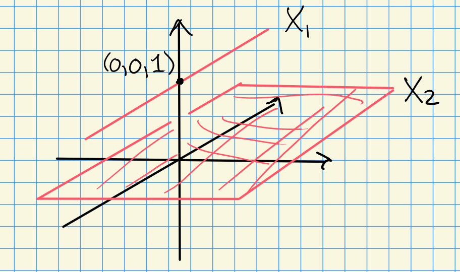

::: {.example}
In $\AA^3_\CC$ with coordinates $x, y, z$, let $X_1 = V(x, z-1)$ be the line through $(0,0,1)$ parallel to the $y$-axis, let $X_2 = V(z)$ be the $xy$-plane, and let $X = X_1 \cup X_2$.

{width=350px}

The two ideals are comaximal:
$$
I(X_1)+I(X_2)=(x,z-1)+(z)=(1).
$$
Thus the Chinese remainder theorem gives $I(X)=I(X_1)\cap I(X_2)=I(X_1)I(X_2)$, so
$$
I(X)=(x,z-1)(z)=(xz,z^2-z).
$$
The coordinate ring decomposes as
$$
\CC[X]=\frac{\CC[x,y,z]}{(xz,z^2-z)}
\cong\frac{\CC[x,y,z]}{(x,z-1)}\times\frac{\CC[x,y,z]}{(z)}
\cong\CC[y]\times\CC[x,y].
$$
:::
