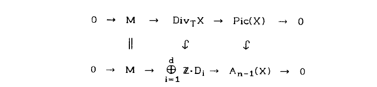
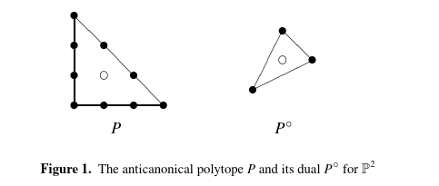
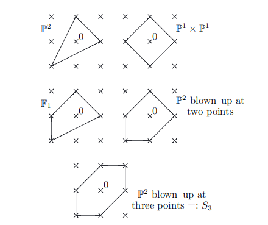

# Polytopes and divisors

A torus-invariant divisor $D=\sum_\rho a_\rho D_\rho$ on $X_\Sigma$ has polytope $P_D=\{m\in M_\RR:\langle m,u_\rho\rangle\ge-a_\rho\text{ for every ray }\rho\}$, and the characters $\chi^m$ for $m\in P_D\cap M$ form a basis of $H^0(X_\Sigma,\OO(D))$ ([[D-TORQD]]).

[[D-TORPOLY]]

[[D-TORMOMENT]]

[[D-FULSIMPLE]]

## Divisors from the rays

[[T-TORDIV]]

In the two sequences, $\Pic$ and $\Cl$ are the quotients of $\CDiv_T$, the torus-invariant Cartier divisors, and of $\Div_T$, all torus-invariant Weil divisors, by the principal divisors $\operatorname{div}(\chi^m)$ ([[T-TORDIV]]).
On a smooth fan $\Pic=\Cl$: the rays of a maximal cone are a lattice basis ([[PR-FULCRIT]]), so the Cartier criterion of [[T-TORDIV]] is satisfied for every torus-invariant divisor.
On a simplicial fan $\Pic$ has finite index in $\Cl$ ([[T-TORDIV]]): the cone over the rational normal curve of degree $d$ has $\Cl\cong\ZZ/d$ and $\Pic=0$ ([[FE-TORCD]]).
On a non-simplicial fan the index can be infinite: the cone over a square, whose toric variety is $V(xy-zw)\subset\AA^4$, has $\Cl\cong\ZZ$ and $\Pic=0$ ([[T-TORDIV]]).

## The polytope of a divisor

[[D-TORQD]]

[[FE-TORP2]]

## Positivity

[[PR-TORPOS]]

For $D = \sum a_\rho D_\rho$ on a complete fan, compute $P_D$ from the inequalities $\inner{m}{u_\rho} \geq -a_\rho$ ([[D-TORQD]]) and compare its vertices with the maximal cones.
The vertex attached to a maximal cone $\sigma$ is its Cartier datum $m_\sigma$, and $D$ is ample exactly when these vertices are distinct, that is, when the support function is strictly upper convex ([[PR-TORPOS]]).
Then $h^0(\OO(D))$ is the number of lattice points in $P_D$ ([[D-TORQD]]).
If two maximal cones give the same vertex, the support function is linear across the wall between them and $D$ is not ample; it is base point free when the support function is still upper convex ([[PR-TORPOS]]).

[[D-FULNORMPOLY]]

[[FE-FULAVA]]

Very ampleness is not read off the normal fan: $D$ is very ample exactly when it is ample and, at every maximal cone $\sigma$ with Cartier datum $m_\sigma$, the translated semigroup $\NN(P_D\cap M-m_\sigma)$ equals the local semigroup $S_\sigma=\sigma^\vee\cap M$, that is, is saturated ([[PR-TORPOS]]); without the shift by $m_\sigma$ the statement is false, and the [[FE-FULAVA|example of an ample divisor that is not very ample]] has a strictly convex support function and an associated map that is two-to-one rather than an embedding.

## Fano and Calabi-Yau

[[D-TORREFL]]

A reflexive polytope $P$ makes $X_P$ Gorenstein Fano: $-K_{X_P}$ is Cartier and ample, and $P_{-K_{X_P}}=P$; conversely a complete Gorenstein Fano toric variety has a reflexive polytope, with normal fan $\Sigma$ ([[D-TORREFL]]).
In dimension two there are $16$ reflexive polygons up to equivalence, exactly five of them smooth, giving the toric del Pezzo surfaces ([[D-TORREFL]]).
