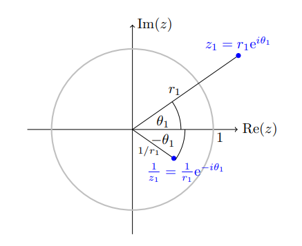

# Complex arithmetic

## Problems on complex arithmetic

[[P-UGA8150S21-HW1-01]]

[[P-3HHKX]]

[[P-43AXY]]

[[P-CZ3R7]]

[[P-UGA8150S21-HW1-05]]

[[P-37Z7J]]

[[P-UYWZ5]]

## Problems on holomorphy and power series

[[P-CV2MR]]

[[P-7UTDI]]

[[P-TFO34]]

[[P-U2ZP6]]

[[P-4YOJC]]

[[P-YHARF]]

[[P-7UIYI]]

[[P-FOYTY]]

[[P-F7HCN]]

[[P-LLNJ7]]

## Identities

::: {.fact title="Sums of two exponentials"}
For real $a, b, \omega$,
$$
\begin{aligned}
e^{a i \omega}+e^{b i \omega} &=2 \cos \qty{\frac{a-b}{2} \omega} e^{\frac{a+b}{2} i \omega}, \\
e^{a i \omega}-e^{b i \omega} &=2 i \sin \qty{\frac{a-b}{2} \omega} e^{\frac{a+b}{2} i \omega}.
\end{aligned}
$$
So a sum or difference of two exponentials is a unimodular complex scalar times a real trigonometric function.
:::

::: {.proof}
Put $\ell \coloneqq \frac{a+b}{2}$ and $k \coloneqq \frac{a-b}{2}$, so that $a - \ell = k$ and $b - \ell = -k$.
Then
$$
e^{ai\omega} \pm e^{bi\omega} = e^{\ell i\omega} \qty{ e^{(a-\ell)i\omega} \pm e^{(b - \ell)i\omega} } = e^{\ell i\omega} \qty{ e^{ki\omega} \pm e^{-ki\omega}},
$$
which is $e^{\ell i\omega}\cdot 2\cos(k\omega)$ for the sum and $e^{\ell i\omega}\cdot 2i\sin(k\omega)$ for the difference.
:::

::: {.example}
With $\omega \coloneqq \pi/2$, $a=-1$, $b=-3$,
$$
\begin{aligned}
e^{-i\pi / 2}+ e^{-3i\pi / 2}
&= e^{-i\omega} + e^{-3i\omega} \\
&= e^{-2i\omega} \qty{e^{i\omega} + e^{-i\omega}}\\
&= e^{-2i\omega}\cdot 2\cos(\omega) \\
&= e^{-i\pi}\cdot 2\cos\qty{\pi / 2} \\
&= 0.
\end{aligned}
$$
:::

::: {.fact title="Complex algebra"}
For $z, w\in\CC$,
$$
\begin{aligned}
z + \bar{z} &= 2\Re(z), & z - \bar{z} &= 2i\Im(z), \\
z\bar z &= \abs{z}^2, & \arg(z/w) &\equiv \arg(z) - \arg(w) \pmod{2\pi} \quad (z,w\neq 0), \\
{1\over i} &= -i = i^3, & {1\over i^3} &= i.
\end{aligned}
$$

With $w\coloneqq e^{iz}$,
$$
\begin{aligned}
\cos(z) &= \frac 1 2 \qty{e^{iz} + e^{-iz}} = {1\over 2}(w+ \inverseof{w}),\\
\sin(z) &= \frac{1}{2i}\qty{e^{iz} - e^{-iz}} = {1\over 2i}(w-\inverseof{w}).
\end{aligned}
$$

The hyperbolic functions are
$$
\begin{aligned}
\cosh(z) &= \cos(iz) = {1\over 2}\qty{e^z + e^{-z}}, \\
\sinh(z) &= -i \sin(iz) = {1\over 2}\qty{e^z - e^{-z}}.
\end{aligned}
$$

:::

::: {.fact title="Hyperbolic functions"}
\envlist

- $\cosh$ and $\sinh$ are periodic with period $2\pi i$.

- $\frac{d}{dz}\cosh(z) = \sinh(z)$ and $\frac{d}{dz}\sinh(z) = \cosh(z)$; more generally $$ \cosh^{(n)}(z) = {e^z + (-1)^n e^{-z}\over 2}, \qquad \sinh^{(n)}(z) = {e^z - (-1)^{n} e^{-z}\over 2}.
$$

- $\sinh$ is odd and $\cosh$ is even.

- $\cosh(z + i\pi) = -\cosh(z)$ and $\sinh(z + i\pi) = -\sinh(z)$.

- The zeros of $\cosh$ are the points $i\qty{\pi/2 + k\pi}$ with $k\in\ZZ$.

- The zeros of $\sinh$ are the points $i\pi k$ with $k\in\ZZ$.

:::

::: {.fact}
For $z, w\in\CC$ and real $a,b,c,d$,
$$
\begin{aligned}
\abs{z \pm w}^2 &= \abs{z}^2 + \abs{w}^2 \pm 2\Re(\bar{w}z), \\
(a+bi)(c+di) &= (ac - bd) + (ad + bc)i, \\
{1\over \abs{z+w}} &\leq {1 \over \abs z - \abs w} \quad \text{if } \abs z > \abs w, \\
\abs{e^{z}} &= e^{\Re(z)}, \qquad \arg(e^z) \equiv \Im(z) \pmod{2\pi}.
\end{aligned}
$$

:::

::: {.fact}
In polar coordinates the inversion $z\mapsto 1/z$ is $Re^{i\theta}\mapsto {1\over R}e^{-i\theta}$: it inverts the modulus and reflects the argument.

:::

## Further problems

[[E-X4MBB]]

[[E-WNNSK]]

[[E-P7SIB]]

[[E-JWO2G]]

[[E-ZCPKK]]
