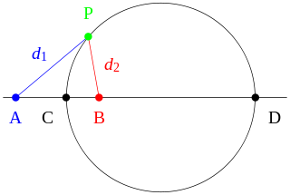
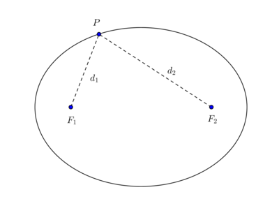
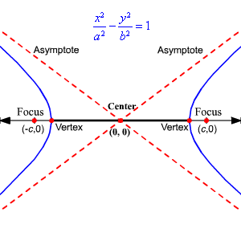
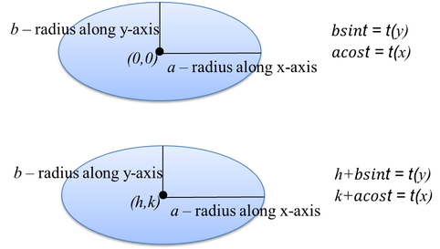
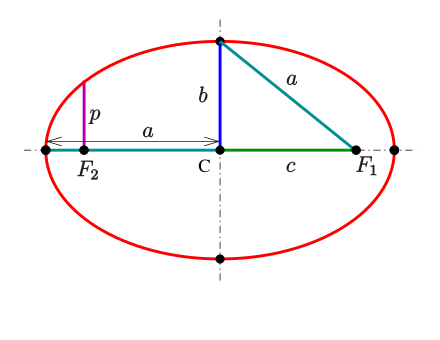

# Precalculus preliminaries

## Geometry

::: {.fact}
The interior angles of a convex $n$-gon sum to $(n-2)\pi$, so each interior angle of a regular $n$-gon is $\frac{n-2}{n}\pi$.

The sum is the one-line count of turning angles: traversing the boundary once, the direction of travel turns through a total of $2\pi$, and each exterior angle is $\pi$ minus the interior angle at that vertex, so $\sum\qty{\pi-\theta_i}=2\pi$ gives $\sum\theta_i=(n-2)\pi$.
:::

::: {.fact title="Standard forms of conic sections"}
\envlist

- Circle: $x^2 + y^2 = r^2$, or $\abs{z-z_0}=r$.
  For $z_1\neq z_2$ in $\CC$ and a constant $c>0$ with $c\neq 1$, the locus $\abs{z-z_1} = c\abs{z-z_2}$ of points whose distances $d_1, d_2$ to the two points $z_1, z_2$ have constant ratio $d_1/d_2 = c$ is also a circle:

- Ellipse: $\qty{\frac x a}^2  + \qty{\frac y b}^2 = 1$, or $\abs{z-z_1} + \abs{z-z_2} = c$ with $c > \abs{z_1-z_2}$, the locus of points whose distances to $z_1$ and $z_2$ have constant sum $d_1 + d_2 = c$:

- Hyperbola: $\qty{\frac x a}^2  - \qty{\frac y b}^2 = 1$, or $\abs{\abs{z-z_1} - \abs{z-z_2}} = c$ with $0 < c < \abs{z_1-z_2}$:

  The rectangular hyperbola $x^2-y^2 = a^2$ is $xy = a^2/2$ after the rotation by $\pi/4$, whose focal distance is $a\sqrt2$; in the notation $c$ of the ellipse above the constant is therefore $c^2/4$, not $c^2/2$.
- Parabola: $y^2 = 4ax$.

The Apollonius circle is [@Ahl73, ch. 3, §3.5, Families of Circles], which names the locus $\abs{z-a}=k\abs{z-b}$ the circles of Apollonius with limit points $a$ and $b$; the ellipse and the hyperbola in their focal forms are (16) and (17) of [@Ahl73, ch. 3, §4.2, A Survey of Elementary Mappings], obtained there as the images of the circles $\abs w=\rho$ and of the rays under $z=\frac12\qty{w+1/w}$.
:::

[[D-CN7QC]]

::: {.fact title="Parameterizations"}
\envlist

- The ellipse $\qty{x\over a}^2 + \qty{y\over b}^2 = 1$ is parameterized by $t\mapsto (a\cos(t), b\sin(t))$:

  - In complex form, $\gamma(t) = pe^{it} + qe^{-it}$ with $p \coloneqq \frac{a+b}{2}$ and $q \coloneqq \frac{a-b}{2}$, since $pe^{it} + qe^{-it} = a\cos(t) + ib\sin(t)$.
  - For $a\geq b$ the foci are $(\pm c, 0)$ with $c\coloneqq \sqrt{a^2-b^2}$, and the vertices are $(\pm a, 0)$ and $(0, \pm b)$:

    

- The circle $(x-h)^2 + (y-k)^2 = r^2$ is parameterized by $t\mapsto (r\cos(t) + h, r\sin(t) + k)$, in complex form $\gamma(t) = z_0 + re^{it}$ with $z_0\coloneqq h + ik$.

- With $u\coloneqq \tan(t/2)$, defined for $t\not\equiv\pi \pmod{2\pi}$,
$$
\cos(t) = {1-u^2\over 1+u^2}, \qquad \sin(t) = {2u\over 1+u^2}.
$$
  This gives the rational parameterization of the ellipse
$$
u\mapsto a {1-u^2\over 1+u^2} +ib{2u\over 1+u^2},
$$
  and, for $a=b=R$, of the circle of radius $R$; the value $u=\infty$ is the point $-a$, so each misses only that point.

- For $a\in\CC\setminus\theset{0}$ and $c\in\RR$, the set $\theset{z \st \bar{a}z + a\bar{z} + c = 0}$ is a line, and every line has this form.

The complex form of the ellipse is (16) of [@Ahl73, ch. 3, §4.2, A Survey of Elementary Mappings]: the section writes the image of $\abs w=\rho$ as $x=\frac12\qty{\rho+\rho^{-1}}\cos\theta$, $y=\frac12\qty{\rho-\rho^{-1}}\sin\theta$, which is this display with $t=\theta$, $p=\frac{\rho}{2}$ and $q=\frac{1}{2\rho}$. The half-angle formulas in $u=\tan(t/2)$ are those of [[FF-2OHYV]], applied coordinatewise to the ellipse. The general line $\bar az+a\bar z+c=0$ with $a=\alpha+i\beta\neq0$ and $z=x+iy$ is the real linear equation $2(\alpha x+\beta y)+c=0$, whose solution set is a line because $(\alpha,\beta)\neq(0,0)$; conversely a line $\alpha x+\beta y+c/2=0$ is this equation with $a=\alpha+i\beta$.

:::

## Algebra

::: {.fact title="Numerical values"}
$\sqrt{2} \approx 1.4142$, $1/\sqrt{2} \approx 0.7071$, $\sqrt{3} \approx 1.7321$, $1/\sqrt{3} \approx 0.5774$, $e\approx 2.7183$, $\pi \approx 3.14159$.

:::

::: {.fact title="Completing the square"}
For $a\neq 0$,
$$
ax^2 + bx + c = a\qty{x + d}^2 + e, \qquad d \coloneqq \frac{b}{2a}, \quad e\coloneqq c - \frac{b^2}{4a}.
$$
In particular $x^2 + bx + c = \qty{x+ {b\over 2}}^2 + c - \qty{b\over 2}^2$.

The identity is the expansion of the right-hand side: $a\qty{x+d}^2+e=ax^2+2adx+ad^2+e$, which equals $ax^2+bx+c$ exactly when $2ad=b$ and $ad^2+e=c$, that is for the $d$ and $e$ displayed.
:::

## Trigonometry

[[FF-ATMHV]] [[FF-ZQFSR]] [[FF-TGTS7]]

[[FF-CLFAB]] [[FF-W2TS2]] [[FF-VT2E7]]

[[FF-YBIQV]] [[FF-CIESS]] [[FF-SF7VN]]

[[FF-JLUCP]]

[[FF-Y6IOA]] [[FF-WDDTM]] [[FF-A7OEY]]

[[FF-7KQCC]] [[FF-2ABHQ]]

::: {.remark}
The root of unity $e^{2\pi i k/n}$ has rectangular coordinates $\qty{\cos(2\pi k/n), \sin(2\pi k/n)}$, so $e^{2\pi i/3} = -\frac12 + \frac{\sqrt3}{2}i$ and $e^{2\pi i/6} = \frac12 + \frac{\sqrt3}{2}i$.

:::

[[FF-XEQFR]] [[FF-TGHJ5]]

[[FF-2OHYV]]

[[FF-TBIC5]]

## Hyperbolic functions

[[FD-XUGN3]]

[[FF-AGEQ4]] [[FF-MV5X6]]

[[FF-VFWB6]] [[FF-VR4UT]]

::: {.remark}
For $z = x+iy$, the addition formulas together with $\cos(iy) = \cosh(y)$ and $\sin(iy) = i\sinh(y)$ give $\cos(z) = \cos(x)\cosh(y) - i\sin(x)\sinh(y)$ and $\sin(z) = \sin(x)\cosh(y) + i\cos(x)\sinh(y)$.
The series expansions are on [[complex-analysis/basics/series-reference|Series reference]].

:::
