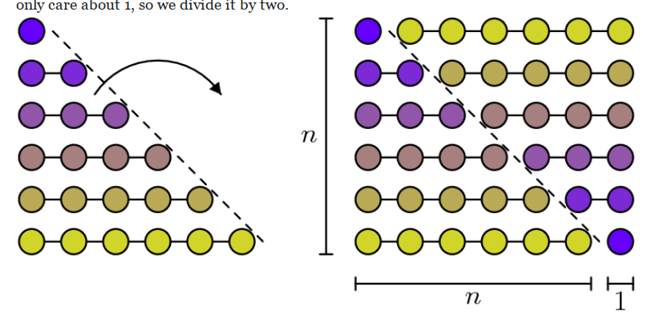

# Series reference

## Factorial notation

[[D-5NQWE]]

::: {.fact}
In binomial coefficients, $\rising{n}{k} = k!{n+k-1 \choose k}$ for $n\in\ZZ_{>0}$, and $\falling{n}{k} = k!{n\choose k}$ for $0\leq k\leq n$.
For $n\in\ZZ_{\geq 0}$,
$$
\qty{\frac{d}{dz}}^k z^n = \falling{n}{k} \, z^{n-k}.
$$

:::

## Standard series

::: {.fact title="Generalized binomial theorem"}
For $\alpha\in\CC$ and $k\geq 0$, set
$$
{\alpha\choose k} \coloneqq {\alpha(\alpha-1)\cdots(\alpha-k+1)\over k!} = \frac{\falling{\alpha}{k}}{k!}.
$$
Then, for $\abs z<1$ and the holomorphic branch of $(1+z)^\alpha$ with value $1$ at $z=0$,
$$
(1+z)^\alpha = \sum_{k\geq 0}{\alpha\choose k}z^k.
$$
When $\alpha\in\ZZ_{\geq 0}$ the series terminates and is the binomial theorem.

This is the binomial series of [@Ahl73, ch. 5, §1.2, The Taylor Series], where ${\mu\choose n}=\frac{\mu(\mu-1)\cdots(\mu-n+1)}{1\cdot2\cdots n}$ is defined and $(1+z)^\mu=1+\mu z+{\mu\choose2}z^2+\cdots+{\mu\choose n}z^n+\cdots$ is listed with its radius of convergence.
:::

::: {.fact title="Power series"}
For $z\in\CC$ unless a radius is stated,
$$
\begin{aligned}
\sum_{k=0}^{N} z^k &= {1 - z^{N+1} \over 1-z} \quad (z\neq 1), \\
{1\over 1-z} &= \sum_{k\geq 0} z^k, \qquad \abs z<1, \\
{1\over 1+z^n} &= \sum_{k\geq 0} (-1)^kz^{nk}, \qquad \abs{z} < 1,\ n\geq 1, \\
e^z &= \sum_{k\geq 0} {z^k \over k!}, \\
\sin(z) &= \sum_{k \geq 0} (-1)^{k} {z^{2k+1} \over (2k+1)!} = z - {1\over 3!}z^3 + {1\over 5!}z^5 - \cdots, \\
\cos(z) &= \sum_{k \geq 0} (-1)^{k} {z^{2k} \over (2k)!} = 1 - {1\over 2!}z^2 + {1\over 4!}z^4 - \cdots, \\
\log(1-z) &= - \sum_{k \geq 1} {z^k\over k}, \qquad \abs{z} < 1, \\
(1+z)^{1/2} &= \sum_{k\geq 0} {1/2 \choose k}z^k = 1 + {1\over 2}z - {1\over 8}z^2 + {1\over 16}z^3 - \cdots, \qquad \abs{z} < 1.
\end{aligned}
$$
Within the disc of convergence,
$$
\qty{\frac{d}{dz}}^k \sum_{n\geq 0} c_n z^n = \sum_{n\geq k} \falling{n}{k} \, c_n z^{n-k}.
$$

The developments are those listed in [@Ahl73, ch. 5, §1.2, The Taylor Series] — $e^z$, $\cos z$ and $\sin z$ there as the definitions of the functions, $(1+z)^\mu$ with the binomial coefficients defined in the same section, and $\log(1+z)$, which is the series above at $-z$ — and the geometric series is the example of [@Ahl73, ch. 2, §2.4], whose Theorem 2 (iii) gives the derivative by termwise differentiation with the same radius of convergence.
:::

[[FF-LF5ND]] [[FF-XKATS]]

[[FF-ENSFJ]] [[FF-5GLOZ]]

::: {.fact title="Expanding square roots"}
Fix $z_0\neq 0$ and a branch $\sqrt{\phantom z}$ on the disc $\abs{z-z_0}<\abs{z_0}$, and let $\sqrt{z_0}$ denote its value at $z_0$.
On that disc, with $u\coloneqq (z-z_0)/z_0$,
$$
\sqrt{z} = \sqrt{z_0} \sqrt{1+u} = \sqrt{z_0} \sum_{k\geq 0} {1/2 \choose k} \qty{z- z_0 \over z_0}^k,
$$
where $\sqrt{1+u}$ is the branch with value $1$ at $u=0$.

:::

## Finite sums

::: {.fact title="Sums of powers"}
$$
\begin{aligned}
\sum_{k=1}^{n} k &=\frac{n(n+1)}{2}, \\
\sum_{k=1}^{n} k^{2} &=\frac{n(n+1)(2 n+1)}{6}, \\
\sum_{k=1}^{n} k^{3} &=\frac{n^{2}(n+1)^{2}}{4} = \qty{\sum_{k=1}^n k}^2, \\
\sum_{k=1}^{n}(2k-1) &= n^2.
\end{aligned}
$$
The last identity cuts an $n\times n$ square of dots into $L$-shaped layers of $1, 3, 5, \ldots, 2n-1$ dots:

:::

::: {.fact title="Sums of rising factorials"}
For $p\geq 1$, in the rising-factorial notation $\rising{k}{p}$,
$$
\begin{aligned}
\sum_{k=1}^{n} \rising{k}{p} &= {\rising{n}{p+1}\over p+1}, \\
\sum_{k=1}^{n} \frac{p}{\rising{k}{p+1}} &= \frac{1}{\rising{1}{p}}-\frac{1}{\rising{n+1}{p}}, \qquad \rising{1}{p} = p!.
\end{aligned}
$$
For $p=2,3$ the first identity reads $\sum_{k=1}^{n} \rising{k}{2} = \frac{n(n+1)(n+2)}{3}$ and $\sum_{k=1}^{n} \rising{k}{3} = \frac{n(n+1)(n+2)(n+3)}{4}$; for $p=1,2$ the second reads $\sum_{k=1}^{n} \frac{1}{k(k+1)}=1-\frac{1}{n+1}$ and $\sum_{k=1}^{n} \frac{2}{k(k+1)(k+2)}=\frac{1}{2}-\frac{1}{(n+1)(n+2)}$.

:::

::: {.remark}
The rising-factorial sums are discrete analogues of $\int_0^n x^p \dx = { n^{p+1} \over p+1}$ and $\int_1^{n+1}{p\over x^{p+1}}\dx = 1 - {1\over (n+1)^p}$.
Writing $k^2 = \rising{k}{2} - k$ gives $\sum_{k=1}^n k^2 = \frac{n(n+1)(n+2)}{3} - \frac{n(n+1)}{2} = {n(n+1)(2n+1) \over 6}$.
The identity $\sum_{k=1}^n k = n(n+1)/2$ counts a staircase of $n$ columns as half of an $n\times(n+1)$ rectangle:

:::

## Inverting power series

::: {.fact title="Cauchy product"}
Where both series converge absolutely,
$$
\sum_{k\geq 0} a_kz^k \cdot \sum_{k\geq 0} b_k z^k = \sum_{k\geq 0} c_k z^k,\qquad c_k \coloneqq \sum_{j=0}^k a_j b_{k-j}.
$$

:::

[[FF-JKLWM]]

[[P-VFAXW]] [[P-IM6MH]] [[P-OCOSY]] [[P-VT4TV]]

::: {.fact title="Inverting with the geometric series"}
For $A(z) \coloneqq 1 + a_1 z + a_2z^2 + \cdots$,
$$
{1\over A(z)} = {1 \over 1- (1-A(z))} = \sum_{k\geq 0} (1-A(z))^k = 1 - (A(z) - 1) + (A(z) - 1)^2 - (A(z) - 1)^3 + \cdots
$$
as formal power series.
Since $(A(z)-1)^k$ has no terms of degree below $k$, the coefficient of $z^m$ in $1/A(z)$ is determined by the summands with $k\leq m$.
For $A(z) = a_0 + a_1z + a_2z^2 + \cdots$ with $a_0\neq 0$, applying the same series to $a_0^{-1}A(z)$, whose constant term is $1$, gives $1/A(z)$.

:::

::: {.proposition}
Let $A$ be holomorphic near $0$ with a [[D-65VIK|zero of order]] $m\geq1$ at $0$, so that $A(z) = z^m \tilde A(z)$ with $\tilde A$ holomorphic near $0$ and $\tilde A(0)\neq 0$.
Then $1/\tilde A$ is holomorphic near $0$, and on a punctured disc
$$
{1\over A(z)} = z^{-m}{1\over \tilde A(z)},
$$
so $1/A$ has a [[D-AUD6K|pole of order $m$]] at $0$.

This is [@Ahl73, ch. 4, §3.2, Zeros and Poles], which reads the order of a pole off the order of the zero of the reciprocal.
:::

[[FF-UQZNR]]

[[P-VT4TV]] [[P-NBSTW]]

## Long division of power series

::: {.fact title="Long division"}
Polynomial long division applies to formal power series.
Dividing by leading terms of highest degree gives the quotient of polynomials, as for $\frac{z^3+1}{z+1}$:
$$
\begin{aligned}
z^3 + 1 &= (z+1)(z^2) + (-z^2 + 1), \\
-z^2 + 1 &= (z+1)(-z) + (z+1), \\
z+1 &= (z+1)(1) + 0,
\end{aligned}
$$
so $\frac{z^3 + 1}{z+1} = z^2 - z + 1$.
Dividing by terms of lowest degree produces the quotient in increasing powers of $z$, which gives the low-order terms of a power series quotient:
$$
\begin{aligned}
1+z^3 &= (1+z)(1) + (-z+z^3), \\
-z+z^3 &= (1+z)(-z) + (z^2 + z^3), \\
z^2 +z^3 &= (1+z)(z^2) + 0,
\end{aligned}
$$
so $\frac{1+z^3}{1+z} = 1 - z + z^2$.

:::

::: {.example title="The Laurent series of $1/\sin(z)$"}
Write $\frac{1}{\sin(z)} = \inverseof{z}\qty{\frac{z}{\sin(z)}}$ and divide $z$ by $\sin(z) = z-\frac{1}{3!}z^3 + \frac{1}{5!}z^5 - \cdots$ in increasing powers:
$$
  \begin{array}{rl}
    \underline{\hspace{8em} 1 + {1\over 3!}z^2 + \left({1\over 3!3!} - {1\over 5!} \right)z^4 + \cdots } &  \\[-5pt]
     z-{1\over 3!}z^3 + {1\over 5!}z^5 + \cdots\hspace{3em} \arrayrule z\hspace{9em}  \\
      \underline{-(z-{1\over 3!}z^3 + {1\over 5!}z^5 + \cdots)} & \\
      {1\over 3!}z^3 - {1\over 5!}z^5 + {1\over 7!}z^7 - \cdots \hspace{0em}& \\
     \underline{-{1\over 3!}z^2(z-{1\over 3!}z^3 + {1\over 5!}z^5 + \cdots)} & \\
      \left( -{1\over 5!} + {1\over 3!3!}\right)z^5 + \left( {1\over 7!} - {1\over 3! 5!} \right)z^7 + \cdots & \\
  \end{array}
$$
So
$$
{z\over \sin(z)} = 1 + {z^2\over 3!} + {7 z^4 \over 360 } + \bigo(z^6),
$$
and dividing by $z$ gives the Laurent series of $1/\sin(z)$ ([[FF-UQZNR]]).

:::

[[P-KUNLD]]
