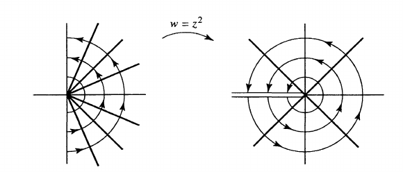
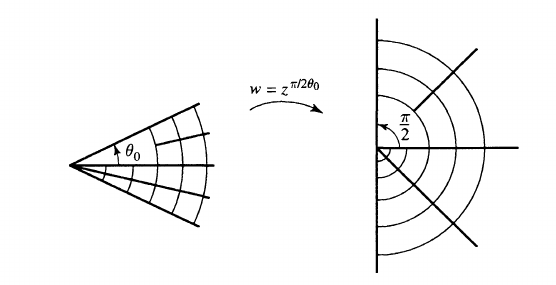
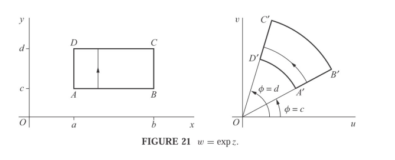
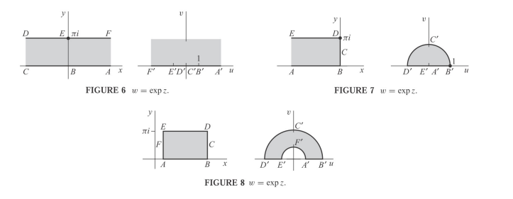

# Build me a map

If $f\colon U\to W$ and $g\colon V\to W$ are [[D-TM4TE|conformal]] bijections onto a standard region $W$ such as $\HH$ or $\DD$, then $\inverseof g\circ f\colon U\to V$ is a conformal bijection.

The regions named below are
$\DD$ the unit disc and $\HH$ the upper half-plane, as in [[PR-OOHFS]];
$Q_i$, the $i$th open quadrant, so $Q_1\coloneqq\theset{z\st\Re z>0,\ \Im z>0}$ and $Q_{ij}$ is the interior of $\overline{Q_i\union Q_j}$, so $\HH = Q_{12}$ and $Q_{14}$ is the right half plane;
and $L\coloneqq\theset{x+iy\st 0<y<\pi}$, the horizontal strip.

## Maps between standard regions

| Region | Standard target | Map |
| --- | --- | --- |
| $\HH$ | $\DD$ | the Cayley map $z\mapsto {z-i\over z+i}$ ([[PR-OOHFS]]) |
| $\DD$ | $\DD$ | the automorphisms $z\mapsto\lambda\,{z-a\over 1-\bar a z}$ with $a\in\DD$ and $\lambda\in S^1$, which are all of them ([[complex-analysis/conformal-maps/blaschke-factors-and-automorphisms|Blaschke factors and automorphisms]]) |
| a sector $0<\Arg z<\pi/n$ | $\HH$ | $z\mapsto z^n$ |
| a symmetric sector $\abs{\Arg z}<\theta_0$ | the right half plane | a branch of $z\mapsto z^a$ with $a = \pi/(2\theta_0)$ |
| the strip $L$ | $\HH$ | $z\mapsto e^z$, which maps $\theset{-\pi<\Im z<\pi}$ onto $\CC\sm\RR_{\leq0}$ |
| a rectangle $a<\Re z<b$, $c<\Im z<d$ | an annular sector | $z\mapsto e^z$, with $\theset{a<\Re z<b,\ c<\Im z<d}$ going to $\theset{Re^{i\theta}\st e^a<R<e^b,\ c<\theta<d}$ for $b>a$ and $0<d-c\leq2\pi$ |
| the half disc $\DD\intersect\HH$ | a quadrant | the Joukowski map $z\mapsto z+\inverseof z$, which maps $\abs z = 1$ onto $[-2,2]$, $\DD\intersect\HH$ onto $Q_{34}$, and $\overline{\DD}^c$ onto $\CC\sm[-2,2]$ |
| a region bounded by two circular arcs | a sector, or a strip when the arcs are tangent | [[D-FRVBV|a Möbius transformation]] sending the two intersection points to $0$ and $\infty$, or the point of tangency to $\infty$ |
| the slit plane $\CC\sm[0,\infty)$ | $\HH$ | the branch of $\sqrt z$ with argument in $(0,\pi)$ |
| $\HH$ | $Q_{34}$ | $z\mapsto -z$ |
| $\CC\smz$ | $\CC\smz$ | $z\mapsto 1/z$, which sends $Re^{it}$ to $\inverseof R e^{-it}$; it is reflection in $\RR$ composed with inversion in $S^1$, and on $\CP^1$ the rotation by $\pi$ about the axis through $\pm1$ |

The two power maps are pictured below.

## Boundary features

The feature of the boundary determines the factor to remove first.

| The region has | Map |
| --- | --- |
| a corner of angle $\theta_0$ at $0$ | $z^{\pi/\theta_0}$, to a half plane |
| two boundary arcs meeting at two points | a Möbius transformation taking those points to $0$ and $\infty$ |
| two tangent boundary circles | a Möbius transformation taking the point of tangency to $\infty$, giving parallel lines |
| a slit along a ray | a branch of $\sqrt z$ |
| a strip | $e^z$ |
| a half-plane, with target $\DD$ | the Cayley map, then an automorphism of $\DD$ |

## Computational facts

::: {.fact}
\envlist

- $\inverseof z = \bar z/\abs z^2$; for example, under $z\mapsto 1/z$ the point $1+i$ on $\abs{z-1} = 1$ goes to ${1-i\over 2}$.

- Conformal maps preserve angles between curves, including at $\infty$ on $\CP^1$.
  Circles meeting orthogonally map to generalized circles meeting orthogonally, and tangent circles map to tangent circles or parallel lines.

- Möbius transformations map generalized circles to generalized circles, where a line is a circle through $\infty$, and map an arc between two points onto an arc between their images ([[T-QGL7C]]).

- The cross ratio $(z;a,b,c)$ sends $a\mapsto1$, $b\mapsto0$ and $c\mapsto\infty$ ([[PR-74KHY]]).

The inverse $\inverseof z=\bar z/\abs z^2$ is [@Ahl73, ch. 1, §1.4, Conjugation, Absolute Value]; the conformality of an analytic map with nonvanishing derivative, and the preservation of angles that gives the orthogonal and tangent cases, are [@Ahl73, ch. 3, §2.3, Conformal Mapping]; the statement that a linear transformation carries circles into circles, lines counting as circles through $\infty$, is Theorem 14 of [@Ahl73, ch. 3, §3.2, The Cross Ratio]; and the cross ratio with its normalisation is [@Ahl73, ch. 3, §3.2, Definition 12], which is also [[FF-W4FFF]].
:::

## Standard maps

Composing the maps of the table gives the map between any two of its regions.

[[PR-OOHFS]]

[[PR-TWG7E]]

Sectors:

[[PR-AQFRA]]

Logs and exponentials:

[[PR-3CDLG]]

[[PR-SF23E]]

[[PR-PELLF]]

[[PR-TQDIL]]

Joukowski maps:

[[PR-IK6LA]]

[[PR-OTMIR]]

[[PR-3LBLV]]

## Exercises

Cross ratios:

[[E-Z23VB]]

Discs and planes:

[[P-AZOFF-C03]] [[E-W6MWU]] [[P-AZOFF-C01]] [[E-PGGNF]] [[E-SS8.EX-5]] [[E-PQ7NC]]

Slits:

[[E-YAYQB]] [[P-AZOFF-C08]] [[P-AZOFF-C09]] [[P-A6PQA]] [[P-AZOFF-C11]]

Strips:

[[P-PPWDW]]

Lunes:

[[E-UUBBS]] [[P-AZOFF-C04]] [[P-OONH6]] [[P-6N3HI]]

Sectors:

[[E-PYJZO]]

Joukowski regions:

[[E-NZY3B]]

Mixed:

[[E-H64WF]] [[E-3GIQS]] [[P-AZOFF-C07]] [[P-AZOFF-C12]] [[E-YCHOS]] [[E-JPAJE]] [[E-PIB7A]] [[E-KZB33]]
