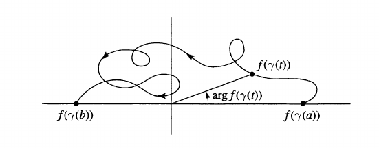

# The argument principle

## The logarithmic derivative

[[D-IA5FS]]

Zeros and poles of $f$ are the only singularities of $\logd f$, so [[T-HRPNO|the residue theorem]] applied to it counts zeros minus poles.

## The statement

[[D-PJ7JM]]

[[T-JXDQT]]

## The index version

[[T-52HK6]]

::: {.example title="Using the index version"}
Let $f(z) = z^2 + z = z(z+1)$.

- $\gamma_1 \coloneqq \theset{\abs z = 2}$ encloses 2 zeros and no poles, so $f\circ \gamma_1$ winds twice about the origin counterclockwise.
- $\gamma_2 \coloneqq \theset{\abs z = {1\over 2}}$ encloses 1 zero and no poles, so $f\circ \gamma_2$ winds once.

:::

::: {.remark title="Tracking the argument by hand"}
The winding number is the total change of a continuous branch of $\arg$ along the image curve, divided by $2\pi$, and it is additive over sub-curves.
For a curve in $\HH$ from a point of $(0,\infty)$ to a point of $(-\infty,0)$, a continuous branch of $\arg$ with values in $[0,\pi]$ changes by $\pi$.

:::

## Solutions of an equation

::: {.example title="The number of solutions of $f(z)=w$"}
The integral
$$
F(w) \coloneqq {1\over 2\pi i} \oint_{\bd \Omega} {f'(z) \over f(z) - w} \dz
$$
is $\frac{1}{2\pi i}\oint_{\bd\Omega} \logd g_w(z)\dz$ for $g_w(z) \coloneqq f(z) - w$, so for holomorphic $f$ it counts the solutions of $f(z) = w$ in $\Omega$ with multiplicity, by [[T-JXDQT|the argument principle]].
It is a continuous function of $w$ on each connected component of $\CC\sm f(\bd\Omega)$ — the denominator is bounded away from $0$ there — and it takes values in $\ZZ$, hence it is constant on each component.
The count is constant on each component, so it changes only across $f(\bd\Omega)$; at an interior value $a$, a solution of $f(z)=a$ of multiplicity $m\geq2$ is a zero of $f'$, so $a$ is a critical value of $f$.
:::

## Exercises

[[E-PWVJS]]
[[E-UVNVV]]
