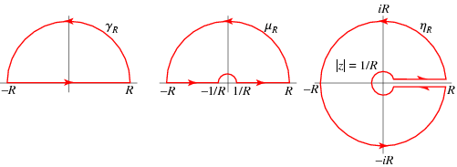
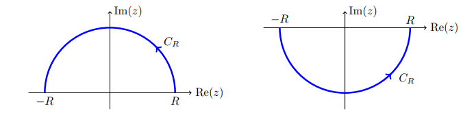
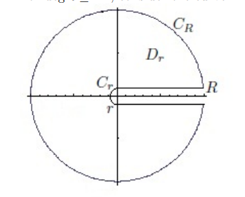
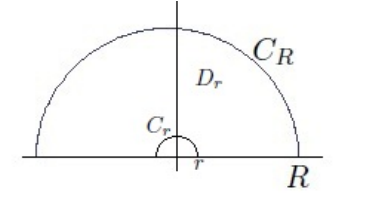
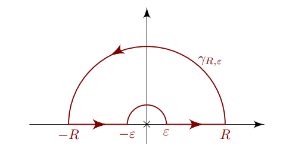

# Which contour do I close?

A real integral is evaluated by residues after it is written as a limit of integrals over closed curves.
The estimates for the added pieces are on [[complex-analysis/residues-and-contours/arc-estimates|Arc estimates]], and residue computations are on [[complex-analysis/residues-and-contours/computing-residues|Computing residues]].

Before closing a contour, check whether the integral needs [[D-C3JIU|residues]] at all.
If $\Omega$ is simply connected and $\gamma$ is a closed curve in $\Omega$, then $\int_\gamma f = 0$ for $f$ [[D-E7A5W|holomorphic]] on $\Omega$ ([[T-2OVCI|Cauchy's theorem]]).
If $f$ has a [[D-6RZQN|primitive]] $F$ on a neighborhood of $\gamma$, then $\int_\gamma f\dz = F(\gamma(1)) - F(\gamma(0))$, which is $0$ for a closed curve.
If $f(z) = g(z)/(z-a)^n$ with $g$ holomorphic inside and on a positively oriented simple closed curve $\gamma$ around $a$, then $\int_\gamma f\dz = 2\pi i\Res_{z=a}f$, and the derivative form of [[T-LA2UI|the Cauchy integral formula]] computes that residue as $\frac{g^{(n-1)}(a)}{(n-1)!}$.
By the definition of the [[D-6DAXB|contour integral]], for a parameterized curve $z\colon[a,b]\to\CC$ one has $\int_\gamma f\dz = \int_a^b f(z(t))z'(t)\dt$, and a circle about $z_0$ is $z = z_0+re^{i\theta}$.

## Rational, decaying at least quadratically

The integrands here are $f = p/q$ rational with $q$ free of real zeros and $\deg q\geq\deg p+2$, or more generally $f = \bigo(1/\abs z^{1+\delta})$ on $\HH$.

::: {.example title="The upper semicircle for a decaying rational function"}
Take the segment $[-R,R]$ followed by the upper semicircle $C_R = \theset{Re^{it}\st t\in[0,\pi]}$.
The arc integral is $\bigo(1/R)$: $\abs f = \bigo(1/R^2)$ on $C_R$ and $\length(C_R) = \pi R$.
[[T-SFXI7|The ML estimate]] gives this bound, and hence
$$
\int_\RR f = 2\pi i\sum_{z_0\in\HH}\Res_{z=z_0}f(z),
$$
the sum over the [[D-AUD6K|poles]] in the open upper half plane.
Closing in the lower half plane gives a clockwise contour and $\int_\RR f = -2\pi i\sum_{\Im z_0<0}\Res_{z=z_0}f(z)$.
:::

## Rational against a sine or cosine

The integrals are $\int_\RR f(x)\cos(ax)\dx$ and $\int_\RR f(x)\sin(ax)\dx$ with $a>0$, $f = p/q$ real rational, $q$ free of real zeros, and $\deg q\geq\deg p+1$.

::: {.example title="The semicircle applied to $f(z)e^{iaz}$"}
Integrate over the same semicircle, with
$$
\int_\RR f(x)\cos(ax)\dx = \Re\int_\RR f(x)e^{iax}\dx, \qquad \int_\RR f(x)\sin(ax)\dx = \Im\int_\RR f(x)e^{iax}\dx,
$$
the integrals over $\RR$ taken as limits of integrals over $[-R,R]$.
[[T-ZO5UU|Jordan's lemma]] bounds the arc: $\abs{e^{iaz}} = e^{-a\Im z}\leq1$ on $\HH$, and $\abs{\int_{C_R}e^{iaz}f(z)\dz}\leq\pi M_R/a$ with $M_R = \sup_{C_R}\abs f = \bigo(1/R)$.
The functions $\cos(az)$ and $\sin(az)$ grow like $e^{aR}/2$ on $C_R$, which is why the integrand is rewritten with $e^{iaz}$.
:::

For $e^{-iax}$ with $a>0$ the lower semicircle is used instead.
Along a vertical line $\Re z = a$ the same reasoning applies to $e^{\pm z}$: since $\abs{e^z} = e^{\Re z}$, an integrand with a factor $e^z$ is closed by a semicircle in the half plane $\Re z<a$, and one with $e^{-z}$ in the half plane $\Re z>a$.

## Rational in $\cos$ and $\sin$, over one period

The integrals are $\int_0^{2\pi}R(\cos\theta,\sin\theta)\dtheta$ with $R$ a rational function of two variables, finite on the unit circle.

::: {.example title="The unit circle"}
Substitute $z = e^{i\theta}$, so that
$$
\cos\theta = {z+\inverseof z\over 2}, \quad \sin\theta = {z-\inverseof z\over 2i}, \quad \dtheta = {\dz\over iz}.
$$
No pieces are added: the substitution writes the integral over $[0,2\pi]$ as an integral over $S^1$, and [[T-HRPNO|the residue theorem]] gives
$$
\int_0^{2\pi}R(\cos\theta,\sin\theta)\dtheta = 2\pi i\sum_{\abs{z_0}<1}\Res_{z=z_0} R\qty{{z+\inverseof z\over 2}, {z-\inverseof z\over 2i}}{1\over iz}.
$$
The factor $1/iz$ can contribute a pole at $z = 0$.
:::

## A branch cut: a power $x^\alpha$

The integrals are $\int_0^\infty x^\alpha f(x)\dx$ with $f$ rational, free of poles on $[0,\infty)$, of degree $\deg f\leq-2$, and $\alpha\in(-1,1)$ nonintegral.

::: {.example title="The keyhole for $x^\alpha$"}
Take the keyhole around the cut along $[0,\infty)$, with the branch $\arg z\in(0,2\pi)$ of $z^\alpha$.
The large circle of radius $R$ contributes $\bigo(R^{\alpha-1})\to0$ by the ML estimate, and the small circle of radius $\varepsilon$ contributes $\bigo(\varepsilon^{1+\alpha})\to0$ because $\alpha>-1$.
Above the cut the integrand is $x^\alpha f(x)$; below it $\arg z = 2\pi$, so the integrand is $e^{2\pi i\alpha}x^\alpha f(x)$ and the edge is traversed from $\infty$ to $0$.
Hence
$$
\qty{1-e^{2\pi i\alpha}}\int_0^\infty x^\alpha f(x)\dx = 2\pi i\sum_{z_0}\Res_{z=z_0}\qty{z^\alpha f(z)},
$$
the sum over the poles $z_0$ of $f$.

The two circles vanish by [[T-SFXI7|the ML estimate]] and the enclosed sum is that of [[T-HRPNO|the residue theorem]].
:::

## A branch cut: a logarithm

The integrals are $\int_0^\infty f(x)\log(x)\dx$, or $\int_0^\infty f(x)\dx$ computed through $\int f(z)\log z\dz$, on an indented semicircle or the keyhole.

::: {.example title="The indented semicircle and the keyhole for a logarithm"}
With the branch $\arg z\in(0,2\pi)$, for $x>0$, for $n\geq1$, and for $c\neq0$,
$$
\lim_{\varepsilon\decreasesto0}\log(x-i\varepsilon) = \ln(x)+2\pi i, \qquad \lim_{x\to0}{x\ln(x)\over x^n+c} = 0;
$$
the first limit is what the edge below the cut contributes, and the second is what the small circle contributes.
For $\zeta = e^{i\theta}$ and $g$ with $g(\zeta x) = g(x)$ for $x>0$, the integral of $\log(z)g(z)$ along the ray $z = \zeta x$ is
$$
\zeta\int_0^\infty\log(\zeta x)g(\zeta x)\dx = \zeta\int_0^\infty\ln(x)g(x)\dx + i\theta\,\zeta\int_0^\infty g(x)\dx,
$$
so a contour made of $[0,\infty)$ and this ray gives a linear relation between $\int_0^\infty\ln(x)g(x)\dx$ and $\int_0^\infty g(x)\dx$.

The relation is the residue sum of [[T-HRPNO|the residue theorem]] on the contour, the two limits displayed being what the edges and the small circle contribute.
:::

## A pole on the real line

The integrand of $\int_\RR f$ has simple poles on $\RR$.
The integral diverges, and for a single pole $x_0$ the [[D-PV4RQ|Cauchy principal value]] is
$$
\PV\int_{-\infty}^{\infty}f(x)\dx = \lim_{R\to\infty}\lim_{\varepsilon\decreasesto0}\qty{\int_{-R}^{x_0-\varepsilon}f(x)\dx + \int_{x_0+\varepsilon}^{R}f(x)\dx},
$$
with the analogous definition for several poles.

::: {.example title="The semicircle indented above each real pole"}
Indent the semicircle by a small half-circle above each real pole.
The integral over the large arc tends to $0$ by the ML estimate when $f = \bigo(1/\abs z^{1+\delta})$ on $\HH$, and by Jordan's lemma when $f(z) = g(z)e^{iaz}$ with $a>0$ and $g = \bigo(1/\abs z)$.
By [[T-SSNLT]], an arc of angle $\theta$ about a simple pole contributes $i\theta\Res$ in the limit, so each clockwise half-circle contributes $-i\pi\Res$, and
$$
\PV\int_\RR f = 2\pi i\sum_{z_0\in\HH}\Res_{z=z_0}f + i\pi\sum_{x_0\in\RR}\Res_{z=x_0}f.
$$
Indenting below a real pole $x_0$ instead puts $x_0$ inside the contour; the counterclockwise half-circle then contributes $+i\pi\Res_{z=x_0}f$, the residue sum gains $2\pi i\Res_{z=x_0}f$, and the value is unchanged.
:::

::: {.example title="$\displaystyle\PV\int_\RR{\cos x\over x^2-1}\dx = -\pi\sin 1$"}
Take $f(z) = e^{iz}/(z^2-1)$, whose simple poles $\pm1$ lie on $\RR$, and indent the semicircle above both of them.
No pole is enclosed, so the closed integral vanishes, and the two clockwise half-circles contribute $-i\pi$ times the residues, which the simple-pole rule [[C-Q6BSL]] gives as
$$
\Res_{z=1}f = {e^{i}\over 2}, \qquad \Res_{z=-1}f = {e^{-i}\over -2},
$$
whose sum is $(e^{i}-e^{-i})/2 = i\sin 1$; the large arc vanishes by [[T-ZO5UU|Jordan's lemma]], since $1/(z^2-1) = \bigo(1/R^2)$ on it.
Hence $\PV\int_\RR f = i\pi\qty{\Res_{z=1}f+\Res_{z=-1}f} = i\pi\cdot i\sin1 = -\pi\sin1$, and taking real parts gives the value; the imaginary part $\PV\int_\RR\sin x/(x^2-1)\dx$ vanishes because that integrand is odd.
:::

## Symmetry under rotation or translation: sectors and rectangles

The integrands are functions whose values on a rotated ray or a translated line are a constant multiple of their values on the real axis.

::: {.example title="A sector for a rotation symmetry"}
If $f(\zeta z) = f(z)$ for $\zeta = e^{2\pi i/m}$, use the sector $\theset{0\leq\arg z\leq 2\pi/m,\ \abs z\leq R}$.
If the arc integral tends to $0$, the ray $z = \zeta x$, traversed toward $0$, contributes $-\zeta\int_0^\infty f$, so, by [[T-HRPNO|the residue theorem]], $(1-\zeta)\int_0^\infty f$ is $2\pi i$ times the sum of the residues in the sector.
For $f(x) = 1/(1+x^n)$ and $\zeta = e^{2\pi i/n}$ this gives $\int_0^\infty {\dx\over 1+x^n} = {\pi/n\over\sin(\pi/n)}$.
For a rational $f$ on the keyhole the two edges are the same ray with the two arguments, and their integrals cancel: the sector relation at $\zeta = e^{2\pi i}$ reads $0 = 2\pi i\sum_{z_0}\Res_{z=z_0}f$. Inserting a factor $\log z$ breaks the cancellation, as in [[complex-analysis/residues-and-contours/which-contour-do-i-close#a-branch-cut-a-logarithm|the logarithm case]].
For $f$ even, $\int_0^\infty f = \frac12\int_\RR f$ and a contour for $\int_\RR f$ applies; for $f$ not even with $f(\zeta z) = f(z)$ for a root of unity $\zeta$, the sector with edge $\zeta[0,\infty)$ applies.
:::

::: {.example title="$\displaystyle\int_\RR {e^{ax}\over 1+e^x}\dx = {\pi\over\sin(\pi a)}$, $0<a<1$"}
Take $f(z) = e^{az}/(1+e^z)$ on the rectangle with vertices $\pm R$ and $\pm R+2\pi i$.
Since $f(z+2\pi i) = e^{2\pi ia}f(z)$, the top edge, traversed from $R+2\pi i$ to $-R+2\pi i$, contributes $-e^{2\pi ia}\int_{-R}^{R}f(x)\dx$.
On the vertical edges $\abs f\leq e^{aR}/(e^{R}-1)$ at $\Re z = R$ and $\abs f\leq e^{-aR}/(1-e^{-R})$ at $\Re z = -R$, so both vanish as $R\to\infty$ because $0<a<1$.
The only enclosed pole is $z = i\pi$, where $1+e^z$ has a simple zero with derivative $e^{i\pi} = -1$, so the residue is $e^{i\pi a}/(-1) = -e^{i\pi a}$.
Hence $(1-e^{2\pi ia})\int_\RR f = -2\pi i\,e^{i\pi a}$, and $1-e^{2\pi ia} = -2i\,e^{i\pi a}\sin(\pi a)$ gives $\pi/\sin(\pi a)$.

The bounds on the vertical edges and [[T-HRPNO|the residue theorem]] on the rectangle give the relation, and the residue at $i\pi$ is the simple-pole value of [[PR-L4Y5F]].
:::

::: {.example title="A rectangle for a translation symmetry"}
If $f(z+ib) = cf(z)$ for real $b$ and constant $c$, use the rectangle with vertices $\pm R$ and $\pm R+ib$.
If the vertical edges contribute integrals tending to $0$, the top edge contributes $-c\int_\RR f$, so $(1-c)\int_\RR f$ is $2\pi i$ times the sum of the residues in the strip $0<\Im z<b$.

The residues are summed by [[T-HRPNO|the residue theorem]], and the vertical edges vanish by [[T-SFXI7|the ML estimate]].
:::

## Bounding denominators

::: {.fact title="Bounding a denominator from below"}
For $\abs z\neq\abs w$ the reverse triangle inequality gives
$$
\abs{z-w}\geq\abs{\abs z-\abs w} \implies {1\over\abs{z-w}}\leq{1\over\abs{\abs z-\abs w}},
$$
and the same bound holds for $\abs{z+w} = \abs{z-(-w)}$.

This is the reverse triangle inequality [@Ahl73, ch. 1, §1.5, (12)], applied to $\abs{z-w}$ and to $\abs{z+w}=\abs{z-(-w)}$.
:::
