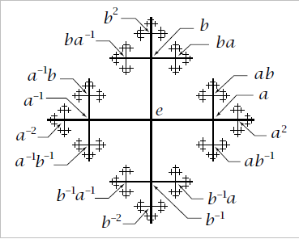
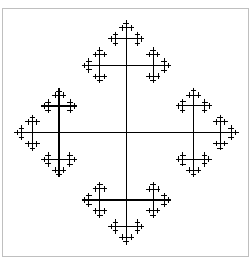
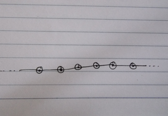
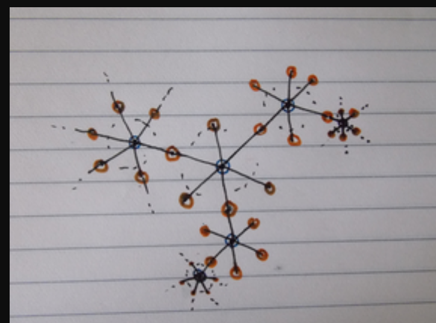

# Examples of covering spaces

[[D-ANO2D]]

## Examples

::: {.example title="Common covering spaces"}
In each diagram the group on the left is the deck group of the covering map on the right.

\begin{tikzcd}
2\pi \ZZ \cong \ZZ
  \ar[r] 
& 
\widehat{S^1} = \RR
  \ar[d, "t\mapsto e^{i t}"] 
\\
& 
S^1 
\end{tikzcd}

Any subgroup $H \leq \pi_1(S^1; 1) = \ZZ$ is of the form $H = n\ZZ$, and the corresponding cover is $\RR/2\pi n\ZZ \cong S^1\to \RR/2\pi\ZZ\cong S^1$, a quotient of the universal cover:

\begin{tikzcd}
	& \ZZ && {\widehat{S^1} = \RR} \\
	n\ZZ && {\widehat{S^1}/n\ZZ \cong S^1} \\
	&&& {S^1} \\
	&& {S^1}
	\arrow[from=1-2, to=1-4]
	\arrow[from=1-4, to=3-4]
	\arrow[from=2-1, to=2-3]
	\arrow[from=2-3, to=4-3]
	\arrow[dashed, from=2-1, to=1-2]
	\arrow[dashed, from=2-3, to=1-4]
	\arrow[dotted, from=4-3, to=3-4]
\end{tikzcd}

\begin{tikzcd}
\ZZ/n
  \ar[r] 
& 
S^1
  \ar[d, "z\mapsto z^n"] 
\\
& 
S^1 
\end{tikzcd}

\begin{tikzcd}
2\pi i \ZZ \cong \ZZ
  \ar[r] 
& 
\widehat{\units{\CC}} = \CC
  \ar[d, "z\mapsto e^{z}"] 
\\
& 
\units{\CC}
\end{tikzcd}

\begin{tikzcd}
 \ZZ^n
  \ar[r] 
& 
\hat{T}^n =\RR^n
  \ar[d] 
\\
& 
T^n 
\end{tikzcd}

\begin{tikzcd}
\ZZ/2
  \ar[r] 
& 
\widehat{\RP^n} = S^n
  \ar[d] 
\\
& 
\RP^n 
\end{tikzcd}

\begin{tikzcd}
\ZZ^{\ast n} 
  \ar[r] 
& 
\widehat{\bigvee^n S^1} = \operatorname{Cayley}(F_n)
  \ar[d] 
\\
& 
\bigvee^n S^1
\end{tikzcd}
where the universal cover is the $2n$-valent Cayley graph of the free group $F_n\cong\ZZ^{\ast n}$ with respect to its free generators.

\begin{tikzcd}
\ZZ/n
  \ar[r] 
& 
  \units{\CC}
  \ar[d, "z\mapsto z^n"] 
\\
& 
\units{\CC}
\end{tikzcd}

\begin{tikzcd}
\ZZ/p
  \ar[r] 
& 
  S^3
  \ar[d] 
\\
& 
L(p, q)
\end{tikzcd}
where $S^3\subseteq\CC^2$ and the generator of $\ZZ/p$ acts by $(z, w) \mapsto (e^{2\pi i/p} z, e^{2\pi i q/p} w)$ for $q$ coprime to $p$.

The torus double covers the Klein bottle, $T^2 \mapsvia{\times 2} \KK$.

:::

::: {.example title="The circle $S^1$"}
With $S^1 \subseteq \CC$, for $n\geq 1$ the map $p_n\colon S^1 \to S^1$, $z\mapsto z^n$, is an $n$-sheeted covering map.
With $\omega_k(t)\coloneqq e^{2\pi i k t}$, the induced map on fundamental groups is
$$
\begin{aligned}
(p_n)_*\colon \pi_1(S^1) &\to \pi_1(S^1), \\
[\omega_1] &\mapsto [\omega_n] = n[\omega_1],
\end{aligned}
$$
so its image is $n\ZZ$, and the deck group is
$$
\Deck(p_n) \cong \pi_1(S^1)/(p_n)_*\pi_1(S^1) \cong \ZZ/n,
$$
generated by rotation by $2\pi/n$.
The universal cover of $S^1$ is $\RR$, with countably infinite fibers.

:::

::: {.example title="Projective $n\dash$space $\RP^n$"}
For $n\geq 2$, the universal cover of $\RP^n$ is $S^n$, a two-sheeted cover whose fibers are pairs of antipodal points.

:::

::: {.example title="The torus $S^1 \cross S^1$"}
The universal cover of $T^2 = S^1 \cross S^1$ is $\RR \cross \RR\to T^2$, $(s,t)\mapsto(e^{2\pi i s},e^{2\pi i t})$.
The fiber over the base point is the integer lattice $\ZZ^2$, and $\Deck(\RR^2\to T^2)\cong\ZZ^2\cong \pi_1(T^2)$ acts by translations.

:::

[[PR-BXAA5]]

::: {.example title="Wedge of circles"}
The fundamental group of $S^1 \vee S^1$ is $\ZZ \ast \ZZ$ [[PR-3APOT|by the wedge formula]], and the universal cover is the $4$-valent Cayley graph of $\ZZ\ast\ZZ$:

[@Hat02, §1.3] tabulates further covering spaces of $S^1\vee S^1$.

:::

[[C-ILVEB]]

::: {.example title="Wedge of projective spaces"}
The fundamental group of $\RP^2 \vee \RP^2$ is $\ZZ/2 \ast \ZZ/2$, and the universal cover is an infinite chain of copies of $S^2$, each attached to its two neighbors at antipodal points:

:::

::: {.example title="$\RP^2 \vee T^2$"}
The fundamental group of $\RP^2 \vee T^2$ is $\ZZ/2 \ast \ZZ^2$.
In the tree describing the universal cover, each red vertex is a copy of $S^2$ covering $\RP^2$ and has $2$ neighbors, and each blue vertex is a copy of $\RR^2$ covering $T^2$ and has countably many neighbors, one for each point of $\ZZ^2$.

:::

## Applications

[[T-TQ4J3]]

[[C-GJRYO]]

[[PR-TRSHQ]]

[[T-O44GI]]

