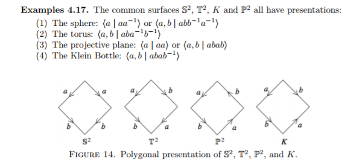
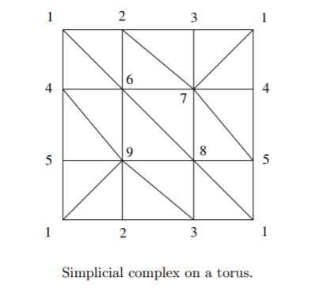
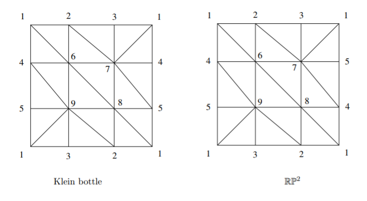
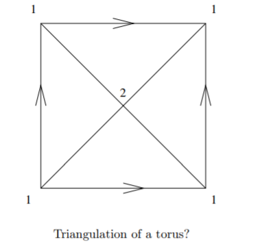

# CW and simplicial complexes

Cell structures on the standard spaces, products of CW complexes, and simplicial complexes.

## Products of CW complexes

[[PR-QJZDT]]

::: {.example}
Let $X= S^a \cross S^b$ with $a,b\geq 1$ and the product of the CW structures $e^0\union e^a$ and $e^0\union e^b$.
Then $p_{S^a}(t) = 1 + t^a$ and $p_{S^b}(t) = 1 + t^b$, so $p_X(t) = 1 + t^a + t^b + t^{a+b}$, and $X$ has one $0$-cell, one $a$-cell, one $b$-cell, and one $(a+b)$-cell.

:::

[[D-EZILB]]

[[E-GTNVU]]

## CW structures on common spaces

::: {.example title="Spheres"}
For $n\geq 1$, $S^n = e^0 \union e^n$, a $0$-cell and an $n$-cell attached by the constant map $\del D^n\to e^0$.
Another CW structure on $S^n$ has two $k$-cells for each $0\leq k \leq n$, the $k$-skeleton being $S^k$ and the two $k$-cells its hemispheres.

:::

::: {.example title="Real projective space"}
$\RP^n = e^0\union e^1 \union e^2 \union \cdots \union e^n$, one cell in each dimension $0,\ldots,n$, with $e^k$ attached by the double cover $S^{k-1}\to\RP^{k-1}$.

:::

::: {.example title="Complex projective space"}
$\CP^n = e^0\union e^2 \union e^4 \union \cdots \union e^{2n}$, with $e^{2k}$ attached by the quotient map $S^{2k-1}\to\CP^{k-1}$.

:::

::: {.example title="Surfaces"}
A closed surface given by a polygon with edge identifications has one $2$-cell, one $1$-cell for each edge pair, and one $0$-cell for each vertex class.

Reading the boundary word of the polygon gives a presentation of $\pi_1$ with one generator per edge pair and the boundary word as relation:

- the sphere: $\generators{a \st aa^{-1}}$, or $\generators{a, b \st abb^{-1}a^{-1}}$;
- the torus: $\generators{a, b \st aba^{-1}b^{-1}}$;
- the projective plane: $\generators{a \st aa}$, or $\generators{a, b \st abab}$;
- the Klein bottle: $\generators{a, b \st abab^{-1}}$.

:::

## Simplicial complexes

::: {.remark}
With the vertices labelled by integers, a simplicial complex is determined by its list of simplices, each $n$-simplex being recorded as the set of the $n+1$ labels of its vertices.

:::

::: {.example title="Torus"}

:::

::: {.example title="Klein bottle and $\RP^2$"}

:::

::: {.example title="A labelling of the torus that is not a triangulation"}

In this picture a triangle has two vertices with the same label $1$, so the vertex set $\theset{1,2}$ does not determine a unique triangle, and the picture is not a simplicial complex.

:::

