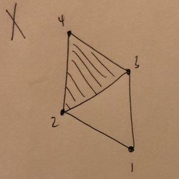

# Point-set examples

## Point-set

[[D-SN2OH]]

::: {.example title="Open and closed subsets of $\RR$"}
\envlist

- $\QQ \subseteq \RR$ is neither open nor closed.
  Every neighborhood of a rational number contains an irrational number, and every neighborhood of an irrational number contains a rational number, so neither $\QQ$ nor $\RR\sm\QQ$ has an interior point.
  $\QQ$ has no isolated points, and every $r\in \RR$ is a boundary point and an accumulation point of $\QQ$.
- $\ZZ \subseteq \RR$ is closed and not open.
  Its complement $\RR\sm\ZZ = \bigcup_{n\in \ZZ} (n, n+1)$ is open, and every neighborhood of $n\in \ZZ$ meets $\RR\sm \ZZ$, so $\ZZ$ has no interior points.
  Every point of $\ZZ$ is an isolated point and a boundary point, and $\ZZ$ has no accumulation points.
- Points are closed in $\RR$, since $\RR \sm \theset{ p } = (-\infty, p) \union (p, \infty)$ is open.
  An infinite intersection of open sets need not be open: $\bigcap_{n\geq 1} (p-1/n, p+1/n) = \theset{ p }$.
- An interval $(a, b)$ is open in $\RR$, and $(a,b)\cross\theset{0}$ is not open in $\RR^d$ for $d\geq 2$.
- $\theset{1/n \suchthat n\geq 1}$ has no interior points, each of its points is isolated, its boundary is $\theset{0}\union\theset{1/n \suchthat n\geq 1}$, and its only accumulation point is $0$.
- The Cantor set has no interior points and no isolated points; every point of it is a boundary point and an accumulation point.

:::

### Common spaces and operations

::: {.example title="Standard spaces"}
$$
S^n,\ \DD^n,\ T^n,\ \RP^n,\ \CP^n,\ \mobiusband,\ \KK,\ \Sigma_{g},\ \RP^\infty,\ \CP^\infty,
$$
where $\mobiusband$ is the Möbius band, $\KK$ the Klein bottle, and $\Sigma_g$ the closed orientable surface of genus $g$.

:::

::: {.example title="Spaces that serve as counterexamples"}
\envlist

- A finite set with at least two points and the discrete topology is compact and Hausdorff and not connected.
- $(a, b)$ and $(a,\infty)$ are homeomorphic to $\RR$ and not compact; $(a,b]$ is neither open nor closed in $\RR$; $\theset{0} \union \theset{1/n\suchthat n\geq 1}$ is compact and countable, and $0$ is not an isolated point.
- $\QQ$ is totally disconnected, not discrete, and not locally compact.
- The topologist's sine curve is connected, not path connected, and not locally connected.
- The one-point compactification of a locally compact Hausdorff space is compact Hausdorff; that of $\QQ$ is compact and not Hausdorff.
- $\RR^\omega$, the countable product of copies of $\RR$, is connected and metrizable in the product topology, metrizable and not connected in the uniform topology, and neither connected nor metrizable in the box topology.
- The Hawaiian earring is path connected and locally path connected and not semilocally simply connected, so it has no universal cover.
- The Cantor set is compact, uncountable, and totally disconnected, with no isolated points.
- Quaternionic projective space $\HP^n$ has a CW structure with one cell in each dimension $0,4,\ldots,4n$, so $H_k(\HP^n)\cong\ZZ$ for $k\in\theset{0,4,\ldots,4n}$ and $H_k(\HP^n)=0$ otherwise.
- The dunce cap is contractible, and no triangulation of it has a free edge, so it is not collapsible.
- The Alexander horned sphere is an embedding $S^2\injects S^3$ one of whose complementary components is not simply connected, so the Schoenflies theorem fails in dimension $3$.

:::

[[FE-BGEZL]]

::: {.example title="Non-Hausdorff spaces"}
\envlist

- An infinite set with the cofinite topology.
- The quotient group $\RR/\QQ$ with the quotient topology, which is indiscrete.
- The line with two origins.
- An algebraic set $V(J) \subseteq \AA^n_{k}$ with infinitely many points, for $k$ a field and $J\normal \kx{n}$, with the Zariski topology.

:::

::: {.example title="Constructions of spaces"}
\envlist

- Knot complements $S^3\sm K$ of a knot $K\subseteq S^3$, whose homotopy type is [[PR-6HORN|computed here]]
- [[D-ANO2D|Covering spaces]]
- [[D-UI3FE|Lens spaces]]
- Matrix groups, the subgroups of [[D-J5AAX|$\GL_n(\RR)$]]
- Prism manifolds, the quotients of $S^3$ by a finite [[D-2PNEG|free action]]
- The pair of pants, the sphere [[D-SPHER|$S^2$]] with three open discs removed
- Seifert surfaces, the compact surfaces in $S^3$ bounded by a knot [[PR-6HORN|knot complements]]
- Surgery on manifolds, removing $S^k\cross D^{n-k}$ and gluing in $D^{k+1}\cross S^{n-k-1}$ along the boundary [[D-JKH35|products]]
- [[D-NJ2Y6|Simplicial complexes]], such as the following:

  

  As a list of simplices,
  $$
  X = \theset{\theset1,\theset2,\theset3,\theset4,\ \theset{1,2},\theset{1,3},\theset{2,3},\theset{2,4},\theset{3,4},\ \theset{2,3,4}}.
  $$

:::

::: {.example title="Operations on spaces"}
\envlist

- [[D-JKH35|Cartesian product]] $A\cross B$
- [[D-IGUUS|Wedge sum]] $A \vee B$
- Connected sum $A\# B$, gluing $A$ and $B$ with open discs removed along their boundary spheres [[D-SPHER|discs and spheres]]
- [[D-ITBUT|Quotient]] $A/B$ by a subspace
- Puncturing, the [[D-LB2LS|subspace]] $A\sm \theset{a_{1},\ldots,a_k}$
- [[D-R4ZCL|Smash product]] $A\wedge B$
- Join $A\ast B$, the quotient of $A\cross B\cross I$ collapsing $A\cross B\cross\theset{0}$ and $A\cross B\cross\theset{1}$ to points
- [[D-II4M4|Cone]] $CA$
- [[D-RZKQD|Suspension]] $\Sigma A$
- [[D-T5Q3V|Loop space]] $\Omega A$
- Identifying finitely many points, the [[D-ITBUT|quotient]] by an equivalence relation with finite classes

:::

### Alternative topologies

::: {.example title="The cofinite topology"}
Let $X$ be a set with the cofinite topology.
Then $X$ is compact, and if $X$ is infinite, then $X$ is not Hausdorff, since any two nonempty open sets have finite complements and therefore intersect.

:::

[[PR-NJTN5]]

::: {.example title="The discrete topology"}
In the discrete topology on $X$, every subset is open.

- $X$ is Hausdorff.
- $X$ is compact if and only if $X$ is finite.
- $X$ is totally disconnected.
- Every map $f\colon X\to Y$ to a space $Y$ is continuous, since every preimage $f^{-1}(V)$ is a subset of $X$ and hence open.

:::

::: {.example title="The indiscrete topology"}
In the indiscrete topology on $X$, the only open sets are $\emptyset$ and $X$.

- If $X$ has at least two points, then $X$ is not Hausdorff.
- Every map $f\colon Y\to X$ from a space $Y$ is continuous, since the preimages of $\emptyset$ and $X$ are $\emptyset$ and $Y$.
- $X$ is compact.

:::

### Connectedness

| Space                  | Connected    | Locally connected |
| ------                 | ---------    | ----------------- |
| $\RR$                  | $\checkmark$ | $\checkmark$      |
| $[0, 1] \union [2, 3]$ |              | $\checkmark$      |
| Topologist's sine curve | $\checkmark$ |                   |
| $\QQ$                  |              |                   |
